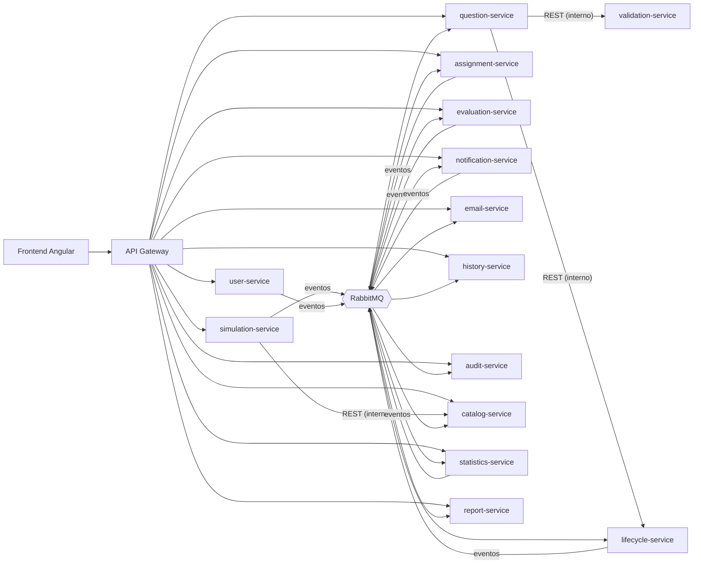

# Banco de Preguntas Saber Pro

Sistema para la **gestión, validación y administración de un banco de preguntas** para la preparación de las pruebas
Saber Pro. Proyecto de curso de Ingeniería de Software II, Universidad del Cauca, periodo 2026.2.

Los autores redactan preguntas de selección múltiple que el sistema valida estructuralmente; un administrador asigna
de 1 a 3 revisores; los revisores evalúan y la pregunta se aprueba por unanimidad; el administrador publica las
aprobadas. Cada paso genera notificaciones y queda en un historial. Con las preguntas publicadas, los estudiantes
presentan simulacros aleatorios con tiempo y calificación automática, y estudiantes y docentes siguen el progreso
(estadísticas, fortalezas y debilidades, reportes).

## Tecnología

| Parte | Tecnologías |
|---|---|
| Backend | Java 21, Spring Boot 3, Spring Data JPA, Flyway, PostgreSQL, RabbitMQ |
| Seguridad | Keycloak (OAuth2 con PKCE, JWT) |
| Frontend | Angular, TypeScript |
| Infraestructura | Docker y Docker Compose |
| Calidad | JUnit 5, MockMvc, ArchUnit, PostgreSQL embebido en las pruebas |
| Monolito del primer corte | Java 17, Swing, SQLite |

## Arquitectura

Microservicios orientados a eventos: cada servicio tiene su propia base de datos y se comunican por RabbitMQ a
través de un API Gateway. Son **14 servicios pequeños**, cada uno con una sola responsabilidad: usuarios, preguntas,
validación, ciclo de vida, asignación de revisores, evaluación, notificaciones, correo, historial, auditoría, catálogo,
simulacros, estadísticas y reportes. El código se publica por partes: hoy el repositorio contiene la primera distribución, de 7
servicios, y la de 14 está implementada y verificada en local.



El diseño completo está en la [documentación del segundo corte](docs/corte-2/README.md).

## Estado del código publicado

El repositorio contiene hoy la **primera distribución, de 7 servicios** (`question`, `review`, `notification`, `history`, `user`,
`simulation` y `tracking`) más `email-service`, `audit-service` y `validation-service` (ya salieron de `notification`, `history` y `question`), la biblioteca común, el gateway, Eureka, Keycloak, el frontend con las pantallas de autor, revisor y
administrador y el Docker Compose. La **nueva distribución, de 14 servicios**, ya está implementada y verificada en local (1040
pruebas de backend, 183 del frontend, recorrido funcional, Postman y k6); su código se irá publicando por partes. Cada servicio
actual se divide así:

| Servicio publicado hoy (primera distribución, 7) | En la nueva distribución (14) |
|---|---|
| `question-service` | `question-service` (contenido), `validation-service` (reglas de calidad, ya publicado) y `lifecycle-service` (estados y su historial) |
| `review-service` | `assignment-service` (asignación de revisores) y `evaluation-service` (evaluación y unanimidad) |
| `notification-service` | `notification-service` (bandeja) y `email-service` (correo, ya publicado) |
| `history-service` | `history-service` (línea de tiempo de cada pregunta) y `audit-service` (auditoría de acciones e inicios de sesión, ya publicado) |
| `user-service` | `user-service` |
| `simulation-service` | `catalog-service` (preguntas publicadas y selección) y `simulation-service` (simulacros) |
| `tracking-service` | `statistics-service` (historial y estadísticas) y `report-service` (reporte del grupo) |

La documentación del repositorio describe la arquitectura de 14 servicios y marca lo que aún no está publicado.

## Estructura del repositorio

```
├── docs/             Documentación: general, corte-1, corte-2 y corte-3
├── monolito/         Corte 1: aplicación de escritorio (app y modulos)
└── microservicios/   Cortes 2 y 3: plataforma y servicios
```

## Cómo ejecutarlo

**La pila publicada** (bases de datos, RabbitMQ, Keycloak, los servicios de preguntas, revisión, notificaciones, historial y usuarios, gateway y
frontend), con Docker Desktop:

```bash
cd microservicios
docker compose up -d --build
```

La aplicación queda en http://localhost:4200 y la API en http://localhost:8080 (Swagger agregado en
`/swagger-ui.html`). Los usuarios de prueba y las demás direcciones están en el
[README de microservicios](microservicios/README.md).

**Monolito de escritorio (primer corte)**, con Java 17 y Maven:

```bash
cd monolito
mvn package
java -jar app/target/banco-preguntas-saberpro.jar
```

Más detalles en el [README del monolito](monolito/README.md).

## Documentación

| Documento | Contenido |
|---|---|
| [`docs/general`](docs/general/README.md) | Visión general, flujo de trabajo, convenciones, respuestas de los docentes y enunciados |
| [`docs/corte-1`](docs/corte-1/README.md) | Monolito: historias de usuario, C4, patrones, pruebas |
| [`docs/corte-2`](docs/corte-2/README.md) | Microservicios: contextos y eventos, arquitectura, patrones, prototipos y contratos de la API |
| [`docs/corte-3`](docs/corte-3/README.md) | Alcance del tercer corte |

## Estado

| Corte | Estado |
|---|---|
| 1. Monolito | Entregado |
| 2. Microservicios | Implementado y verificado en local con 14 servicios; publicados 7 (primera distribución) y el resto en publicación por partes |
| 3. Hexagonal con DDD en un servicio, documento final y sustentación | Keycloak y la historia del historial ya están hechos; el resto pendiente |

## Autores

- Edward Esteban Dávila Salazar: edwarddavila@unicauca.edu.co
- Laura Isabel Sánchez Fernández
- Kevin Yesid Castaño Herrera
