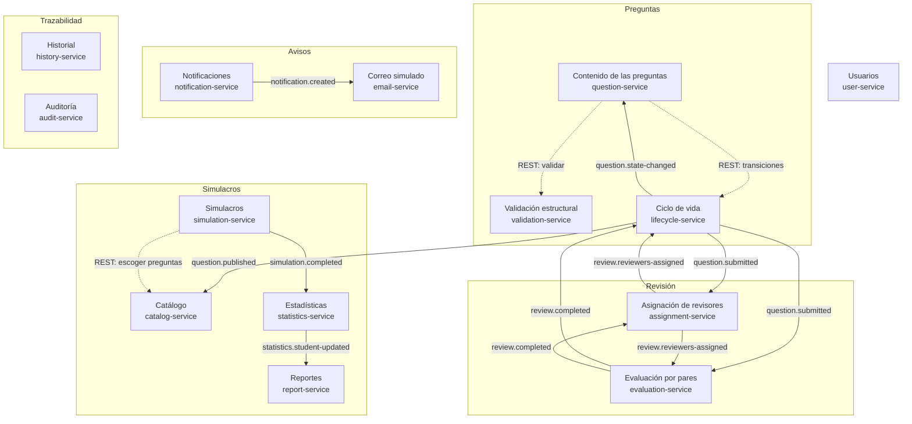
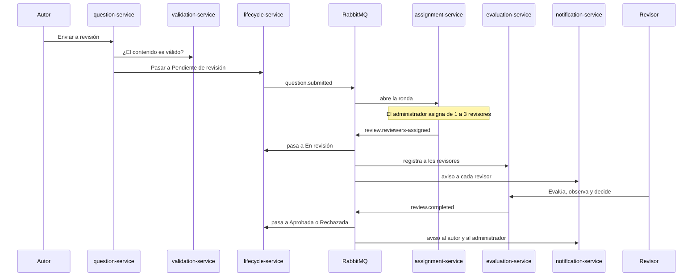

# 02 · Contextos delimitados y eventos

> **Estado del repositorio (octubre de 2026).** Esta documentación describe la arquitectura de **14 microservicios** que se está
> implementando. El código publicado hoy en el repositorio corresponde a la primera distribución, de **7 servicios**; la nueva
> distribución divide varios de ellos para que cada uno tenga una sola responsabilidad (ver la tabla del [README de los servicios](../../microservicios/servicios/README.md)). Ya está implementada y verificada de punta a punta en local y el código se irá publicando por
> partes; mientras tanto, lo que no está en el repositorio aparece en esta documentación como texto, sin enlace.

## Contextos delimitados

El docente propone ocho contextos como aproximación. Para esta iteración partimos de ellos y los dividimos hasta que cada servicio
tiene **una sola responsabilidad y es pequeño**: son **14 servicios** más el gateway. Los dos contextos que los docentes dejaron para
el tercer corte (simulacros y seguimiento académico) también están construidos por adelantado (ver
[simulacros y seguimiento](../corte-3/simulacros-y-seguimiento.md)).



| Contexto del docente | Servicio | Alcance |
|---|---|---|
| Gestión de Usuarios | `user-service` | Sincroniza los usuarios y roles de Keycloak y publica los eventos de acceso |
| Gestión de Preguntas | `question-service` | HU-01 a HU-03: guardar, modificar, consultar y filtrar el contenido |
| Validación de Preguntas | `validation-service` | Las reglas de calidad (HU-03), sin estado |
| Ciclo de Vida de Preguntas | `lifecycle-service` | Estados, transiciones, historial de cambios y los eventos de la pregunta (RF-14 y RF-15) |
| Revisión por Pares | `assignment-service` | HU-04: rondas, asignación de revisores y bandeja del revisor |
| Revisión por Pares | `evaluation-service` | HU-05: evaluaciones, decisión por unanimidad y resultado |
| (transversal) | `notification-service` | Bandeja de avisos de cada usuario |
| (transversal) | `email-service` | El correo simulado de cada aviso, con reintentos y registro |
| Administración y Trazabilidad | `history-service` | Línea de tiempo de cada pregunta (HU-06) |
| Administración y Trazabilidad | `audit-service` | Auditoría de acciones e inicios de sesión |
| Simulacros de Evaluación | `catalog-service` | Copia de las preguntas publicadas y selección al azar (RF-22). Los docentes lo ubicaron en el corte 3 ([consulta 4](../general/consultas-a-docentes.md)); se construyó por adelantado |
| Simulacros de Evaluación | `simulation-service` | RF-21 a RF-24: generar, presentar con tiempo y calificar |
| Seguimiento Académico | `statistics-service` | RF-25 a RF-27: historial, estadísticas, fortalezas y debilidades |
| Seguimiento Académico | `report-service` | RF-28: reporte del grupo en JSON y CSV |

**Por qué se dividió así.** La regla fue que cada servicio tenga un motivo de cambio y sus datos propios: la validación cambia cuando
cambian los criterios de calidad; el ciclo de vida, cuando cambian los estados; la asignación y la evaluación, cuando cambia cómo se
reparte y cómo se decide la revisión; el correo, cuando cambia el canal de envío; la auditoría y el historial, cuando cambian lo que se
quiere saber de cada pregunta o de cada usuario. Cada división quitó de un servicio una responsabilidad que escalaba o fallaba distinto.

**El costo y cómo se acota.** Dividir cuesta llamadas de red. Se evitó con eventos casi siempre; las únicas llamadas REST síncronas son
tres, y todas propagan la identidad de quien hizo la petición para que el servicio llamado vuelva a comprobar el rol:

| Llamada | Por qué es síncrona |
|---|---|
| `question-service` → `validation-service` | El autor necesita saber **ahora** qué campos corregir; la respuesta decide si se guarda |
| `question-service` → `lifecycle-service` | Crear, enviar, reabrir y publicar deben cambiar el estado antes de contestarle al usuario |
| `simulation-service` → `catalog-service` | El estudiante espera el simulacro armado; las respuestas correctas nunca salen del catálogo hacia el navegador |

Si uno de esos servicios no responde, la operación no se hace y se informa 503 (la consulta de una pregunta sigue funcionando).

## Eventos

Comunicación asíncrona por RabbitMQ: exchange `bancopreguntas.events` de tipo *topic*. Cada mensaje lleva
un sobre común y un cuerpo pequeño con identificadores, no copias de las entidades (salvo `question.published`, que lleva el
contenido para que el catálogo no tenga que consultar a nadie).

```json
{
  "eventId": "uuid",
  "type": "review.completed",
  "occurredAt": "2026-10-06T10:15:30Z",
  "data": {}
}
```

| Evento | Lo publica | Lo consumen | Efecto |
|---|---|---|---|
| `question.submitted` | lifecycle-service | assignment, evaluation, notification, history, audit | Se abre el caso y la ronda de revisión pendiente de asignar |
| `question.reopened` | lifecycle-service | assignment, evaluation, history, audit | El autor corrige una pregunta rechazada: la ronda anterior se cierra |
| `question.state-changed` | lifecycle-service | question, catalog, history, audit | Traza del ciclo de vida; question-service actualiza su copia del estado; el catálogo retira la pregunta archivada |
| `question.published` | lifecycle-service | catalog, notification, history, audit | El administrador publica una pregunta aprobada; el catálogo la agrega |
| `review.reviewers-assigned` | assignment-service | evaluation, lifecycle, notification, history, audit | La pregunta pasa a "En revisión"; evaluation-service registra a los revisores; se avisa a cada revisor y al autor |
| `review.evaluation-submitted` | evaluation-service | assignment, notification, history, audit | La bandeja del revisor lo marca como evaluado; se avisa al administrador (y al autor si es tardía) |
| `review.completed` | evaluation-service | assignment, lifecycle, notification, history, audit | La pregunta pasa a Aprobada o Rechazada; se avisa al autor, al administrador y a los revisores |
| `notification.created` | notification-service | email | Se envía (de forma simulada) el correo del aviso |
| `simulation.completed` | simulation-service | statistics | Un simulacro terminó y está calificado; entra al historial del estudiante |
| `statistics.student-updated` | statistics-service | report | Cambió el resumen de un estudiante; el reporte del grupo lo guarda |
| `auth.login-succeeded` / `auth.login-failed` | user-service | audit | Auditoría de inicios de sesión, tomados de los eventos de Keycloak |

Cuerpo (`data`) de cada evento:

| Evento | Campos |
|---|---|
| `question.submitted` | `questionId`, `authorId`, `title`, `competency`, `version` |
| `question.reopened` | `questionId`, `authorId`, `version` |
| `question.state-changed` | `questionId`, `from`, `to`, `changedBy` (nulo si lo hizo el sistema), `sequence` (número de cambios; solo crece), `version` |
| `question.published` | `questionId`, `publishedBy`, `version`, `title`, `competency`, `topic`, `subtopic`, `difficulty`, `context`, `statement`, `optionA` a `optionD`, `correctAnswer` (el contenido de la pregunta, para el catálogo) |
| `review.reviewers-assigned` | `questionId`, `authorId`, `round`, `reviewerIds[]`, `assignedBy` (`system` en la reasignación automática), `automatic`, `questionVersion`, `title`, `competency` |
| `review.evaluation-submitted` | `questionId`, `authorId`, `round`, `reviewerId`, `decision` (`APROBAR` o `RECHAZAR`), `observation`, `late` |
| `review.completed` | `questionId`, `authorId`, `round`, `result` (`APPROVED` o `REJECTED`), `observations[]` (`reviewerId`, `decision`, `text`) |
| `notification.created` | `notificationId`, `recipientId`, `kind`, `questionId`, `subject`, `message`, `createdAt` |
| `simulation.completed` | `simulationId`, `studentId`, `startedAt`, `finishedAt`, `durationSeconds`, `expired`, `total`, `correct`, `incorrect`, `unanswered`, `score`, `byCompetency[]` (`competency`, `correct`, `total`) |
| `statistics.student-updated` | `studentId`, `simulations`, `scoreSum`, `average`, `best`, `last`, `trend`, `weaknesses[]`, `byCompetency[]`, `updatedAt` |
| `auth.login-succeeded` | `userId`, `ip`, `loggedInAt` |
| `auth.login-failed` | `userId`, `ip`, `reason`, `attemptedAt` |

El esquema formal está en [`api/eventos/eventos.schema.json`](api/eventos/eventos.schema.json).

Garantías: mensajes persistentes con confirmación de entrega y consumidores **idempotentes** (se ignora un
`eventId` ya procesado). Dos eventos llevan además un número que permite ignorar avisos atrasados sin llevar registro:
`sequence` en `question.state-changed` (quien guarda una copia del estado solo acepta un cambio más nuevo) y `simulations` en
`statistics.student-updated` (el reporte solo reemplaza un resumen por otro con más simulacros).

## Flujo principal



## Cambios respecto al diseño inicial (implementación)

- El servicio opcional de auditoría se implementó primero como `history-service` (historial y auditoría juntos) y luego se
  separó en **`history-service`** (línea de tiempo de cada pregunta, HU-06) y **`audit-service`** (auditoría de acciones e inicios de
  sesión, que no es requisito de los docentes pero se construyó como valor agregado).
- La validación, el ciclo de vida y el catálogo salieron de `question-service` y de `simulation-service`; la revisión se dividió en
  asignación y evaluación; el correo salió de `notification-service`; y el seguimiento se dividió en estadísticas y reportes
  (la última versión de esta división es la de los 14 servicios).
- Se añadieron los eventos `question.reopened`, `question.published`, `notification.created`, `statistics.student-updated` y `auth.*`
  (tabla de arriba). Los eventos de revisión llevan además el número de **ronda** y las banderas `automatic` (reasignación automática de
  revisores) y `late` (observación recibida cuando la ronda ya se había cerrado); los de pregunta llevan su **versión**.
- Los eventos de los servicios que los publican (`lifecycle`, `assignment`, `evaluation`, `notification`, `simulation`, `statistics` y
  `user`) se publican con el **patrón Outbox** (se guardan en la misma transacción que el cambio y un relevo los envía), de modo que
  no se pierden si RabbitMQ está caído. Detalle en [08](08-implementacion-seguridad-y-resiliencia.md).
- Un mensaje que falla tras 4 reintentos va a la cola de mensajes muertos `bancopreguntas.dead-letter`.
- `question.published` lleva el contenido de la pregunta.
