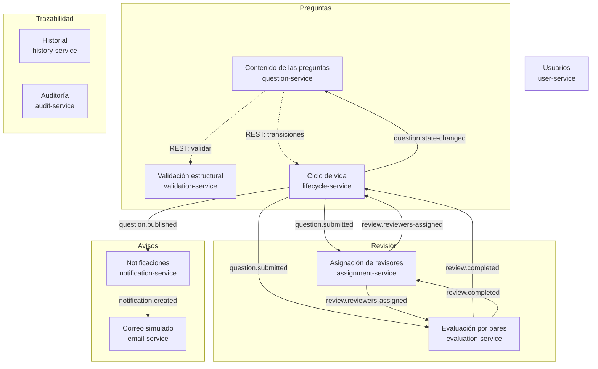
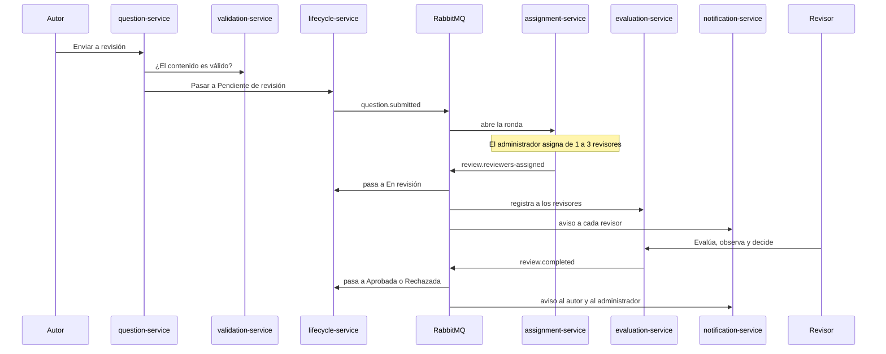

# 02 · Contextos delimitados y eventos

## Contextos delimitados

El docente propone ocho contextos como aproximación. Para esta iteración partimos de ellos y los dividimos hasta que cada servicio
tiene **una sola responsabilidad y es pequeño**: son **10 servicios** más el gateway. Los contextos de simulacros y seguimiento
académico los dejaron los docentes para el tercer corte y no forman parte de esta entrega.



| Contexto del docente | Servicio | Alcance |
|---|---|---|
| Gestión de Usuarios | `user-service` | Sincroniza los usuarios y roles de Keycloak y publica los eventos de acceso |
| Gestión de Preguntas | `question-service` | HU-01 a HU-03: guardar, modificar, consultar y filtrar el contenido |
| Validación de Preguntas | `validation-service` | Las reglas de calidad (HU-03), sin estado |
| Ciclo de Vida de Preguntas | `lifecycle-service` | Estados, transiciones, historial de cambios y los eventos de la pregunta (RF-14 y RF-15) |
| Revisión por Pares | `assignment-service` | HU-04: rondas, asignación de revisores y bandeja del revisor |
| Revisión por Pares | `evaluation-service` | HU-05: evaluaciones, decisión por unanimidad y resultado |
| (transversal) | `notification-service` | Bandeja de avisos de cada usuario |
| (transversal) | `email-service` | El correo simulado de cada aviso, con reintentos y registro |
| Administración y Trazabilidad | `history-service` | Línea de tiempo de cada pregunta (HU-06) |
| Administración y Trazabilidad | `audit-service` | Auditoría de acciones e inicios de sesión |

**Por qué se dividió así.** La regla fue que cada servicio tenga un motivo de cambio y sus datos propios: la validación cambia cuando
cambian los criterios de calidad; el ciclo de vida, cuando cambian los estados; la asignación y la evaluación, cuando cambia cómo se
reparte y cómo se decide la revisión; el correo, cuando cambia el canal de envío; la auditoría y el historial, cuando cambian lo que se
quiere saber de cada pregunta o de cada usuario. Cada división quitó de un servicio una responsabilidad que escalaba o fallaba distinto.

**El costo y cómo se acota.** Dividir cuesta llamadas de red. Se evitó con eventos casi siempre; las únicas llamadas REST síncronas son
dos, y todas propagan la identidad de quien hizo la petición para que el servicio llamado vuelva a comprobar el rol:

| Llamada | Por qué es síncrona |
|---|---|
| `question-service` → `validation-service` | El autor necesita saber **ahora** qué campos corregir; la respuesta decide si se guarda |
| `question-service` → `lifecycle-service` | Crear, enviar, reabrir y publicar deben cambiar el estado antes de contestarle al usuario |

Si uno de esos servicios no responde, la operación no se hace y se informa 503 (la consulta de una pregunta sigue funcionando).

## Eventos

Comunicación asíncrona por RabbitMQ: exchange `bancopreguntas.events` de tipo *topic*. Cada mensaje lleva
un sobre común y un cuerpo pequeño con identificadores, no copias de las entidades (salvo `question.published`, que lleva el
contenido para que el catálogo no tenga que consultar a nadie).

```json
{
  "eventId": "uuid",
  "type": "review.completed",
  "occurredAt": "2026-10-06T10:15:30Z",
  "data": {}
}
```

| Evento | Lo publica | Lo consumen | Efecto |
|---|---|---|---|
| `question.submitted` | lifecycle-service | assignment, evaluation, notification, history, audit | Se abre el caso y la ronda de revisión pendiente de asignar |
| `question.reopened` | lifecycle-service | assignment, evaluation, history, audit | El autor corrige una pregunta rechazada: la ronda anterior se cierra |
| `question.state-changed` | lifecycle-service | question, history, audit | Traza del ciclo de vida; question-service actualiza su copia del estado |
| `question.published` | lifecycle-service | notification, history, audit | El administrador publica una pregunta aprobada; se avisa al autor |
| `review.reviewers-assigned` | assignment-service | evaluation, lifecycle, notification, history, audit | La pregunta pasa a "En revisión"; evaluation-service registra a los revisores; se avisa a cada revisor y al autor |
| `review.evaluation-submitted` | evaluation-service | assignment, notification, history, audit | La bandeja del revisor lo marca como evaluado; se avisa al administrador (y al autor si es tardía) |
| `review.completed` | evaluation-service | assignment, lifecycle, notification, history, audit | La pregunta pasa a Aprobada o Rechazada; se avisa al autor, al administrador y a los revisores |
| `notification.created` | notification-service | email | Se envía (de forma simulada) el correo del aviso |
| `auth.login-succeeded` / `auth.login-failed` | user-service | audit | Auditoría de inicios de sesión, tomados de los eventos de Keycloak |

Cuerpo (`data`) de cada evento:

| Evento | Campos |
|---|---|
| `question.submitted` | `questionId`, `authorId`, `title`, `competency`, `version` |
| `question.reopened` | `questionId`, `authorId`, `version` |
| `question.state-changed` | `questionId`, `from`, `to`, `changedBy` (nulo si lo hizo el sistema), `sequence` (número de cambios; solo crece), `version` |
| `question.published` | `questionId`, `publishedBy`, `version`, `title`, `competency`, `topic`, `subtopic`, `difficulty`, `context`, `statement`, `optionA` a `optionD`, `correctAnswer` (el contenido de la pregunta, para el catálogo) |
| `review.reviewers-assigned` | `questionId`, `authorId`, `round`, `reviewerIds[]`, `assignedBy` (`system` en la reasignación automática), `automatic`, `questionVersion`, `title`, `competency` |
| `review.evaluation-submitted` | `questionId`, `authorId`, `round`, `reviewerId`, `decision` (`APROBAR` o `RECHAZAR`), `observation`, `late` |
| `review.completed` | `questionId`, `authorId`, `round`, `result` (`APPROVED` o `REJECTED`), `observations[]` (`reviewerId`, `decision`, `text`) |
| `notification.created` | `notificationId`, `recipientId`, `kind`, `questionId`, `subject`, `message`, `createdAt` |
| `auth.login-succeeded` | `userId`, `ip`, `loggedInAt` |
| `auth.login-failed` | `userId`, `ip`, `reason`, `attemptedAt` |

El esquema formal está en [`api/eventos/eventos.schema.json`](api/eventos/eventos.schema.json).

Garantías: mensajes persistentes con confirmación de entrega y consumidores **idempotentes** (se ignora un
`eventId` ya procesado). El evento `question.state-changed` lleva además un número, `sequence`, que permite ignorar avisos atrasados sin llevar registro
(quien guarda una copia del estado solo acepta un cambio más nuevo).

## Flujo principal



## Cambios respecto al diseño inicial

- La auditoría empezó dentro de `history-service` y se separó en dos: `history-service` guarda la línea de tiempo de cada pregunta
  (HU-06) y `audit-service` guarda la auditoría de acciones e inicios de sesión. Este último no lo piden los docentes, pero ya estaba
  construido.
- La validación y el ciclo de vida salieron de `question-service`; la revisión se dividió en asignación y evaluación; y el correo salió
  de `notification-service`.
- Se añadieron los eventos `question.reopened`, `question.published`, `notification.created` y `auth.*` (tabla de arriba). Los eventos
  de revisión llevan el número de **ronda** y las banderas `automatic` (reasignación automática de revisores) y `late` (observación
  recibida cuando la ronda ya se había cerrado); los de pregunta llevan su **versión**.
- Los servicios que publican eventos (`lifecycle`, `assignment`, `evaluation`, `notification` y `user`) usan el **patrón Outbox**: el
  evento se guarda en la misma transacción que el cambio y un relevo lo envía, así que no se pierde si RabbitMQ está caído. El detalle
  está en [08](08-implementacion-seguridad-y-resiliencia.md).
- Un mensaje que falla tras 4 reintentos va a la cola de mensajes muertos `bancopreguntas.dead-letter`.
- `question.published` lleva el contenido de la pregunta.
