# 03 · Arquitectura (C4 y UML)

> Cada diagrama de este documento también está como imagen (SVG y PNG) en [`img/diagramas`](img/diagramas/), lista para el documento formal en Word o PDF.
> Los nombres de clases, tablas y rutas son los del código; si algo cambia en el código, este documento se actualiza con él.

## Estilo arquitectónico

Microservicios orientados a eventos con un API Gateway como único punto de entrada, una base de datos
por servicio y un broker de mensajes para la comunicación entre servicios. Son 10 servicios pequeños, cada uno con una sola
responsabilidad ([02 · Contextos](02-contextos-y-eventos.md) explica la división). Frontend y backend están
separados y se comunican solo por API REST. La identidad la gestiona un proveedor externo (Keycloak) y los
servicios validan el JWT que emite. La justificación de cada decisión está en
[10 · Decisiones de arquitectura y SOLID](10-decisiones-y-solid.md).

## C4 · Nivel 1: contexto del sistema

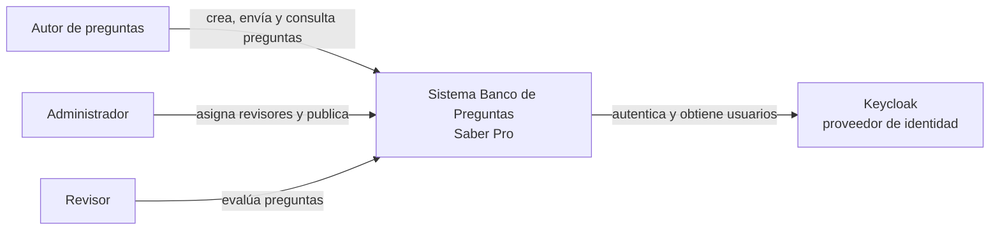

El correo electrónico es simulado (decisión del docente): el sistema deja el aviso en la bandeja de cada usuario y
`email-service` registra el «envío»; por eso no aparece un servidor de correo como sistema externo.

## C4 · Nivel 2: contenedores

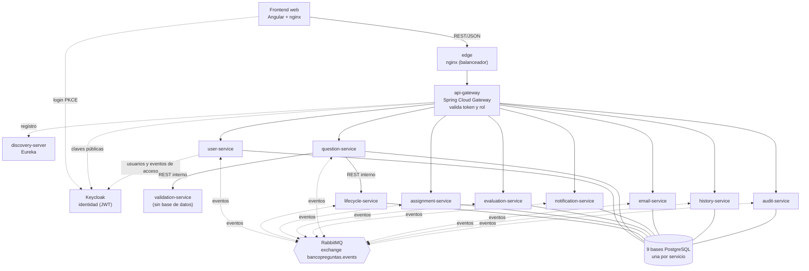

| Contenedor | Responsabilidad | Puerto |
|---|---|---|
| frontend | Aplicación Angular servida por nginx | 4200 |
| edge | Balanceador nginx delante de las réplicas del gateway | 8080 |
| api-gateway | Enrutamiento por Eureka, validación del token, autorización por rol, circuit breaker y reintentos | interno |
| discovery-server | Registro de servicios (Eureka) | 8761 |
| keycloak | Proveedor de identidad: inicio de sesión, roles y token JWT | 8180 |
| user-service | Sincroniza usuarios y roles de Keycloak; consulta sus eventos de acceso y los publica | 8081 (depuración) |
| question-service | Contenido de las preguntas: crear, modificar, consultar y filtrar | 8082 (depuración) |
| assignment-service | Rondas de revisión, asignación de revisores y bandeja del revisor | 8083 (depuración) |
| notification-service | Consume eventos y crea los avisos de la bandeja; publica `notification.created` | 8084 (depuración) |
| history-service | Línea de tiempo de cada pregunta | 8085 (depuración) |
| email-service | Correo simulado de cada aviso, con reintentos y registro | 8090 (depuración) |
| audit-service | Auditoría de acciones e inicios de sesión | 8091 (depuración) |
| lifecycle-service | Estados de la pregunta, transiciones, historial y sus eventos (interno) | 8094 (depuración) |
| validation-service | Reglas de calidad del contenido de una pregunta (interno, sin estado) | 8095 (depuración) |
| evaluation-service | Evaluación de los revisores y decisión por unanimidad | 8096 (depuración) |
| RabbitMQ | Broker de eventos | 5672, panel 15672 |
| PostgreSQL ×9 | Una base por servicio (todos menos validation) | 5433 a 5446 (depuración) |

## C4 · Nivel 3: componentes

Todos los servicios siguen la misma organización interna: `api`, `application`, `domain` e
`infrastructure`. La capa de aplicación declara **puertos** (interfaces) y la de infraestructura los implementa con
**adaptadores** (JPA, RabbitMQ, clientes REST): es una organización hexagonal. Una prueba de arquitectura
(`ArquitecturaTest`, con ArchUnit) hace fallar la compilación si el dominio depende de Spring, de JPA o de las otras
capas. Se muestran los servicios con más lógica; los demás (`user`, `history`, `audit` y `email`) siguen el
mismo esquema con un controlador, un servicio de aplicación, sus puertos y adaptadores.

### question-service

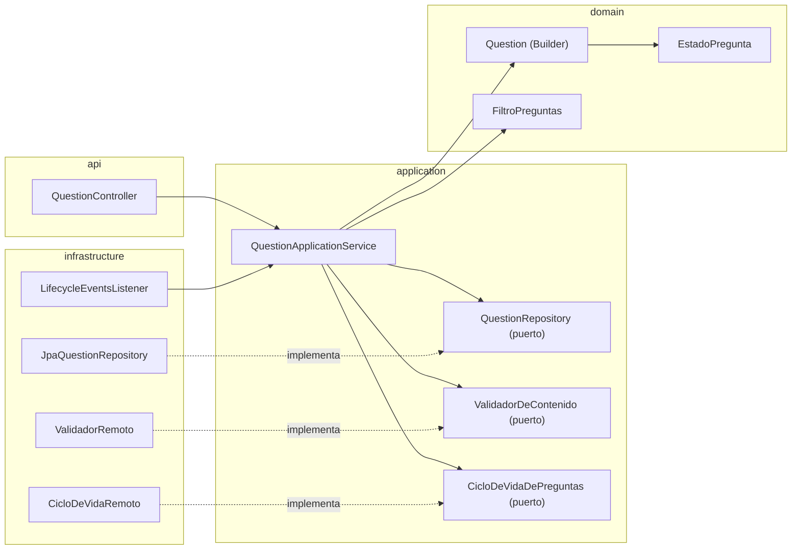

### lifecycle-service

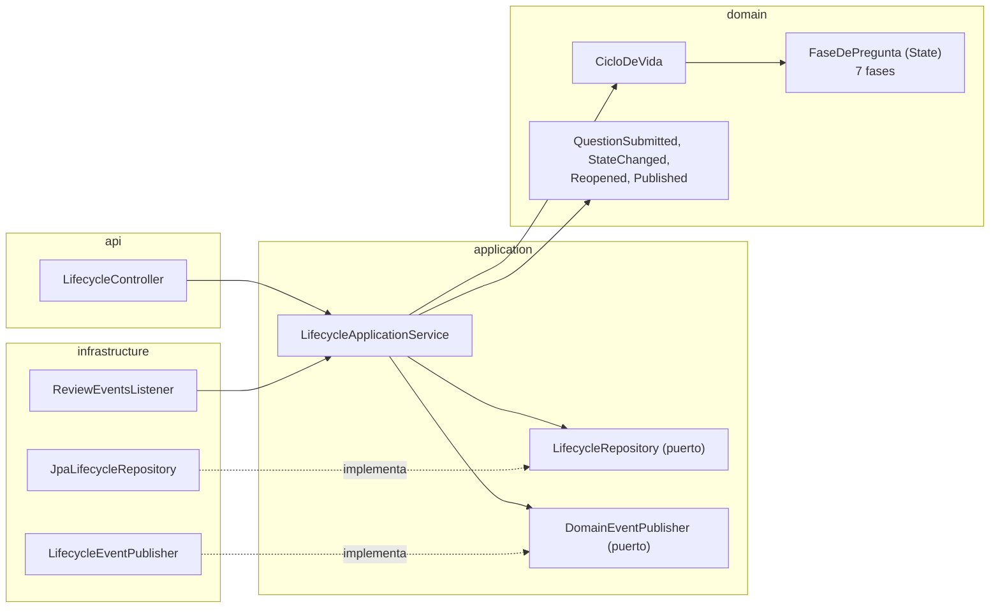

### assignment-service

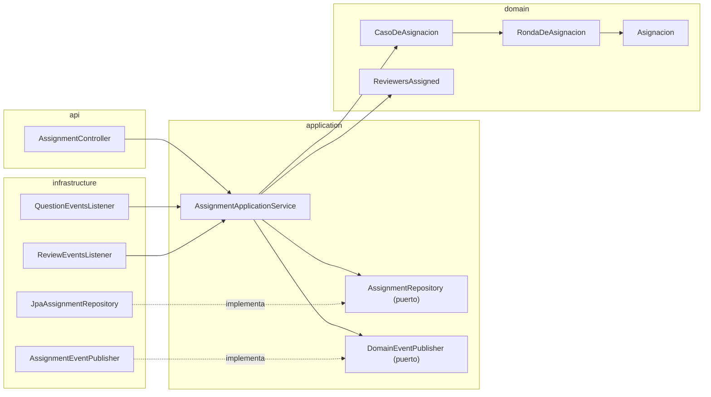

### evaluation-service

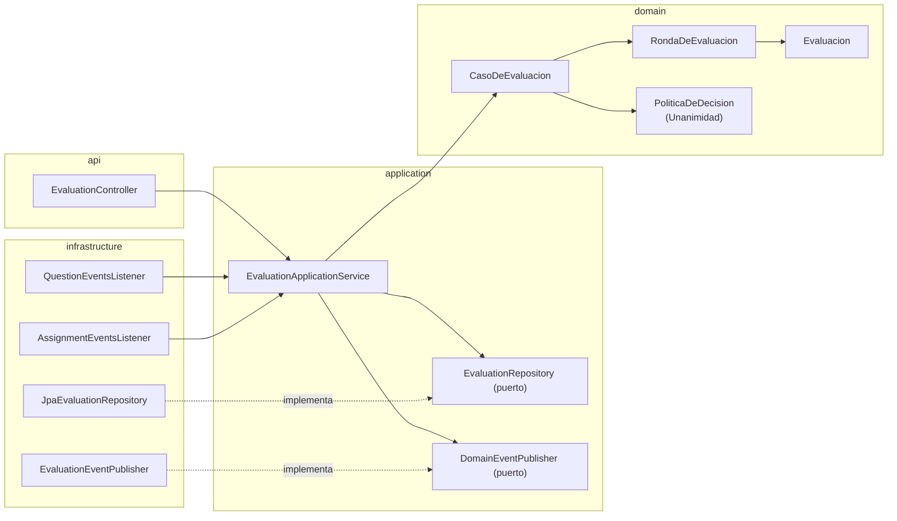

### notification-service y email-service

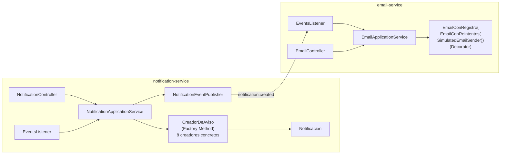

## Máquina de estados de la pregunta

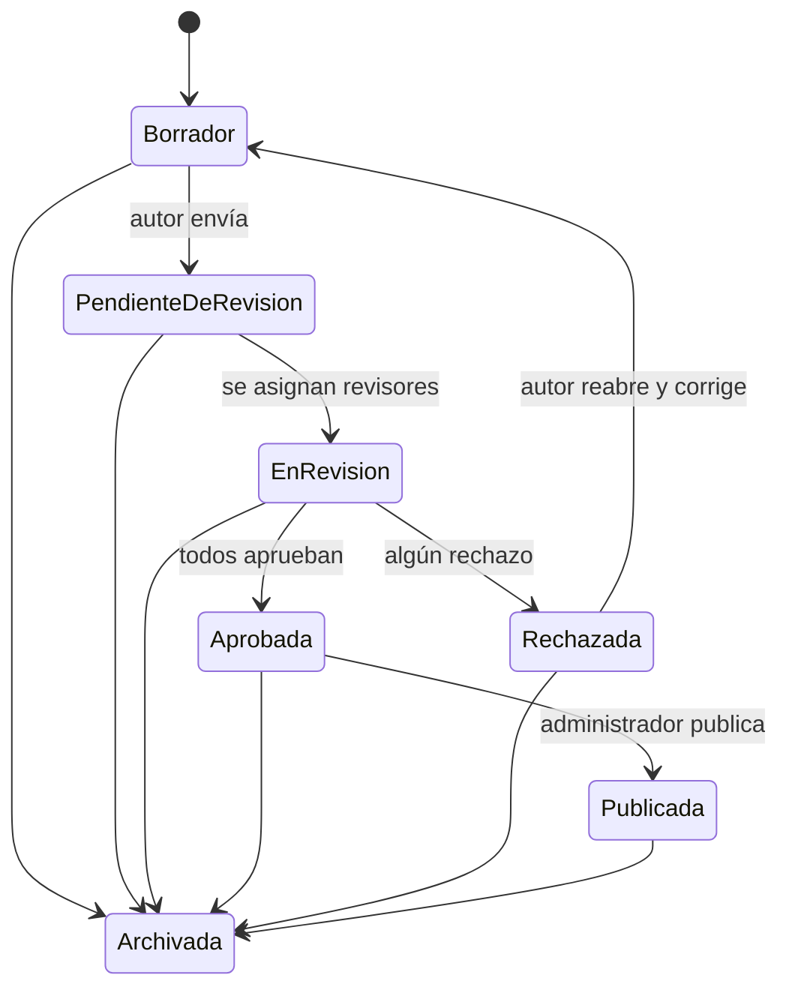

Las transiciones válidas las decide `lifecycle-service`: cada estado es una clase (`FaseDePregunta`, patrón State) que sabe a
cuáles puede pasar, y las protegen pruebas. Cualquier estado puede pasar a Archivada porque la pregunta nunca se borra físicamente
(RNF-16); hoy ninguna operación de la API archiva, porque los docentes no definieron quién archiva ni cuándo (ver
[pendientes](README.md#pendiente)). `question-service` guarda una copia del estado para listar y filtrar.

## Secuencia · HU-04: asignar revisores

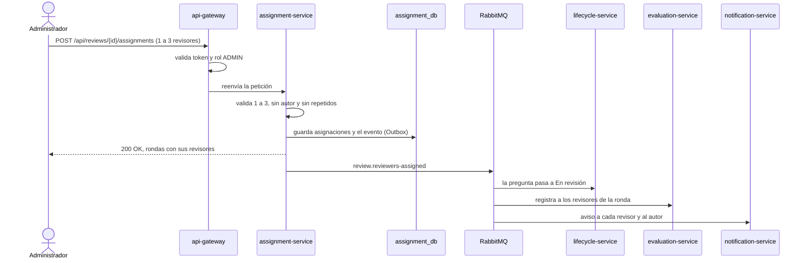

## Secuencia · HU-05: evaluar una pregunta

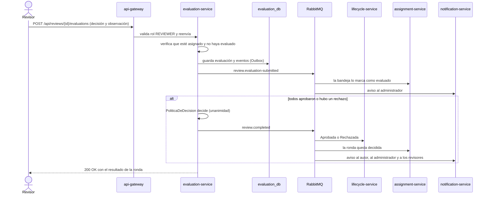

## Secuencia · HU-06: corregir una pregunta rechazada

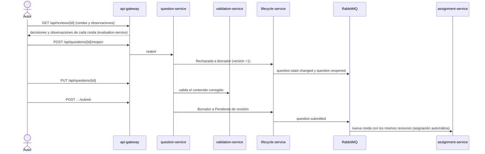

## Modelo de datos por servicio

Los servicios se refieren entre sí solo por identificador, sin claves foráneas entre bases. No hay borrado
físico (RNF-16): se usan estados y fechas. Las migraciones de Flyway están en `src/main/resources/db/migration`
de cada servicio. Todos los consumidores de eventos guardan `processed_event` (idempotencia) y los servicios que publican
(`lifecycle_db`, `assignment_db`, `evaluation_db`, `notification_db` y `user_db`) guardan además
`outbox_event` (patrón Outbox: `seq`, `event_id`, `routing_key`, `payload`, `created_at`, `sent_at`). `validation-service` no tiene base.

### user_db

`user-service` no guarda contraseñas: Keycloak es la fuente de la identidad y aquí solo se mantiene una copia de
los perfiles para listar revisores y asignar.

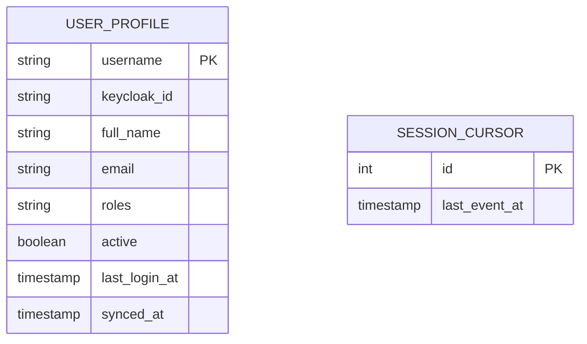

### question_db

Solo el contenido y una copia del estado; el historial de estados y los eventos son de `lifecycle_db`.

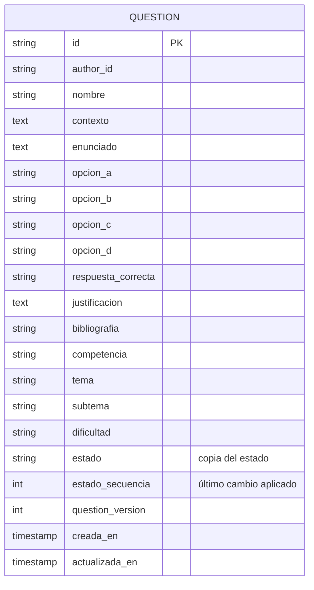

### lifecycle_db

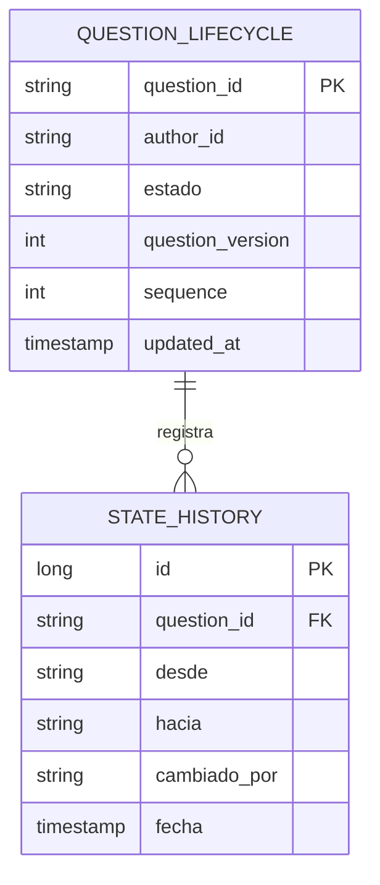

### assignment_db

Una **ronda** es una vuelta de revisión de una versión de la pregunta; si el autor corrige y reenvía, se abre otra.

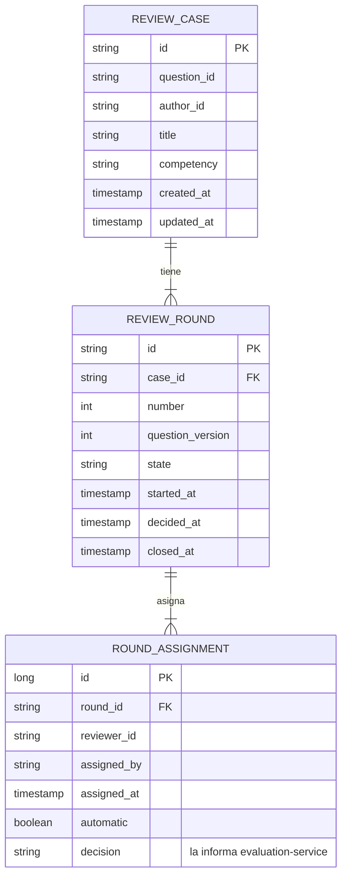

### evaluation_db

Las mismas rondas, vistas desde la evaluación: los revisores los informa `assignment-service` y aquí se guardan las evaluaciones.

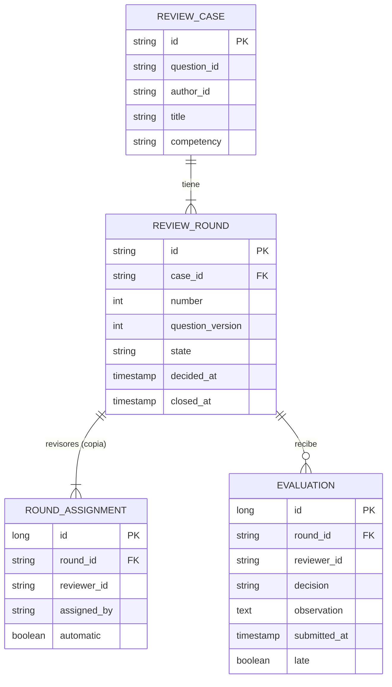

### notification_db

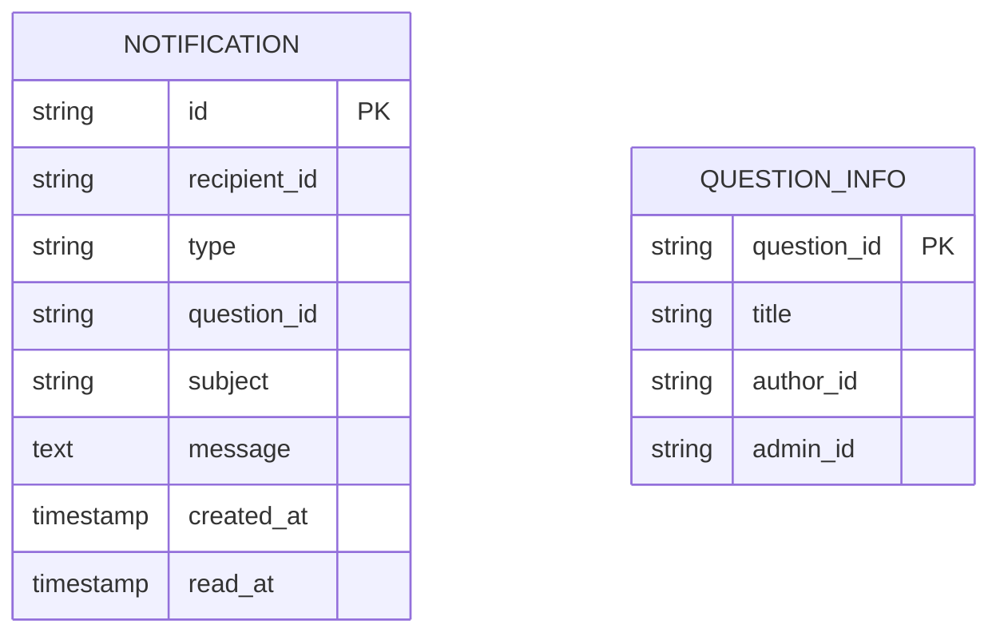

### email_db

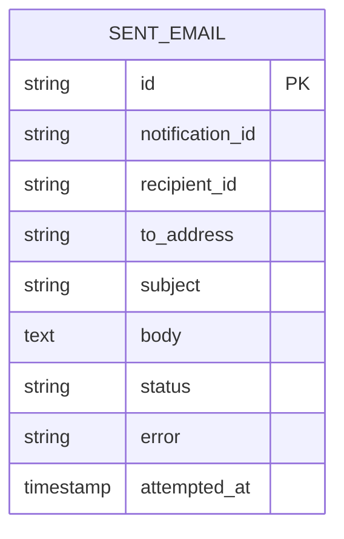

### history_db

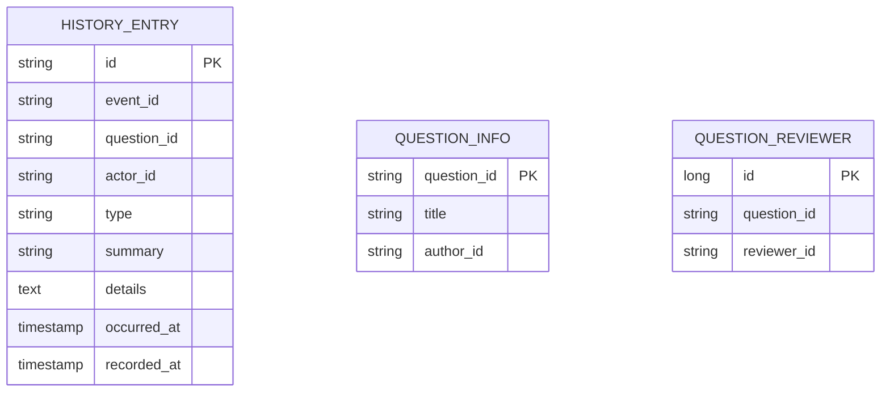

### audit_db

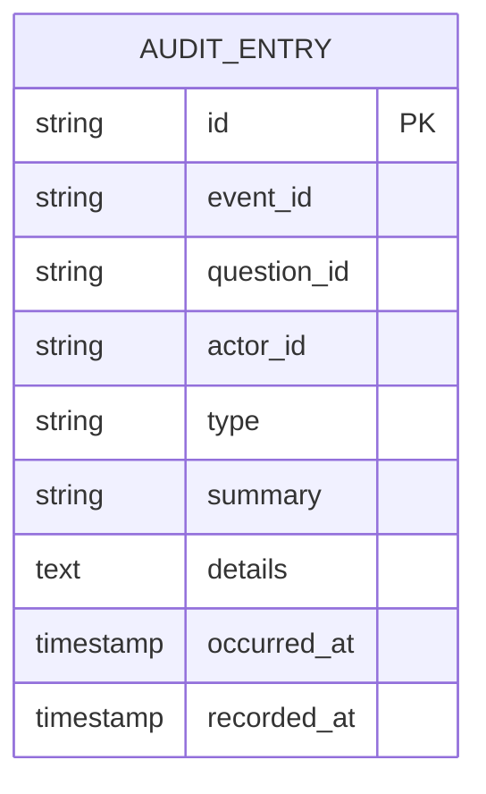

## Despliegue

El despliegue completo (con `edge`, Eureka, Keycloak y las réplicas) está en [08 · Implementación](08-implementacion-seguridad-y-resiliencia.md#topología-desplegada). Todo se levanta con `docker compose up -d --build` desde `microservicios/`; los servicios de negocio no publican puertos al exterior (solo `docker-compose.debug.yml`).
