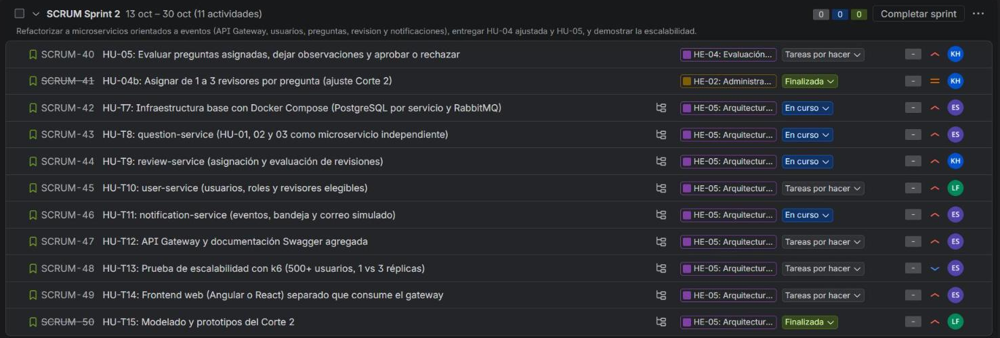
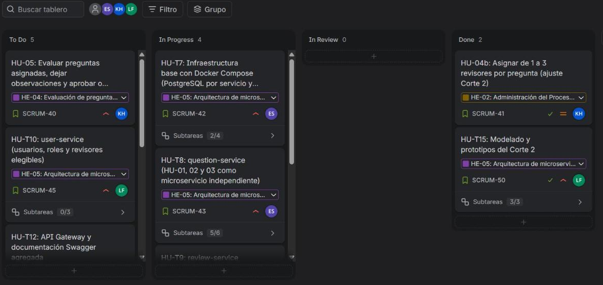

# 07 · Planificación del Sprint 2

Tablero en Jira: proyecto **SCRUM**, sprint **SCRUM Sprint 2**, del **13 al 30 de octubre de 2026**
([tablero](https://dvlasz.atlassian.net/jira/software/projects/SCRUM/boards/1)). El sprint reúne once historias
y sus subtareas técnicas; todo lo obligatorio del Corte 2 tiene prioridad **Alta** y las adiciones tienen
prioridad **Baja** y quedan en el backlog.

Las reglas de revisión (1 a 3 revisores, unanimidad, rondas por versión, reasignación automática) y de correo se
confirmaron con el docente el 5 de octubre y están implementadas.
La arquitectura hexagonal/DDD queda para el corte 3.

## Épicas

| Clave | Épica | Prioridad |
|---|---|---|
| SCRUM-6 | HE-01 Gestión del banco de preguntas (primer corte) | Media |
| SCRUM-23 | HE-02 Administración del proceso de revisión | Media |
| SCRUM-38 | HE-04 Evaluación de preguntas por revisores | Alta |
| SCRUM-39 | HE-05 Arquitectura de microservicios y eventos (corte 2) | Alta |

## Historias del sprint

| Clave | Historia | Prioridad | Responsable | Subtareas |
|---|---|---|---|---|
| SCRUM-40 | HU-05 Evaluar preguntas asignadas, dejar observaciones y aprobar o rechazar | Alta | Kevin | Sin subtareas propias; se desarrolla en SCRUM-76, 77 y 80 a 83 |
| SCRUM-41 | HU-04b Asignar de 1 a 3 revisores por pregunta (ajuste del corte 2) | Media | Kevin | Sin subtareas propias; se desarrolla en SCRUM-76 y 77 |
| SCRUM-42 | HU-T7 Infraestructura base con Docker Compose | Alta | Edward | SCRUM-51 a 54 |
| SCRUM-43 | HU-T8 `question-service` | Alta | Edward | SCRUM-55 a 60 |
| SCRUM-44 | HU-T9 `review-service` | Alta | Kevin | SCRUM-76 y 77 |
| SCRUM-45 | HU-T10 `user-service` | Alta | Laura | SCRUM-61 a 63 |
| SCRUM-46 | HU-T11 `notification-service` | Alta | Edward | SCRUM-78 y 79 |
| SCRUM-47 | HU-T12 API Gateway y Swagger agregado | Alta | Edward | SCRUM-64 a 66 |
| SCRUM-48 | HU-T13 Prueba de escalabilidad con k6 | Baja | Edward | SCRUM-67 y 68 |
| SCRUM-49 | HU-T14 Frontend web separado | Alta | Edward | SCRUM-80 a 83 |
| SCRUM-50 | HU-T15 Modelado y prototipos | Alta | Laura | SCRUM-69 a 71 |

## Adiciones fuera del alcance obligatorio

Quedan en el backlog con prioridad **Baja**; se atienden después de cumplir lo obligatorio.

| Clave | Historia | Responsable | Subtareas |
|---|---|---|---|
| SCRUM-72 | HU-T16 `history-service` (historial de revisiones y auditoría de accesos) | Kevin | SCRUM-84 y 85 |
| SCRUM-73 | HU-T17 Descubrimiento de servicios con Eureka | Edward | SCRUM-86 |
| SCRUM-74 | HU-T18 Seguridad con Keycloak (inicio de sesión PKCE, realm de prueba y entrada con nginx) | Edward | SCRUM-87 y 88 |
| SCRUM-75 | HU-T19 Resiliencia y mensajería confiable (outbox, reintentos con cola de errores y circuit breaker) | Edward | SCRUM-89 a 91 |

## Reparto

Cada integrante responde por servicios completos, y su trabajo queda registrado con su autoría en los commits
del repositorio y como asignación en Jira.

| Integrante | Responsabilidad |
|---|---|
| Edward Dávila | Infraestructura con Docker Compose, `question-service`, `notification-service`, API Gateway, frontend web y prueba de escalabilidad |
| Kevin Castaño | `review-service`, evaluación por los revisores, asignación de 1 a 3 revisores y, como adición, `history-service` |
| Laura Sánchez | `user-service`, modelado y prototipos del corte 2 y documentación de variables de entorno y arranque |

## Capturas del sprint

Estado del sprint el 13 de octubre de 2026.

## Seguimiento

El avance se publica en la rama `corte-2` en commits por servicio. Cada commit se refleja en el issue
correspondiente de Jira con un comentario y el enlace al commit, y el estado de las subtareas se actualiza a
medida que se publican.
