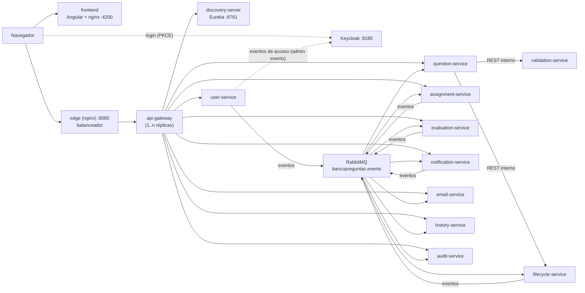

# 08 · Implementación: topología, seguridad y resiliencia

Este documento describe **lo que quedó construido** al cierre de la iteración y las decisiones técnicas que
se tomaron al construirlo. Los documentos 02 y 03 recogen el diseño inicial; donde difieren, manda este.

## Topología desplegada

Todo se levanta con un solo comando (`docker compose up -d --build` en `microservicios/`).

| Pieza | Puerto | Función |
|---|---|---|
| `frontend` | 4200 | Aplicación Angular servida por nginx; la dirección del gateway y de Keycloak se lee de `config.json` en tiempo de ejecución |
| `edge` | 8080 | nginx que reparte las peticiones entre las réplicas del gateway (con *keepalive* hacia ellas y reintento ante una réplica caída) |
| `api-gateway` | interno | Spring Cloud Gateway: enrutamiento por Eureka, validación del token, autorización por rol, circuit breaker, reintentos, CORS |
| `discovery-server` | 8761 | Eureka: registro y descubrimiento; permite añadir réplicas sin cambiar configuración |
| `keycloak` | 8180 | Proveedor de identidad (realm `bancopreguntas` con usuarios y roles de prueba precargados) |
| `user-service` | interno | Sincroniza usuarios desde Keycloak y consulta los eventos de acceso |
| `question-service` | interno | HU-01 a HU-03: contenido de las preguntas; usa validation y lifecycle por REST |
| `validation-service` | interno | Reglas de calidad del contenido (sin estado ni base de datos) |
| `lifecycle-service` | interno | Estados, transiciones, historial de la pregunta y sus eventos |
| `assignment-service` | interno | Rondas de revisión, asignación de revisores y bandeja del revisor |
| `evaluation-service` | interno | Evaluaciones de los revisores y decisión por unanimidad |
| `notification-service` | interno | Bandeja de notificaciones |
| `email-service` | interno | Correo simulado con reintentos y registro |
| `history-service` | interno | Línea de tiempo de cada pregunta |
| `audit-service` | interno | Auditoría de acciones e inicios de sesión |
| `rabbitmq` | 5672 / 15672 | Bus de eventos |
| `postgres-*` ×9 | 5433–5446 | Una instancia de PostgreSQL 16 por servicio con datos (todos menos validation) |

Los servicios no publican puertos al exterior: se entra solo por `edge`. El archivo
`docker-compose.debug.yml` los publica (8081–8087 y 8090–8096) para depurar desde el IDE.

Réplicas: `docker compose up -d --scale question-service=3 --scale api-gateway=2`.

## Seguridad

**Autenticación.** Keycloak 26. El navegador inicia sesión con *Authorization Code + PKCE* y envía el JWT al
gateway. Cada servicio vuelve a validar la firma (clave pública de Keycloak, `jwk-set-uri` interno) y el
emisor (`issuer-uri`), de modo que no depende de que el gateway sea el único camino.

**Autorización redundante.** El gateway aplica una tabla de reglas (`RoleRules`: método + camino → roles) y, además,
cada controlador exige el rol de su operación (`requireAnyRole`). Un error en una barrera no abre la operación.

| Rol | Puede |
|---|---|
| `AUTHOR` | Crear, modificar, enviar a revisión y reabrir sus preguntas; ver historial y notificaciones propias |
| `REVIEWER` | Ver las preguntas asignadas y enviar evaluaciones |
| `ADMIN` | Ver todas las preguntas, asignar revisores, publicar, listar usuarios, ver auditoría y correos |

**Anti-suplantación.** En modo `jwt` las cabeceras `X-User-Id` y `X-User-Roles` se ignoran en los servicios y el
gateway las elimina de la petición entrante. El modo `headers` existe solo para pruebas y desarrollo; el
compose arranca en `jwt` por defecto (`SECURITY_MODE`).

**Auditoría de accesos.** Keycloak registra los eventos de inicio de sesión (correctos y fallidos); `user-service`
los consulta periódicamente y publica `auth.login-succeeded` / `auth.login-failed`, que `audit-service`
guarda. Un administrador los ve en la pantalla de auditoría.

**Identidad entre servicios.** Las dos llamadas REST entre servicios (question → validation y question → lifecycle) pasan la identidad de quien hizo la petición: `bp-platform` copia el token (`Authorization`) y las
cabeceras de identidad al `RestClient`, así que el servicio llamado vuelve a validar el token y a exigir el rol, y nadie gana
permisos por pasar por un servicio intermedio. El gateway no tiene rutas hacia validation ni lifecycle. Solo se manda el token a servicios internos (nombres sin puntos), nunca a un servidor externo.

**Cuenta de servicio.** `user-service` habla con la API de administración de Keycloak con un cliente de
credenciales propio (`client credentials`), sin usuario ni contraseña de persona.

**Secretos.** Los valores de desarrollo van en `.env` (no se versiona; ver `.env.example`). El realm de
prueba trae usuarios de ejemplo solo para el entorno local.

## Resiliencia

| Mecanismo | Dónde | Qué evita |
|---|---|---|
| **Circuit breaker** (Resilience4J) | Una por ruta del gateway | Esperar a un servicio caído: tras 50 % de fallos en 20 llamadas, responde `503` de inmediato con un mensaje en español y prueba de nuevo a los 10 s |
| **Reintento** | Gateway, solo `GET`, 2 veces con espera creciente | Fallos momentáneos de una réplica. Va *dentro* del circuit breaker; al revés actuaría sobre una respuesta ya enviada |
| **Bulkhead** | Gateway, 1000 llamadas simultáneas por servicio | Que un servicio lento acumule peticiones sin límite. El valor por defecto (25) rechazaba llamadas sanas bajo carga |
| **Límite de tiempo** | Gateway, 10 s | Peticiones colgadas |
| **Balanceo con reintento** | `edge` | Una réplica del gateway caída: nginx prueba otra |
| **Outbox** | lifecycle, assignment, evaluation, notification y user | Perder un evento cuando RabbitMQ está caído (ver abajo) |
| **Reintento del consumidor + cola de mensajes muertos** | Todos los consumidores | Perder o bloquear la cola por un mensaje que falla |
| **Consumidores idempotentes** | Todos | Efectos dobles si un evento llega repetido (`processed_event`) |

### Patrón Outbox

Problema: publicar el evento *después* del commit puede fallar (RabbitMQ caído), y entonces el cambio queda
guardado pero nadie se entera; publicarlo *antes* puede avisar de algo que luego se deshace.

Solución: el evento se inserta en la tabla `outbox_event` **en la misma transacción** que el cambio de negocio.
Un relevo (`OutboxRelay`) lee los pendientes cada 0,5 s y los publica en orden; si el broker no responde,
los deja y reintenta. La entrega es *al menos una vez* y los consumidores son idempotentes, así que el efecto
neto es *exactamente una vez*.

- `SELECT … FOR UPDATE SKIP LOCKED`: con varias réplicas del servicio, dos relevos nunca toman el mismo evento.
- Si el envío falla a mitad de un lote, se detiene para **conservar el orden**.
- Los eventos enviados se borran pasadas 24 h; el aviso de “broker caído” se limita a uno cada 30 s en el registro.
- Se desactiva con `bancopreguntas.events.outbox.enabled=false` (se publica directo tras el commit).
- Código: `bp-platform/.../events/{EventPublisher, OutboxEventPublisher, OutboxRelay}`; migraciones
  `lifecycle V1`, `assignment V1`, `evaluation V1`, `notification V3` y `user V2`. Los servicios que
  solo escuchan eventos (`question`, `email`, `history` y `audit`) desactivan el Outbox con
  `bancopreguntas.events.outbox.enabled=false`.

**Prueba realizada:** con RabbitMQ detenido, un autor envió una pregunta a revisión. El servicio respondió
`200` (antes del Outbox respondía `503`); los dos eventos (`question.submitted` y `question.state-changed`)
quedaron pendientes en la tabla; al encender RabbitMQ salieron y el servicio de revisión los procesó. (Prueba hecha cuando el
sistema tenía 7 servicios; el mecanismo es el mismo de `bp-platform` en los 7 que hoy publican con Outbox.)

### Reintentos y mensajes muertos

Cada consumidor reintenta un mensaje que falla hasta 4 veces (1 s, 2 s, 4 s). Si sigue fallando se rechaza sin
reencolar y RabbitMQ lo envía, por una *política* sobre las colas `*.q.*`, al exchange
`bancopreguntas.dlx` y de ahí a la cola `bancopreguntas.dead-letter`, donde queda para revisarlo. La política
la aplica el contenedor de un solo uso `rabbitmq-policy` (no se cambian los argumentos de las colas, lo que
obligaría a borrarlas). Los mensajes malformados (JSON inválido, campos faltantes) se descartan directo a esa cola.

## Pruebas

| Módulo | Pruebas |
|---|---|
| `bp-platform` | 70 |
| `question-service` | 141 |
| `validation-service` | 53 |
| `lifecycle-service` | 99 |
| `assignment-service` | 96 |
| `evaluation-service` | 107 |
| `notification-service` | 85 |
| `email-service` | 38 |
| `history-service` | 54 |
| `audit-service` | 38 |
| `user-service` | 62 |
| `api-gateway` | 25 |

Todas se ejecutan sin Docker (PostgreSQL embebido y RabbitMQ simulado). La pila se verificó en Docker el 26 de octubre de 2026: el
recorrido funcional pasó con 71 comprobaciones y 0 fallos (ver [plan de pruebas](anexos/plan-de-pruebas.md)).

## Qué queda para el corte 3

Rediseño con DDD en un servicio (agregados, objetos de valor y servicios de dominio), el documento final y la demostración.
Los servicios actuales separan dominio, aplicación (interfaces) e infraestructura, con ArchUnit vigilando que el dominio no dependa
de Spring, pero el modelado formal en DDD no se hizo en esta iteración.
