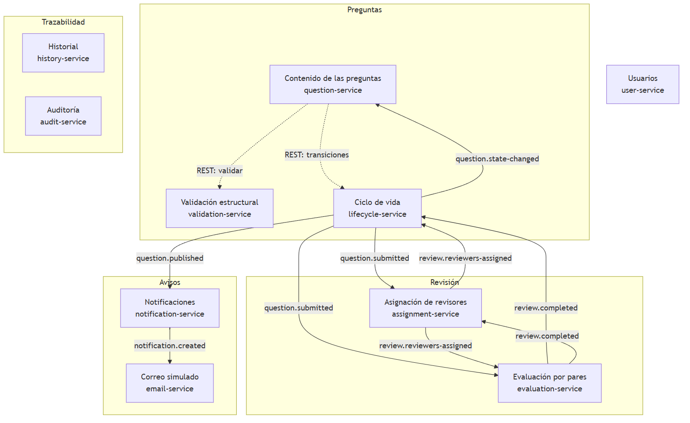
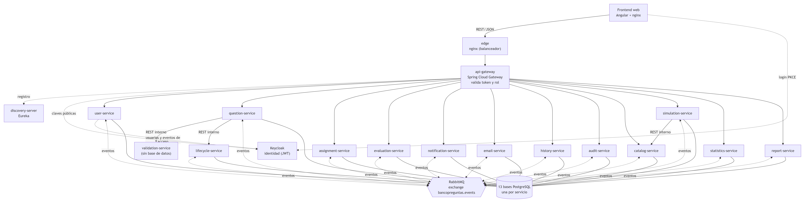
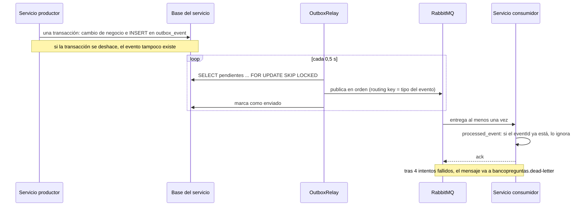
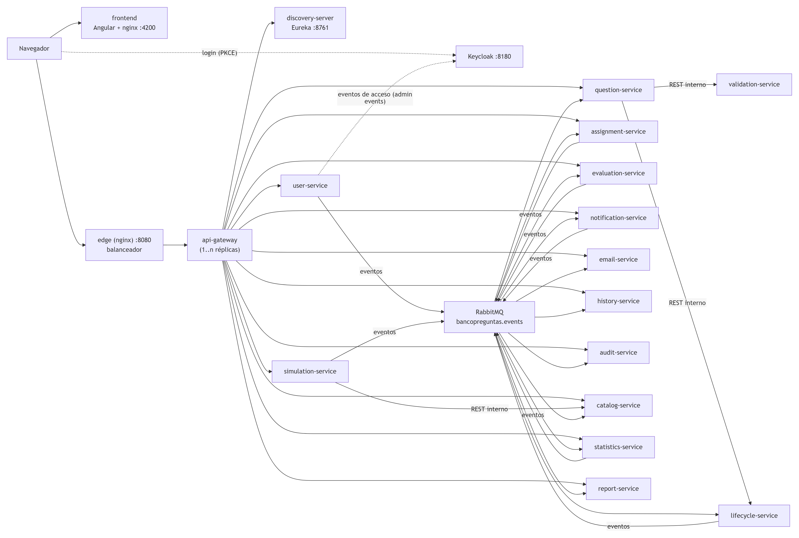
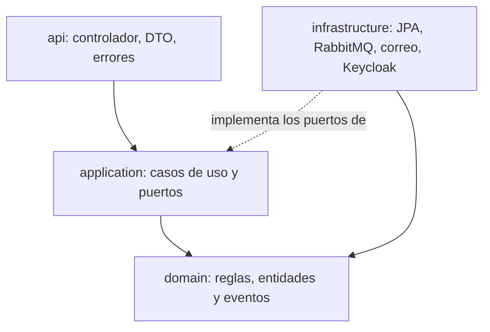
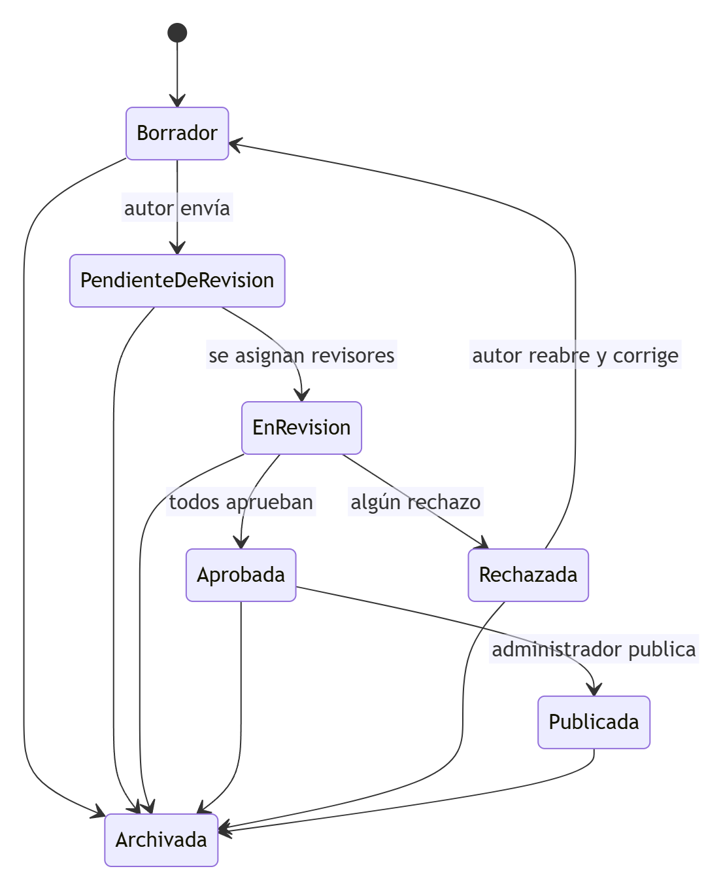

# Informe de decisiones de arquitectura y SOLID

## 1. Introducción

Este informe reúne, en un solo documento, **todas las decisiones de arquitectura** del Banco de Preguntas Saber Pro y la forma
en que el código cumple los principios **SOLID** y las buenas prácticas de diseño. Cada decisión dice qué se decidió, por qué, qué
alternativas se descartaron y qué se paga por ella. Los nombres de clases, de colas y de variables son los del código; el informe
se contrastó con él servicio por servicio.

Complementa a los documentos del segundo corte: el [diseño de contextos y eventos](02-contextos-y-eventos.md), la
[arquitectura C4](03-arquitectura-c4-uml.md), la [escalabilidad](04-escalabilidad.md), los [patrones](05-patrones.md), la
[implementación](08-implementacion-seguridad-y-resiliencia.md) y el [resumen de decisiones](10-decisiones-y-solid.md).

### 1.1 Propósito

Dar a los docentes, y a cualquier persona que herede el proyecto, la justificación de la arquitectura: no solo *cómo* está hecho el
sistema sino *por qué* se hizo así y cuáles son las consecuencias.

### 1.2 Alcance

- La solución del segundo corte: 14 microservicios de negocio, el API Gateway, Eureka, el balanceador de entrada, Keycloak,
  RabbitMQ, PostgreSQL y la aplicación web de Angular.
- Los servicios de simulacros y de seguimiento académico, construidos por adelantado del tercer corte.
- El monolito del primer corte solo se menciona como punto de partida.

### 1.3 Cómo está organizado el informe

El capítulo 2 resume el contexto y los requisitos que gobiernan la arquitectura. El capítulo 3 es el registro de decisiones. El
capítulo 4 detalla cada decisión. El capítulo 5 describe la arquitectura interna de los servicios. El capítulo 6 resume los patrones
de diseño. El capítulo 7 explica SOLID con ejemplos del código y sus pruebas. El capítulo 8 recoge las buenas prácticas, el capítulo 9
los escenarios de calidad con su evidencia, el capítulo 10 los riesgos y limitaciones y el capítulo 11 las conclusiones.

### 1.4 Cómo se lee cada decisión

Cada decisión se presenta con cuatro partes: el **contexto** que la motivó, la **decisión** tomada, las **alternativas** que se
descartaron y las **consecuencias**, positivas y negativas, con lo que se hizo para mitigarlas.

## 2. Contexto del sistema

### 2.1 Qué hace el sistema

Los autores redactan preguntas de selección múltiple con única respuesta; el sistema las valida estructuralmente. Un administrador
asigna de 1 a 3 revisores, los revisores evalúan y la pregunta se aprueba por unanimidad; el administrador publica las aprobadas. Cada
paso genera notificaciones y queda en un historial. Con las preguntas publicadas, los estudiantes presentan simulacros aleatorios con
tiempo y calificación automática, y estudiantes y docentes siguen el progreso (estadísticas, fortalezas y debilidades, reportes del
grupo).

### 2.2 Requisitos que gobiernan la arquitectura

| Requisito | Qué exige | Cómo lo atiende la arquitectura |
|---|---|---|
| RNF-17 y RNF-18, escalabilidad | 500 o más usuarios concurrentes, con réplicas | Servicios sin estado de sesión, una base por servicio, gateway y balanceador que reparten entre réplicas |
| RNF-08, contraseñas | No guardar contraseñas en claro | Keycloak autentica; ningún servicio las guarda |
| RNF-13, reglas independientes | Agregar o quitar un criterio de calidad sin tocar los demás | Una clase por regla de validación |
| RNF-16, sin borrado físico | Trazabilidad completa | Borrado lógico y un historial de estados |
| Trazabilidad y auditoría | Saber qué pasó con cada pregunta y quién entró | `history-service` y `audit-service` consumen los eventos |
| Disponibilidad del flujo principal | Que un servicio secundario caído no detenga la revisión | Eventos asíncronos, Outbox y reintentos |

### 2.3 Restricciones confirmadas por los docentes

- Microservicios en Java con Spring Boot, una base PostgreSQL por servicio y RabbitMQ; sin Saga, CQRS ni Event Sourcing.
- Frontend web separado, en Angular o React, que solo habla con el API Gateway.
- Revisión por unanimidad con 1 a 3 revisores asignados por el administrador; un solo rechazo devuelve la pregunta.
- Las notificaciones no deben enviar correo real en las pruebas (se simula).
- Swagger y una colección de Postman por módulo; escalabilidad probada hasta el límite de la máquina.
- Los patrones de diseño se acumulan entre iteraciones; la rúbrica pide al menos seis (dos de cada tipo).

## 3. Registro de decisiones

La **Tabla 3.1** lista las decisiones. Cada una tiene su detalle en el capítulo 4.

**Tabla 3.1.** Registro de decisiones de arquitectura.

| Id | Decisión | Dónde se ve |
|---|---|---|
| AD-01 | Aplicación web de una página (Angular), separada del backend | `frontend/` |
| AD-02 | Microservicios orientados a eventos, una base por servicio, API Gateway y RabbitMQ | Todo el sistema |
| AD-03 | 14 servicios pequeños, cada uno con una sola responsabilidad y sus propios datos | Todo el sistema |
| AD-04 | Solo tres llamadas síncronas entre servicios, con la identidad propagada; todo lo demás, por eventos | `ValidadorRemoto`, `CicloDeVidaRemoto`, `CatalogoRemoto` |
| AD-05 | PostgreSQL por servicio con migraciones de Flyway | `db/migration` de cada servicio |
| AD-06 | Un exchange *topic* común y una cola por consumidor | `bp-platform`, `RabbitTopology` |
| AD-07 | Outbox, consumidores idempotentes, reintentos y cola de mensajes muertos | `OutboxRelay`, `processed_event` |
| AD-08 | Keycloak con JWT validado dos veces (gateway y servicio) | `infraestructura/keycloak`, `bp-platform` |
| AD-09 | Spring Cloud Gateway, Eureka y nginx, con Resilience4J | `infraestructura/` |
| AD-10 | Capas con puertos y adaptadores en todos los servicios, vigiladas por ArchUnit | `ArquitecturaTest` |
| AD-11 | Biblioteca común `bp-platform`, solo infraestructura | `plataforma/bp-platform` |
| AD-12 | Un solo rechazo cierra la ronda; las rondas se llevan por versión de la pregunta | `evaluation-service` |
| AD-13 | Correo simulado detrás del puerto `EmailSender`, con decoradores | `email-service` |
| AD-14 | Máximo de revisores configurable (3 por defecto) | `ASSIGNMENT_MAX_REVIEWERS` |
| AD-15 | Historial y auditoría solo a partir de eventos | `history-service`, `audit-service` |
| AD-16 | El identificador de una persona es su nombre de usuario de Keycloak | Todos los servicios |
| AD-17 | Borrado lógico | Estado `Archivada` |
| AD-18 | Catálogo propio de simulacros alimentado por `question.published` y copia de las preguntas en cada simulacro | `catalog-service`, `simulation-service` |
| AD-19 | Estadísticas calculadas al consultar | `statistics-service` |
| AD-20 | Roles de estudiante y docente separados de autor y revisor | `RoleRules`, Keycloak |
| AD-21 | Contratos generados del código (OpenAPI), colecciones de Postman y diagramas como texto | `docs/corte-2/api` |
| AD-22 | Docker Compose para todo el despliegue local | `microservicios/docker-compose.yml` |
| AD-23 | Estrategia de pruebas por capas, con arquitectura, carga y contrato | Capítulo 9 |

## 4. Detalle de las decisiones

### 4.1 Tipo de aplicación (AD-01)

**Contexto.** El segundo corte exige frontend y backend separados que se comuniquen por una API REST.

**Decisión.** Aplicación web de una sola página en Angular 22 (componentes independientes, señales, sin zone.js) que consume la API a
través del gateway y se autentica con Keycloak. Backend y frontend son proyectos distintos que solo se hablan por HTTP y JSON.

**Alternativas.** La aplicación de escritorio Swing del primer corte (no se despliega en contenedores y el foco de la iteración es el
backend) y React en lugar de Angular.

**Consecuencias.** Una web evita instalar nada en los equipos de autores, revisores y administradores y permite escalar el backend sin
tocar el cliente. Angular aporta rutas, formularios, inyección de dependencias y pruebas por defecto, y TypeScript detecta en
compilación los errores de contrato con la API. El costo son dos bases de código y dos conjuntos de pruebas (183 en el frontend), y
hay que mantener los modelos de TypeScript alineados con los DTO del backend; eso lo cubren las colecciones de Postman y el recorrido
funcional.

### 4.2 Estilo arquitectónico (AD-02)

**Contexto.** El corte pide una solución distribuida y escalable.

**Decisión.** Microservicios orientados a eventos: una base de datos por servicio, un API Gateway como entrada única y RabbitMQ como
bus. Cada contexto delimitado evoluciona y escala por separado.

**Alternativas.** Un monolito modular (más simple, pero no cumple el corte ni escala por partes); microservicios con llamadas REST
síncronas entre ellos (acopla la disponibilidad: si revisión cae, preguntas no puede enviar); Saga, CQRS y Event Sourcing (los docentes
los dejaron fuera de alcance).

**Consecuencias.** Hay consistencia eventual: la pregunta pasa a «En revisión» unos milisegundos después de asignar los revisores, y
hay más piezas que operar y probar. Se mitiga con el patrón Outbox (no se pierden eventos), consumidores idempotentes, reintentos con
cola de mensajes muertos y circuit breaker en el gateway.

La **Figura 4.1** muestra los contextos delimitados y la **Figura 4.2** los contenedores del sistema.



**Figura 4.1.** Contextos delimitados del sistema.



**Figura 4.2.** Diagrama de contenedores del sistema (modelo C4, nivel 2).

### 4.3 Cuántos servicios y por qué tan pequeños (AD-03)

**Contexto.** El sistema empezó con siete servicios. Varios mezclaban responsabilidades con motivos de cambio o de escala distintos
(por ejemplo, `question-service` guardaba el contenido, validaba las reglas de calidad y llevaba los estados).

**Decisión.** Se dividieron hasta tener 14 servicios, cada uno con una sola responsabilidad y su propia base de datos: el contenido,
las reglas de calidad y el ciclo de vida de la pregunta; la asignación y la evaluación de la revisión; la bandeja y el correo; el
historial y la auditoría; el catálogo y los simulacros; las estadísticas y el reporte del grupo.

**Alternativas.** Mantener los siete servicios (menos piezas, responsabilidades mezcladas); dividir todavía más, por ejemplo un
servicio por regla de validación (el costo de operación superaría la ganancia).

**Consecuencias.** Cada servicio se entiende entero, se prueba y se reemplaza por separado, y los que tienen carga distinta escalan
por separado. A cambio hay más contenedores (13 bases PostgreSQL), más eventos y consistencia eventual entre la copia del estado de
`question-service` y el ciclo de vida; se mitiga con Outbox, idempotencia y números de secuencia, y porque todos los servicios
comparten la misma plantilla.

La **Tabla 4.1** muestra cómo se corresponden los contextos propuestos por el docente con los servicios.

**Tabla 4.1.** Contextos delimitados y servicios.

| Contexto | Servicio | Alcance |
|---|---|---|
| Gestión de Usuarios | `user-service` | Usuarios y roles sincronizados desde Keycloak; eventos de acceso |
| Gestión de Preguntas | `question-service` | Crear, modificar y listar el contenido |
| Validación de Preguntas | `validation-service` | Siete reglas de validación; sin estado ni base de datos |
| Ciclo de Vida de Preguntas | `lifecycle-service` | Siete estados con el patrón State, historial de estados y eventos |
| Asignación de Revisión | `assignment-service` | Rondas, asignación de revisores y bandeja del revisor |
| Evaluación por Pares | `evaluation-service` | Evaluaciones, unanimidad y rondas |
| Notificaciones (transversal) | `notification-service` | Bandeja de avisos |
| Correo (transversal) | `email-service` | Correo simulado con reintentos y registro |
| Trazabilidad | `history-service` | Historial por pregunta |
| Auditoría | `audit-service` | Acciones e inicios de sesión |
| Catálogo | `catalog-service` | Preguntas publicadas y selección al azar |
| Simulacros de Evaluación | `simulation-service` | Simulacros con tiempo y calificación |
| Seguimiento Académico | `statistics-service` | Historial, estadísticas, fortalezas y debilidades de cada estudiante |
| Reporte del grupo | `report-service` | Resumen por estudiante para docentes |

### 4.4 Comunicación entre servicios (AD-04)

**Contexto.** Si los servicios se llamaran siempre por REST, la caída de uno detendría a los demás.

**Decisión.** Casi todo viaja por eventos en RabbitMQ; los eventos llevan identificadores y los datos mínimos que el consumidor
necesita (*event-carried state transfer*, AD-18). Solo hay tres llamadas síncronas, donde el usuario espera la respuesta:
`question-service` a `validation-service` y a `lifecycle-service`, y `simulation-service` a `catalog-service`. La identidad de quien
hizo la petición viaja en la llamada y el servicio llamado vuelve a exigir el rol; si el otro no responde, la operación falla con 503 y
no deja nada a medias. El gateway no expone esos tres puntos internos. Además, los servicios hablan con Keycloak: todos para obtener
las claves con las que validan el token y `user-service` para leer los usuarios y los eventos de acceso.

**Consecuencias.** El flujo de revisión, las notificaciones, el correo, el historial, la auditoría y las estadísticas funcionan aunque
los demás estén caídos. Las tres llamadas síncronas acoplan la disponibilidad de guardar una pregunta y de crear un simulacro; es un
costo aceptado. Los datos que un servicio necesita de otro se copian (por ejemplo `question_info` en `notification-service` e
`history-service`); esa duplicación es deliberada y mínima.

### 4.5 Persistencia (AD-05)

**Decisión.** PostgreSQL 16, una base por servicio, con el esquema versionado por migraciones de Flyway (`db/migration`).

**Alternativas.** Una base compartida (más simple, pero acopla los servicios por el esquema) y JDBC puro (más control, más código).

**Consecuencias.** Ningún servicio puede leer las tablas de otro. No hay joins entre servicios: se guardan solo identificadores y se copia
lo mínimo. JPA oculta consultas, por lo que hay pruebas de persistencia sobre un PostgreSQL real embebido. Flyway asegura que cada
entorno tenga el mismo esquema.

### 4.6 Mensajería (AD-06)

**Decisión.** RabbitMQ 3.13 con un exchange *topic* durable, `bancopreguntas.events`, común a todos los servicios. La routing key es el
tipo del evento y cada consumidor tiene su propia cola (`<servicio>.q.<evento>`), de modo que varios servicios reciben el mismo
evento sin conocerse. Todos los eventos usan el sobre `{eventId, type, occurredAt, data}`.

**Alternativas.** Kafka: más potente, pero mucho más pesado para este volumen.

**Consecuencias.** El orden estricto solo se garantiza dentro de una cola, no entre servicios; por eso los consumidores no suponen un
orden global y las operaciones son idempotentes. Los diez eventos están descritos en
[`eventos.schema.json`](api/eventos/eventos.schema.json).

### 4.7 Mensajería confiable (AD-07)

**Contexto.** Publicar un evento después del commit puede fallar si RabbitMQ está caído, y entonces el cambio queda guardado pero nadie
se entera; publicarlo antes puede avisar de algo que luego se deshace.

**Decisión.** Patrón **Outbox**: el evento se inserta en la tabla `outbox_event` en la misma transacción que el cambio de negocio y un
relevo (`OutboxRelay`) lo publica después, cada 0,5 s y en orden (**Figura 4.3**). Con varias réplicas, cada lote se toma con
`FOR UPDATE SKIP LOCKED`, así que dos réplicas nunca publican el mismo evento. Los consumidores son **idempotentes** (tabla
`processed_event`) y, si un mensaje falla, reintentan hasta cuatro veces (1 s, 2 s y 4 s) antes de enviarlo a la cola de mensajes
muertos `bancopreguntas.dead-letter`, por una política que aplica el contenedor `rabbitmq-policy`.

<!-- img: img/diagramas/outbox-y-consumo.png -->


**Figura 4.3.** Publicación con Outbox y consumo idempotente.

**Alternativas.** Publicar directo tras el commit (se pierden eventos con RabbitMQ caído).

**Consecuencias.** Hay una tabla y un proceso periódico más, y la entrega es «al menos una vez», que se compensa con la idempotencia;
el efecto neto es exactamente una vez. Los servicios que solo consumen (`question`, `email`, `history`, `audit`, `catalog` y `report`) desactivan el Outbox.
Se comprobó con una prueba real: con RabbitMQ detenido, un autor envió una pregunta a revisión, el servicio respondió 200, los dos
eventos quedaron pendientes en la tabla y, al encender RabbitMQ, salieron y el servicio de revisión los procesó (prueba hecha cuando el sistema tenía siete servicios).

### 4.8 Seguridad (AD-08)

**Decisión.** Keycloak 26 autentica con OpenID Connect (*Authorization Code* con PKCE) y emite un JWT firmado. El gateway valida el
token y autoriza por rol (`RoleRules`); cada servicio **vuelve a validar** la firma y el emisor y exige el rol de cada operación
(autorización redundante). El gateway descarta las cabeceras `X-User-Id` y `X-User-Roles` que envíe un cliente, y en el modo `jwt` los
servicios las ignoran: nadie puede hacerse pasar por otro.

**Alternativas.** Implementar el inicio de sesión en `user-service` con BCrypt (menos piezas, pero más código de seguridad propio y más
riesgo) y confiar solo en el gateway (cualquiera que llegue a un servicio por la red interna se saltaría la seguridad).

**Consecuencias.** Un error en una barrera no abre la operación. Se paga con un contenedor más y la configuración del realm
(`bancopreguntas`, cinco roles y usuarios de demostración). Ningún servicio guarda contraseñas (RNF-08).

### 4.9 Entrada única y resiliencia (AD-09)

**Decisión.** Spring Cloud Gateway como única puerta (token, roles, CORS, enrutamiento), Eureka para descubrir réplicas y nginx
(`edge`) para repartir entre las réplicas del gateway. Resilience4J protege cada ruta (**Tabla 4.2**).

**Tabla 4.2.** Mecanismos de resiliencia.

| Mecanismo | Dónde | Qué evita |
|---|---|---|
| Circuit breaker | Cada ruta del gateway | Esperar a un servicio caído: tras 50 % de fallos en 20 llamadas responde 503 de inmediato y prueba de nuevo a los 10 s |
| Reintento | Gateway, solo consultas GET, dos veces | Fallos momentáneos de una réplica; va por dentro del circuit breaker |
| Bulkhead | Gateway, 1000 llamadas simultáneas por servicio | Que un servicio lento acumule peticiones sin límite |
| Límite de tiempo | Gateway, 10 s | Peticiones colgadas |
| Balanceo con reintento | `edge` | Una réplica del gateway caída: nginx prueba otra |
| Outbox y reintentos | Servicios y consumidores | Perder o bloquear eventos |

**Alternativas.** Direcciones fijas en el gateway (más simple, no escala) y ninguna protección (un servicio lento acumularía
peticiones). Los valores se ajustaron midiendo: el bulkhead por defecto (25) rechazaba llamadas sanas bajo carga.

**Consecuencias.** Más contenedores, pero se pueden agregar réplicas con `docker compose up -d --scale <servicio>=N` sin cambiar
configuración.

### 4.10 Biblioteca común (AD-11)

**Decisión.** `bp-platform` reúne lo transversal (sobre de eventos, Outbox, identidad del usuario, errores y configuración de OpenAPI)
y se activa sola por autoconfiguración. Solo contiene infraestructura, **nunca modelo de dominio**, para no acoplar los contextos.

**Alternativa.** Copiar el código en cada servicio (14 copias que se desincronizan).

### 4.11 Decisiones de negocio y de diseño

La **Tabla 4.3** recoge las decisiones de negocio y de diseño con su razón.

**Tabla 4.3.** Decisiones de negocio y de diseño.

| Id | Decisión | Por qué | Alternativa descartada |
|---|---|---|---|
| AD-12 | Un solo rechazo cierra la ronda y la pregunta queda Rechazada; las rondas se llevan por versión | Lo confirmó el docente; al corregir y reenviar se abre una ronda nueva con el historial de las anteriores. Las evaluaciones que llegan después se avisan como tardías | Esperar a que todos evalúen; sobrescribir la revisión |
| AD-13 | Correo simulado tras el puerto `EmailSender`, con decoradores de reintentos y de registro | Enviar correo real en pruebas bloquea cuentas; cambiar a SMTP real solo requiere otro adaptador | SMTP real con una cuenta de prueba |
| AD-14 | Máximo de revisores configurable (`ASSIGNMENT_MAX_REVIEWERS`, 3 por defecto) | Los docentes piden de 1 a 3 «y si queda abierto a más no hay problema» | Valor fijo en el código |
| AD-15 | Historial y auditoría solo a partir de eventos | Es un consumidor puro: no afecta al flujo principal y se puede reconstruir | Que cada servicio guarde su historial |
| AD-16 | El identificador de una persona es su nombre de usuario de Keycloak | Los servicios se refieren a las personas solo por identificador; no hace falta una tabla de usuarios en cada uno | Un UUID propio sincronizado en cada servicio |
| AD-17 | Borrado lógico: nada se elimina | RNF-16; mantiene la trazabilidad | Borrado físico |
| AD-18 | Catálogo propio de simulacros, alimentado por `question.published` con el contenido, y copia de las preguntas en cada simulacro | Los simulacros no dependen de que `question-service` esté en pie, y lo que vio el estudiante no cambia si la pregunta se archiva | Consultar por REST en cada simulacro; referenciar el catálogo |
| AD-19 | Estadísticas calculadas al consultar | El historial es la única fuente y los cálculos son funciones puras fáciles de probar; basta para el volumen del proyecto | Precalcular agregados por evento |
| AD-20 | Roles de estudiante y docente separados de autor y revisor | Cada uno ve solo lo suyo: el estudiante no ve preguntas en elaboración ni revisiones | Un solo rol «usuario» con permisos finos |

### 4.12 Tecnologías

La **Tabla 4.4** resume las tecnologías, para qué se usan y por qué se eligieron.

**Tabla 4.4.** Tecnologías y su justificación.

| Tecnología | Para qué | Por qué se eligió | Alternativas y desventajas |
|---|---|---|---|
| Java 21 y Spring Boot 3.5 | Todos los servicios | Los docentes lo piden; ecosistema maduro para REST, JPA, AMQP y seguridad; el dominio ya estaba en Java | Quarkus o Micronaut arrancan más rápido, pero el equipo no los conoce |
| Spring Data JPA y Flyway | Persistencia y migraciones | JPA reduce código repetitivo; Flyway versiona el esquema | JDBC puro; JPA oculta consultas, por eso hay pruebas de persistencia |
| PostgreSQL 16 | Datos | Confirmado por los docentes; una base por servicio evita el acoplamiento por esquema | Una base compartida |
| RabbitMQ 3.13 | Bus de eventos | Exchange *topic*, una cola por consumidor, entrega persistente, confirmaciones, cola de mensajes muertos y panel | Kafka |
| Keycloak 26 | Identidad | OpenID Connect con PKCE, JWT firmado, administración de usuarios y eventos de acceso | Inicio de sesión propio con BCrypt |
| Spring Cloud Gateway, Eureka y nginx | Entrada, descubrimiento y balanceo | Token, roles, CORS y resiliencia en un solo lugar; réplicas sin cambiar configuración | Direcciones fijas |
| Resilience4J | Resiliencia | Circuit breaker, reintentos, tiempos y bulkhead integrados con el gateway | Sin protección |
| Angular, TypeScript y nginx | Frontend | Ver AD-01 | React |
| Docker y Docker Compose | Despliegue | Toda la pila con un comando y pruebas de réplicas con `--scale` | Kubernetes, fuera de alcance |
| JUnit 5, MockMvc, ArchUnit y PostgreSQL embebido | Pruebas del backend | Corren sin Docker: dominio con dobles en memoria, persistencia sobre PostgreSQL real, API con MockMvc, seguridad con tokens firmados y arquitectura con ArchUnit | Testcontainers (exige Docker abierto) |
| Vitest | Pruebas del frontend | Integrado con Angular y rápido | Karma y Jasmine |
| k6, Postman y newman | Carga y contrato | Escalabilidad (RNF-17 y RNF-18) y colecciones por módulo ejecutables en automático | JMeter |
| springdoc OpenAPI | Documentación de la API | El contrato sale del código y no se desactualiza | Escribir los contratos a mano |
| Mermaid y modelo C4 | Diagramas | Texto versionado en git, exportable a imagen | Herramientas gráficas |

### 4.13 Despliegue (AD-22)

**Decisión.** Un `docker-compose.yml` levanta toda la pila: 7 bases PostgreSQL, RabbitMQ, Keycloak, Eureka, los 7 servicios, el
gateway, el balanceador `edge` y el frontend (20 contenedores, todos saludables), más un contenedor de un solo uso,
`rabbitmq-policy`, que aplica la política de la cola de mensajes muertos y termina. Un segundo archivo, `docker-compose.debug.yml`, publica los puertos de los servicios para depurarlos.

**Consecuencias.** Cualquier persona levanta el sistema con `docker compose up -d --build`. El costo es que Docker Compose no es un
orquestador: no reinicia por salud entre máquinas ni escala automáticamente (Kubernetes quedó fuera de alcance por indicación de los
docentes). La **Figura 4.4** muestra la topología desplegada.



**Figura 4.4.** Topología desplegada con Docker Compose.

## 5. Arquitectura interna de los servicios

### 5.1 Capas con puertos y adaptadores (AD-10)

**Decisión.** Todos los servicios tienen la misma estructura (**Tabla 5.1**): `api`, `application`, `domain` e `infrastructure`. El
dominio no depende de Spring ni de la base de datos; los casos de uso dependen de **puertos** (interfaces) que implementa la
infraestructura con **adaptadores** (JPA, RabbitMQ, correo, Keycloak). La **Figura 5.1** muestra el sentido de las dependencias.

**Tabla 5.1.** Capas de cada servicio.

| Capa | Contiene | Depende de |
|---|---|---|
| `api` | Controlador REST, DTO y manejo de errores | `application` |
| `application` | Casos de uso (`*ApplicationService`) y puertos (`port/`) | `domain` |
| `domain` | Reglas de negocio, entidades, objetos de valor y eventos de dominio | Nada del proyecto |
| `infrastructure` | Adaptadores: persistencia JPA, mensajería, configuración, Keycloak, correo | `application` y `domain` |

<!-- img: img/diagramas/capas-y-puertos.png -->


**Figura 5.1.** Sentido de las dependencias entre las capas de un servicio.

**Cómo se protege.** `ArquitecturaTest` (ArchUnit) hace **fallar la compilación** si el dominio depende de Spring, de JPA, de Jackson o
de AMQP, o de las capas de aplicación, infraestructura o API; si la aplicación depende de los adaptadores o de la persistencia y la
mensajería; o si la infraestructura depende de la API. La regla está en los 14 servicios.

```java
@ArchTest
static final ArchRule el_dominio_no_depende_de_Spring =
        noClasses().that().resideInAPackage(DOMINIO)
                .should().dependOnClassesThat().resideInAnyPackage("org.springframework..")
                .because("el dominio es lógica de negocio pura");
```

**Figura 5.2.** Una de las reglas de ArchUnit que protege la arquitectura (`question-service`).

**Consecuencias.** El dominio se prueba sin levantar nada, y cambiar una tecnología (por ejemplo, el correo simulado por uno real) es
cambiar un adaptador. El costo es más clases (puertos, adaptadores y DTO) que en una arquitectura por capas clásica.

### 5.2 Ciclo de vida de la pregunta

Los siete estados y sus transiciones (RF-14 y RF-15) se modelan con el patrón State: `EstadoPregunta` identifica el estado y cada
fase (`FaseBorrador`, `FasePendienteDeRevision`, `FaseEnRevision`, `FaseAprobada`, `FaseRechazada`, `FasePublicada` y
`FaseArchivada`) implementa solo lo que se puede hacer en ese estado. La **Figura 5.3** muestra el diagrama de estados.



**Figura 5.3.** Estados de una pregunta y sus transiciones.

## 6. Patrones de diseño

El sistema aplica nueve patrones del catálogo GoF (**Tabla 6.1**), seis para la rúbrica (dos de cada tipo) y tres más; el detalle de
cada uno, con su problema, solución y pruebas, está en el [documento de patrones](05-patrones.md).

**Tabla 6.1.** Patrones de diseño implementados.

| Tipo | Patrón | Dónde |
|---|---|---|
| Creacional | Builder | `Question.Builder` en `question-service` |
| Creacional | Factory Method | `CreadorDeAviso` y sus ocho creadores en `notification-service` |
| Estructural | Adapter | Puertos y adaptadores de todos los servicios |
| Estructural | Facade | `api-gateway` |
| Estructural | Decorator | `EmailConReintentos` y `EmailConRegistro` sobre `EmailSender` en `email-service` |
| Comportamiento | Strategy | `PoliticaDeDecision` y `SelectorDePreguntas` |
| Comportamiento | State | `FaseDePregunta` y sus siete fases en `lifecycle-service` |
| Comportamiento | Template Method | `ReglaPorOpcion` en `validation-service` |
| Comportamiento | Observer | Eventos de RabbitMQ |

## 7. Principios SOLID

### 7.1 Responsabilidad única (S)

Cada clase tiene una razón para cambiar (**Tabla 7.1**).

**Tabla 7.1.** Ejemplos del principio de responsabilidad única.

| Ejemplo | Responsabilidad |
|---|---|
| `QuestionValidator` y cada `*Rule` | El validador reúne las violaciones; cada regla comprueba una sola cosa (RF-08 a RF-13) |
| `EstadoPregunta` y las clases `Fase…` | `EstadoPregunta` identifica el estado; cada fase conoce lo que se puede hacer en él |
| `OutboxEventPublisher` y `OutboxRelay` | El primero solo guarda el evento en la transacción; el segundo lo reenvía |
| `QuestionApplicationService`, `AssignmentApplicationService`, `EvaluationApplicationService`, `LifecycleApplicationService` | Orquestan casos de uso; no tocan HTTP, SQL ni RabbitMQ |
| `QuestionController`, `AssignmentController` y `EvaluationController` | Traducen HTTP a casos de uso y viceversa |
| `Unanimidad` y `CasoDeEvaluacion` | La primera decide el resultado de una ronda; el segundo lleva las rondas y las asignaciones |

### 7.2 Abierto/cerrado (O)

Se agrega comportamiento nuevo sin modificar el código existente (**Tabla 7.2**).

**Tabla 7.2.** Cómo se extiende el sistema sin modificar lo existente.

| Para… | Basta con… | Sin tocar… |
|---|---|---|
| Una regla de validación nueva | Una clase que implemente `ValidationRule` y registrarla en `QuestionValidator.porDefecto()` | Las demás reglas ni el servicio |
| Un tipo de aviso nuevo | Una subclase de `CreadorDeAviso`, un valor en `TipoNotificacion` y su registro en `CreadoresDeAviso` | `NotificationApplicationService` |
| Otra forma de decidir una ronda (mayoría) | Una implementación de `PoliticaDeDecision` elegida en `ApplicationConfig` | `CasoDeEvaluacion` |
| Un estado nuevo del ciclo de vida | Una clase que implemente `FaseDePregunta` y una línea en `FaseDePregunta.de` | Los casos de uso |
| Una regla que examine cada opción | Una subclase de `ReglaPorOpcion` con solo el paso `evaluar` | El recorrido de las opciones |
| Reintentos o registro en el correo | Decoradores de `EmailSender` apilados en `ApplicationConfig` | El caso de uso y el adaptador |
| Otra forma de escoger preguntas de un simulacro | Una implementación de `SelectorDePreguntas` | `SimulationApplicationService` |
| Otra ruta protegida en el gateway | Una línea en `RoleRules` | La configuración de seguridad |

```java
public interface ValidationRule {
    /** Retorna las violaciones encontradas; una lista vacía si el contenido cumple la regla. */
    List<Violacion> validar(ContenidoPregunta contenido);
}

public static QuestionValidator porDefecto() {
    return new QuestionValidator(List.of(
            new CamposObligatoriosRule(), new ContextoObligatorioRule(), new PreguntaDirectaUnicaRule(),
            new CuatroOpcionesRule(), new RespuestaCorrectaUnicaRule(), new ExpresionesProhibidasRule(),
            new LongitudYEstructuraOpcionesRule()));
}
```

**Figura 7.1.** Una regla nueva de validación se agrega a la lista sin modificar las existentes.

### 7.3 Sustitución de Liskov (L)

Toda implementación puede usarse donde se espera su tipo base sin que el cliente note la diferencia.

- `Unanimidad` cumple el contrato de `PoliticaDeDecision` (decide a partir de los revisores y las evaluaciones), por lo que
  `CasoDeEvaluacion` funciona igual con cualquier otra política.
- Los ocho creadores de aviso son intercambiables: `CreadoresDeAvisoTest` crea cada tipo a través de la clase base y comprueba el
  mismo contrato (una notificación del tipo pedido, sin leer, con asunto y mensaje).
- `SimulatedEmailSender`, los decoradores `EmailConReintentos` y `EmailConRegistro` y el doble de las pruebas sustituyen a cualquier
  `EmailSender`; el caso de uso se comporta igual.
- Las siete fases del patrón State responden a la misma interfaz `FaseDePregunta`, y `FaseDePreguntaTest` comprueba que cada operación
  solo se admite desde su estado.

### 7.4 Segregación de interfaces (I)

Los puertos son pequeños y cada cliente depende solo de lo que usa (**Tabla 7.3**).

**Tabla 7.3.** Puertos pequeños y específicos.

| Puerto | Qué expone |
|---|---|
| `EmailSender` | Un único método, `enviar` |
| `ProcessedEvents` | Solo `registrarSiEsNuevo` (idempotencia) |
| `QuestionInfoRepository` y `NotificationRepository` | Separados: lo que se recuerda de una pregunta no se mezcla con la bandeja |
| `DomainEventPublisher` | Publicar eventos de dominio, sin saber cómo viajan |
| `ValidationRule` | Un único método, `validar` |

```java
/**
 * Puerto de salida: envío de correo electrónico. Hoy lo implementa un adaptador que solo simula el envío;
 * conectar un servidor SMTP real es cambiar ese adaptador, no la aplicación.
 */
public interface EmailSender {
    /** @throws RuntimeException si el correo no pudo enviarse */
    void enviar(Correo correo);
}
```

**Figura 7.2.** El puerto `EmailSender`, de un solo método.

### 7.5 Inversión de dependencias (D)

Los módulos de alto nivel (casos de uso) no dependen de los de bajo nivel (JPA, RabbitMQ); ambos dependen de abstracciones.

- Los servicios de aplicación reciben sus puertos, el reloj (`Clock`) y el generador de identificadores **por constructor**, y
  `ApplicationConfig` de cada servicio los ensambla con los adaptadores. Por eso las pruebas usan dobles en memoria y un reloj manual.
- La estrategia de decisión y la pila de decoradores del correo se eligen en `ApplicationConfig`, no dentro de los casos de uso.
- `ArquitecturaTest` hace fallar la compilación si se rompe la dirección de las dependencias (sección 5.1).

```java
@Bean
PoliticaDeDecision politicaDeDecision() {
    return new Unanimidad();
}

@Bean
EmailSender emailSender(@Value("${notification.email-attempts:3}") int intentos) {
    return new EmailConRegistro(new EmailConReintentos(new SimulatedEmailSender(), intentos));
}
```

**Figura 7.3.** `ApplicationConfig` elige la estrategia y apila los decoradores; los casos de uso solo ven las interfaces.

## 8. Buenas prácticas aplicadas

**Tabla 8.1.** Buenas prácticas y dónde se aplican.

| Práctica | Dónde |
|---|---|
| Inmutabilidad | `Question` y los objetos de valor son inmutables; un cambio devuelve una instancia nueva (`conEstado`, `reabrir`) |
| Fallar rápido con mensajes claros | Los errores se traducen a respuestas en español con el motivo (`ApiError` y `PlatformExceptionHandler`, más un manejador por servicio) |
| Sin números ni textos mágicos | Límites, mensajes y rutas en constantes y configuración (`ASSIGNMENT_MAX_REVIEWERS`, `RoleRules`) |
| Configuración fuera del código | Variables de entorno (`.env.example`); el `.env` real no se versiona |
| Idempotencia | `processed_event` en cada consumidor |
| Autorización redundante | El gateway y cada servicio comprueban el rol |
| Pruebas por capa | Dominio, aplicación con dobles, API, persistencia sobre PostgreSQL real, mensajería, seguridad, arquitectura y flujo de extremo a extremo |
| Documentación viva | OpenAPI exportado de los servicios, README por servicio y por módulo, diagramas versionados en git y trazabilidad de requisitos |
| Control de versiones | Commits pequeños y descriptivos, ramas por corte y plantilla de pull request |

## 9. Escenarios de calidad y evidencia

**Tabla 9.1.** Escenarios de calidad, respuesta de la arquitectura y evidencia.

| Atributo | Estímulo | Respuesta de la arquitectura | Evidencia |
|---|---|---|---|
| Escalabilidad | 600 usuarios concurrentes | Réplicas detrás del gateway; trabajo lento por eventos | k6: 223 peticiones/s con p95 de 18 ms a ritmo humano; 1 128 peticiones/s con p95 de 692 ms en estrés; 0 % de error ([04](04-escalabilidad.md)) |
| Disponibilidad | RabbitMQ caído | Outbox: el cambio se guarda y el evento sale al volver el broker | Prueba real descrita en 4.7 |
| Disponibilidad | Un servicio caído o lento | Circuit breaker, límite de tiempo y bulkhead en el gateway | Pruebas del gateway (25) |
| Seguridad | Petición sin token, con otro rol o con cabeceras de identidad falsas | 401 o 403; las cabeceras se descartan | Pruebas del gateway y de `bp-platform` |
| Modificabilidad | Un tipo de aviso, una regla o una política nuevos | Una clase nueva sin tocar el código existente | Tabla 7.2 y las pruebas de cada patrón |
| Trazabilidad | Saber qué pasó con una pregunta | Historial por eventos y auditoría | `history-service` y `audit-service` y sus 92 pruebas |
| Testabilidad | Cambiar una regla de negocio | Dominio sin dependencias, dobles en memoria y ArchUnit | 1040 pruebas del backend sin Docker |
| Interoperabilidad | Que otra aplicación consuma la API o los eventos | Contratos OpenAPI y esquema de eventos generados del código | `docs/corte-2/api` |

**Resumen de las pruebas.** Backend: 1040 pruebas (`bp-platform` 69, `question-service` 189, `validation-service` 28,
`lifecycle-service` 78, `assignment-service` 77, `evaluation-service` 76, `notification-service` 91, `email-service` 38,
`history-service` 54, `audit-service` 38, `catalog-service` 47, `simulation-service` 79, `statistics-service` 55,
`report-service` 31, `user-service` 62, `discovery-server` 3 y `api-gateway` 25); frontend: 183; recorrido funcional contra Docker: 73 comprobaciones con tokens reales de
Keycloak; Postman: 11 colecciones, 200 peticiones y 314 verificaciones; carga: k6.

## 10. Riesgos y limitaciones

**Tabla 10.1.** Riesgos y limitaciones conocidos.

| Riesgo o limitación | Consecuencia | Qué se hizo o se haría |
|---|---|---|
| Consistencia eventual | Entre la acción y su efecto en otro servicio pasan milisegundos | Idempotencia, Outbox y reintentos; la interfaz consulta el estado |
| Entrega al menos una vez | Un evento puede llegar repetido | Consumidores idempotentes (`processed_event`) |
| Cola de mensajes muertos sin proceso automático | Un mensaje que falla cuatro veces queda para revisión manual | Documentado; en producción se agregaría una alerta y un reproceso |
| Una sola instancia de Keycloak, RabbitMQ y de cada base | Es un punto único de falla fuera de Docker Compose | Fuera de alcance (sin Kubernetes); se documenta |
| Estadísticas calculadas al consultar | Con muchísimos estudiantes habría que precalcular | Basta para el volumen del proyecto; se diseñó para cambiarlo sin tocar la API |
| Datos copiados entre servicios (`question_info`) | Podrían quedar desactualizados | Solo se copia lo mínimo y se actualiza con cada evento |
| Interfaz web de estudiante y docente | Los servicios de simulacros y seguimiento tienen API completa, pero sus pantallas están pendientes | Registrado en el tablero como trabajo siguiente |
| DDD formal y rediseño hexagonal de un servicio | Requisito del tercer corte | Pendiente; la estructura actual (puertos y adaptadores, reglas de ArchUnit) es la base |

## 11. Conclusiones

- La arquitectura de microservicios orientados a eventos desacopla a los servicios: la caída de notificaciones, historial o
  seguimiento no detiene la revisión de preguntas, y cada contexto escala por separado.
- La mensajería confiable (Outbox, idempotencia, reintentos y cola de mensajes muertos) convierte la entrega «al menos una vez» en un
  efecto «exactamente una vez» y se comprobó con RabbitMQ detenido.
- La separación en capas con puertos y adaptadores, vigilada por ArchUnit, mantiene el dominio libre de tecnología; eso hace que las
  pruebas sean rápidas y que los cambios de tecnología se concentren en un adaptador.
- Los cinco principios SOLID no son una declaración: cada uno tiene ejemplos concretos en el código y pruebas que lo respaldan, y los
  nueve patrones de diseño los refuerzan.
- Cada decisión tiene un costo, que está identificado y, cuando fue posible, mitigado; los riesgos que quedan están documentados en el
  capítulo 10.
