# Documento de arquitectura

**Edward Esteban Dávila Salazar**

**Laura Isabel Sánchez Fernández**

**Kevin Yesid Castaño Herrera**

**Proyecto 2**

**Ingeniería de Software 2**

**Profesor:**

**Wilson Libardo Pantoja Yepez**

**Universidad del Cauca**

**Facultad de Ingeniería Electrónica y Telecomunicaciones**

**Departamento de Sistemas**

**Ingeniería de Software 2**

**Popayán, noviembre de 2026**

**DOCUMENTO DE ARQUITECTURA**

Proyecto 2 presentado en el curso de Ingeniería de Software 2

Estudiantes del Programa de Ingeniería de Sistemas

Profesor: Wilson Libardo Pantoja Yepez

Popayán, 2026

## Contenido

- Introducción
- 1. Historias de usuario de la segunda iteración
  - HU-01 · Crear pregunta de selección múltiple
  - HU-02 · Enviar a revisión
  - HU-03 · Listar preguntas creadas
  - HU-04 · Asignar revisores (ajustada)
  - HU-05 · Evaluar preguntas asignadas (nueva)
  - Trazabilidad: criterio, código y prueba
  - Definición de terminado
- 2. Prototipos de la interfaz
- 3. Planificación de tareas del Sprint 2
- 4. Atributos de calidad y escenario de escalabilidad
  - 4.1 Atributos de calidad de la iteración
  - 4.2 Escenario de calidad de escalabilidad
  - 4.3 La prueba
- 5. Contextos delimitados y eventos
  - 5.1 Eventos
- 6. Arquitectura y diseño de software (modelo C4 y UML)
  - 6.1 Estilo arquitectónico
  - 6.2 C4 nivel 1: contexto
  - 6.3 C4 nivel 2: contenedores
  - 6.4 C4 nivel 3: componentes
  - 6.5 UML: estados y secuencias
  - 6.6 Vista de ejecución
  - 6.7 Tecnologías
- 7. Patrones de diseño, principios SOLID y decisiones de diseño
  - 7.1 Patrones de diseño implementados
  - 7.2 Principios SOLID
  - 7.3 Decisiones de diseño
- 8. Seguridad y resiliencia
- 9. Pruebas unitarias y organización del repositorio
  - 9.1 Pruebas unitarias automatizadas
  - 9.2 Organización del repositorio
  - 9.3 Trabajo en equipo
- 10. Cómo ejecutar el sistema
- 11. Enlaces

## Lista de figuras

- Figura 1. Prototipo de la pantalla "Crear pregunta" (HU-01).
- Figura 2. Prototipo de la pantalla "Asignar revisores" (HU-04). Con un cuarto revisor se muestra el error y el botón queda deshabilitado.
- Figura 3. Prototipo de la pantalla "Evaluar pregunta" (HU-05).
- Figura 4. Backlog del Sprint 2 en Jira (al cerrar el sprint, 3 de noviembre de 2026).
- Figura 5. Tablero del Sprint 2 en Jira (al cerrar el sprint, 3 de noviembre de 2026).
- Figura 6. Diagrama de contextos delimitados y de los eventos entre ellos.
- Figura 7. Flujo principal: del envío de una pregunta a la decisión de los revisores.
- Figura 8. C4 nivel 1: el sistema, sus usuarios y el sistema externo de identidad.
- Figura 9. C4 nivel 2: contenedores del sistema.
- Figura 10. C4 nivel 3: `question-service`. El `Question` se arma con un Builder y consulta a validación y ciclo de vida por interfaces.
- Figura 11. C4 nivel 3: `lifecycle-service`, dueño del estado de la pregunta (patrón State).
- Figura 12. C4 nivel 3: `assignment-service`.
- Figura 13. C4 nivel 3: `evaluation-service`, con la política de decisión por unanimidad.
- Figura 14. C4 nivel 3: `notification-service` y `email-service`.
- Figura 15. Máquina de estados de la pregunta (siete estados y sus transiciones válidas).
- Figura 16. Secuencia de la HU-04: asignar revisores.
- Figura 17. Secuencia de la HU-05: evaluar una pregunta.
- Figura 18. Despliegue con Docker Compose.

## Lista de tablas

- Tabla 1. Historias de usuario del segundo corte.
- Tabla 2. Trazabilidad de los criterios de aceptación al código y a las pruebas.
- Tabla 3. Datos generales del Sprint 2.
- Tabla 4. Historias del Sprint 2 y su responsable.
- Tabla 5. Reparto del trabajo.
- Tabla 6. Atributos de calidad relevantes de la iteración.
- Tabla 7. Escenario de calidad de escalabilidad.
- Tabla 8. Resultados de la prueba de carga con 600 usuarios (26 de octubre de 2026, una réplica de cada servicio).
- Tabla 9. Hallazgos de la prueba de carga y su corrección.
- Tabla 10. Contextos y servicios.
- Tabla 11. Llamadas síncronas entre servicios.
- Tabla 12. Eventos, quién los publica y quién los consume.
- Tabla 13. Contenedores y su responsabilidad.
- Tabla 14. Patrones de diseño implementados.
- Tabla 15. Cobertura de la rúbrica.
- Tabla 16. Aplicación de los principios SOLID.
- Tabla 17. Decisiones de arquitectura y su motivo.
- Tabla 18. Pruebas automatizadas por módulo.
- Tabla 19. Enlaces del proyecto.

## Introducción

Este documento describe la arquitectura y el diseño de la segunda iteración del Sistema de Banco de Preguntas Saber Pro. En el primer corte el
sistema era una aplicación de escritorio en Java (Swing) con módulos Maven. En este corte lo rehicimos como una solución distribuida:
**diez microservicios** con Spring Boot, orientados a eventos, detrás de un API Gateway, con una base de datos PostgreSQL por servicio, RabbitMQ
como bus de eventos y un frontend web en Angular que solo habla con el gateway por una API REST.

La iteración implementa cinco historias de usuario. Las tres primeras vienen del primer corte (crear una pregunta con validación estructural,
enviarla a revisión y listar las preguntas del autor). La cuarta cambia: el administrador asigna entre uno y tres revisores y el sistema
avisa a los implicados. La quinta es la nueva: el revisor evalúa las preguntas que le asignaron, deja observaciones y las aprueba o las rechaza.
Las notificaciones salen por correo simulado, como lo acordamos con el docente.

El documento sigue el orden de la guía de entrega: historias de usuario con sus criterios, la planificación del Sprint 2, el escenario de calidad de
escalabilidad, la arquitectura con el modelo C4 y UML, los patrones de diseño y, al final, las pruebas, el repositorio y los enlaces.
Las decisiones de diseño y la forma de ejecutar el sistema van en secciones aparte.

## 1. Historias de usuario de la segunda iteración

Las cinco historias de usuario (HU) corresponden a los cinco requisitos funcionales de alto valor que pide el enunciado del segundo corte. Cada una
tiene su historia en el tablero de Jira (Sprint 2). La HU-05 es la historia nueva de esta iteración.

**Tabla 1.** Historias de usuario del segundo corte.

| HU | Rol | Épica | Qué cambia en esta iteración |
|---|---|---|---|
| HU-01 Crear pregunta | Autor | HE-01 | Pasa a `question-service`; la validación estructural la hace `validation-service` |
| HU-02 Enviar a revisión | Autor | HE-01 | El estado lo lleva `lifecycle-service`, que publica `question.submitted` |
| HU-03 Listar preguntas | Autor | HE-01 | Pasa a `question-service`; mantiene filtros y paginación |
| HU-04 Asignar revisores | Administrador | HE-02 | **Ajuste:** entre 1 y 3 revisores, con aviso a los implicados |
| HU-05 Evaluar preguntas | Revisor | HE-04 | **Nueva** |

Una sexta historia (el autor consulta el historial de revisiones de sus preguntas) es del tercer corte. Ya la tiene `history-service`, pero no
forma parte de esta entrega y no se evalúa aquí.

### HU-01 · Crear pregunta de selección múltiple

Como autor de preguntas quiero crear preguntas de selección múltiple con única respuesta, acordes al Diseño Centrado en Evidencia, para
alimentar el banco de preguntas Saber Pro.

Criterios de aceptación:

1. La pregunta tiene contexto, pregunta directa, cuatro distractores, respuesta correcta, justificación, bibliografía, competencia, tema, subtema y nivel de dificultad.
2. Al grabar se aplica la validación estructural: contexto presente, una única pregunta directa, exactamente cuatro opciones distintas, una única respuesta correcta, sin "todas" ni "ninguna de las anteriores" y opciones con longitud y estructura razonables.
3. Si la validación falla, no se guarda y se informan todas las violaciones juntas.
4. Al guardar, la pregunta queda en estado **Borrador**.

### HU-02 · Enviar a revisión

Como autor quiero cambiar el estado de mis preguntas de "Borrador" a "Pendiente de revisión" para que el administrador les asigne revisores.
Los estados se muestran con colores.

1. Solo las preguntas en Borrador pueden enviarse.
2. El envío pide confirmación y deja la pregunta en "Pendiente de revisión".
3. El cambio queda registrado en el historial de estados.
4. `lifecycle-service` publica el evento `question.submitted` para que `assignment-service` y `evaluation-service` conozcan la pregunta.

### HU-03 · Listar preguntas creadas

Como autor quiero listar las preguntas que he creado para verlas y editarlas.

1. El listado es paginado y se filtra por estado, competencia y tema.
2. Cada estado se muestra con su color.
3. Solo se pueden editar las preguntas en Borrador; las demás se ven en solo lectura.
4. Sin resultados, se muestra un mensaje claro.

### HU-04 · Asignar revisores (ajustada)

Como administrador quiero asignar entre 1 y 3 revisores a las preguntas en estado "Pendiente de revisión", para que otros docentes las revisen.

1. Solo se listan las preguntas en estado "Pendiente de revisión".
2. Se asigna mínimo 1 y máximo 3 revisores; con 0 o más de 3 no se guarda y se muestra el motivo.
3. El autor de la pregunta no aparece entre los revisores y un revisor no se repite.
4. Al asignar, la pregunta pasa automáticamente a "En revisión".
5. Cada revisor recibe un aviso en su bandeja y un correo (simulado), y el autor recibe el aviso de que su pregunta entró en revisión.

### HU-05 · Evaluar preguntas asignadas (nueva)

Como revisor quiero listar las preguntas que me asignó el administrador para leerlas, dejar la evaluación y cambiar el estado a Aprobada o Rechazada.

1. El revisor ve solo las preguntas que tiene asignadas y pendientes de evaluar.
2. Puede abrir una pregunta, leerla completa y registrar su decisión (aprobar o rechazar) con observaciones. Rechazar exige una observación.
3. Los revisores de la misma pregunta ven las observaciones de los demás, para llegar a un consenso. No hay puntaje rígido.
4. La pregunta se aprueba solo si **todos** los revisores asignados aprueban (unanimidad). Con un solo rechazo la ronda se cierra y la pregunta queda Rechazada. Las observaciones que lleguen después se guardan marcadas como tardías.
5. El autor lee las observaciones de los revisores en el detalle de su pregunta.
6. Se notifica a los implicados (bandeja y correo simulado): al revisor, su asignación; al administrador, cada evaluación recibida; al autor, el resultado con las observaciones; y al administrador y a los revisores, el resultado de la revisión.
7. Nada se borra físicamente: cada ronda y cada evaluación quedan guardadas.

### Trazabilidad: criterio, código y prueba

Cada criterio se cumple en una clase concreta y lo verifica una prueba automática. Las clases y las pruebas son las del repositorio
(`microservicios/servicios/<servicio>/src`).

**Tabla 2.** Trazabilidad de los criterios de aceptación al código y a las pruebas.

| Criterio | Dónde se cumple | Prueba que lo verifica |
|---|---|---|
| HU-01 · 1 y 4 | `QuestionApplicationService.crearBorrador` (question-service) | `QuestionApplicationServiceTest.guardaEnBorrador` |
| HU-01 · 2 y 3 | `QuestionValidator` y las siete reglas `*Rule` (validation-service) | `ReglasDeValidacionTest` (`rechazaMasDeUnaPregunta`, `rechazaTodasLasAnteriores...`), `QuestionApplicationServiceTest.rechazaContenidoInvalido` |
| HU-02 · 1 y 2 | `QuestionApplicationService.enviarARevision`, `FaseBorrador` (lifecycle-service) | `QuestionApplicationServiceTest.pasaAPendiente` y `soloDesdeBorrador`, `FaseDePreguntaTest`; en el frontend, `formulario-pregunta.spec.ts` (confirmación) |
| HU-02 · 3 y 4 | `LifecycleApplicationService.enviarARevision` guarda el cambio y publica `QuestionSubmitted` | `LifecycleApplicationServiceTest` |
| HU-03 | `QuestionApplicationService.buscarDelAutor` y `FiltroPreguntas` | `QuestionApplicationServiceTest.aplicaFiltros`, `paginaLosResultados`, `sinResultados`; `mis-preguntas.spec.ts` |
| HU-04 · 1 a 4 | `AssignmentApplicationService.asignarRevisores`, `CasoDeAsignacion` (assignment-service) | `AssignmentApplicationServiceTest.asignar`, `asignacionInvalida`, `maximoConfigurable` |
| HU-04 · 5 | `NotificationApplicationService` con los creadores de aviso (`AvisoRevisoresAsignados`, `AvisoPreguntaEnRevision`); `email-service` registra el correo | `NotificationApplicationServiceTest.asignacion`, `avisoAlAutor`, `avisosAlAdministradorYRevisores`; `EmailApplicationServiceTest` |
| HU-05 · 1 | `AssignmentApplicationService.asignadasA` | `AssignmentApplicationServiceTest.bandeja` |
| HU-05 · 2 y 3 | `EvaluationApplicationService.evaluar`, `CasoDeEvaluacion` (evaluation-service) | `EvaluationApplicationServiceTest.evaluacionInvalida`, `quienVeQue` |
| HU-05 · 4 | `Unanimidad` (estrategia de `PoliticaDeDecision`) | `UnanimidadTest` (`todosAprueban`, `unRechazo`), `EvaluationApplicationServiceTest.aprobacion`, `rechazo`, `observacionTardia` |
| HU-05 · 5 | `EvaluationApplicationService.caso` | `EvaluationApplicationServiceTest.autorLeeLasObservaciones` |
| HU-05 · 6 | `NotificationApplicationService` (avisos de aprobación, rechazo y resultado) | `NotificationApplicationServiceTest.aprobada`, `rechazada`, `evaluaciones` |
| HU-05 · 7 | Sin endpoints de borrado; rondas y evaluaciones persistidas | `EvaluationApplicationServiceTest.rondaNueva`; `JpaEvaluationRepositoryTest` |

Aparte de las pruebas unitarias, el recorrido funcional automático (`microservicios/pruebas-funcionales/recorrido_funcional.py`) pasa por
las cinco historias contra la pila completa de Docker, con tokens reales de Keycloak, y las colecciones de Postman repiten los casos de
éxito y de error de cada servicio.

### Definición de terminado

Una historia está terminada cuando sus criterios se cumplen al ejecutar el sistema, tiene pruebas automáticas en verde, sus subtareas
de Jira están finalizadas y sus cambios están en el repositorio.

## 2. Prototipos de la interfaz

El frontend es una aplicación web separada del backend. Los prototipos son de alta fidelidad (marcos de 1440 x 900) y están en Figma
([abrir el archivo](https://www.figma.com/design/kk6g0a8B4gv7wqCsYRb4Xd/Banco-de-Preguntas-Saber-Pro---Prototipos?node-id=165-2)). La
interfaz implementada sigue esas pantallas. Los estados de la pregunta se muestran siempre con el mismo color: Borrador (gris), Pendiente
de revisión (ámbar), En revisión (azul), Aprobada (verde), Rechazada (rojo), Publicada (turquesa) y Archivada (gris).

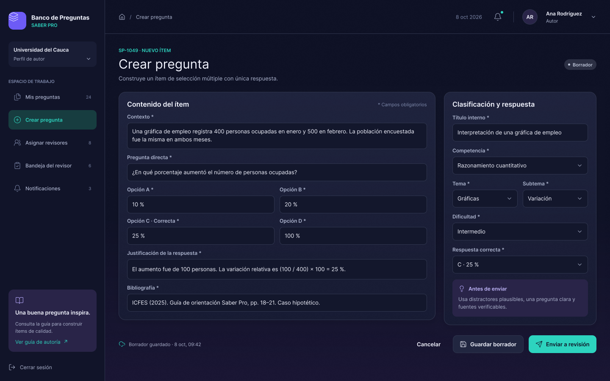

**Figura 1.** Prototipo de la pantalla "Crear pregunta" (HU-01).

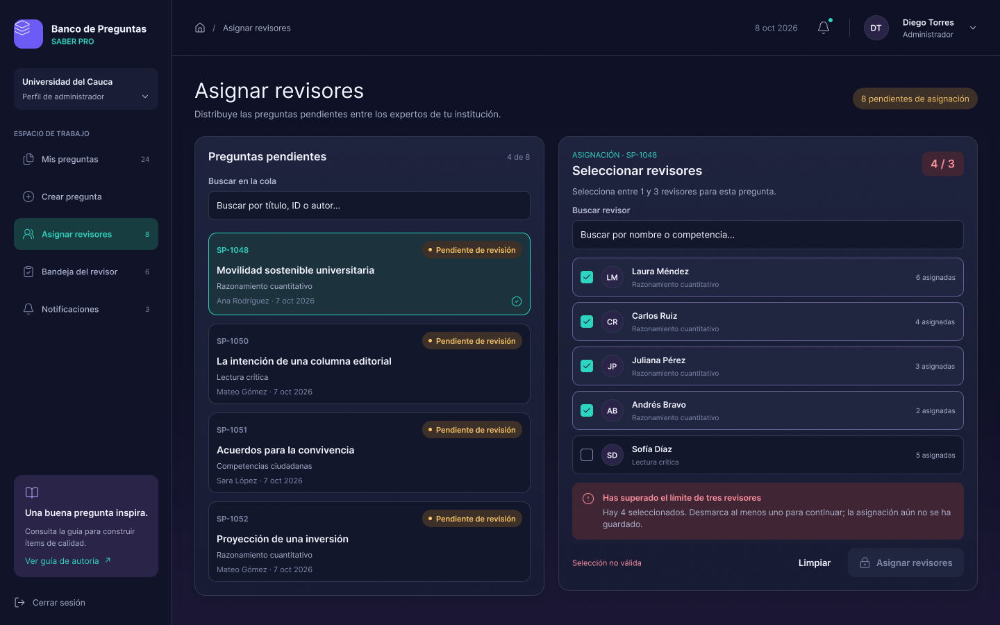

**Figura 2.** Prototipo de la pantalla "Asignar revisores" (HU-04). Con un cuarto revisor se muestra el error y el botón queda deshabilitado.

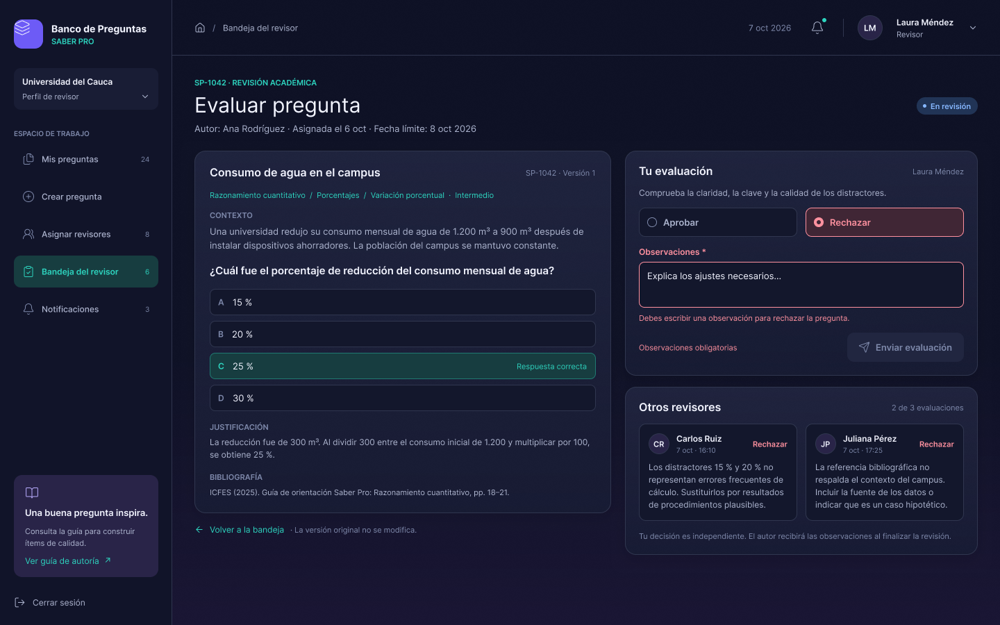

**Figura 3.** Prototipo de la pantalla "Evaluar pregunta" (HU-05).

Las pantallas están en `frontend/src/app/features`: `questions` (mis preguntas, formulario y detalle), `review` (asignar revisores, bandeja y
evaluar), `notifications`, `history` y `admin` (publicación y auditoría).

La prueba de usabilidad con usuarios no la pide el segundo corte; se hace en el tercero.

## 3. Planificación de tareas del Sprint 2

La planificación se lleva en Jira, en el tablero SCRUM Sprint 2: [abrir el tablero](https://dvlasz.atlassian.net/jira/software/projects/SCRUM/boards/1).

**Tabla 3.** Datos generales del Sprint 2.

| Dato | Valor |
|---|---|
| Sprint | SCRUM Sprint 2 |
| Inicio | 13 de octubre de 2026 |
| Fin | 30 de octubre de 2026 |
| Objetivo | Pasar el sistema a microservicios orientados a eventos con las cinco historias del segundo corte, el gateway, el frontend web y la prueba de escalabilidad |

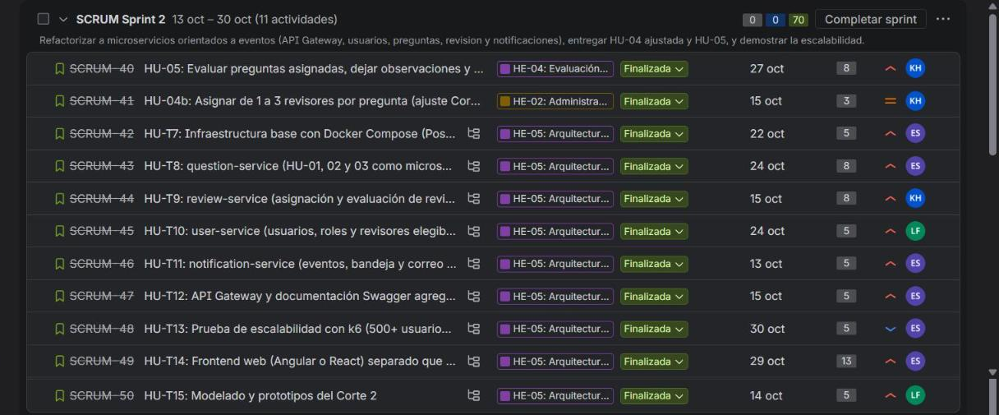

**Figura 4.** Backlog del Sprint 2 en Jira (al cerrar el sprint, 3 de noviembre de 2026).

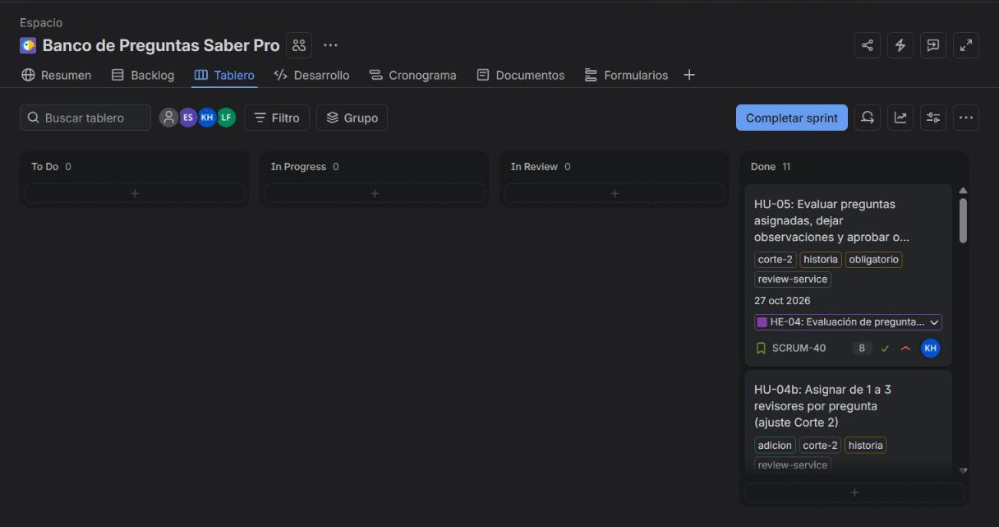

**Figura 5.** Tablero del Sprint 2 en Jira (al cerrar el sprint, 3 de noviembre de 2026).

El sprint reúne once historias de Jira y sus subtareas técnicas. Todo lo obligatorio del segundo corte tiene prioridad Alta; lo que no
pide el corte quedó en el backlog con prioridad Baja.

**Tabla 4.** Historias del Sprint 2 y su responsable.

| Clave | Historia | Prioridad | Responsable |
|---|---|---|---|
| SCRUM-40 | HU-05 Evaluar preguntas asignadas, dejar observaciones y aprobar o rechazar | Alta | Kevin |
| SCRUM-41 | HU-04b Asignar de 1 a 3 revisores por pregunta (ajuste del corte 2) | Media | Kevin |
| SCRUM-42 | HU-T7 Infraestructura base con Docker Compose | Alta | Edward |
| SCRUM-43 | HU-T8 `question-service` | Alta | Edward |
| SCRUM-44 | HU-T9 Revisión (`assignment-service` y `evaluation-service`) | Alta | Kevin |
| SCRUM-45 | HU-T10 `user-service` | Alta | Laura |
| SCRUM-46 | HU-T11 `notification-service` | Alta | Edward |
| SCRUM-47 | HU-T12 API Gateway y Swagger agregado | Alta | Edward |
| SCRUM-48 | HU-T13 Prueba de escalabilidad con k6 | Baja | Edward |
| SCRUM-49 | HU-T14 Frontend web separado | Alta | Edward |
| SCRUM-50 | HU-T15 Modelado y prototipos | Alta | Laura |

Cada integrante respondió por servicios completos, y su trabajo queda con su autoría en los commits y como asignación en Jira.

**Tabla 5.** Reparto del trabajo.

| Integrante | Responsabilidad |
|---|---|
| Edward Dávila | Infraestructura con Docker Compose, `question-service`, notificaciones, API Gateway, frontend web y prueba de escalabilidad |
| Kevin Castaño | Revisión (`assignment-service` y `evaluation-service`), `validation-service`, `history-service` y `audit-service` |
| Laura Sánchez | `user-service`, `lifecycle-service`, `email-service`, modelado y prototipos, y documentación de variables de entorno y arranque |

## 4. Atributos de calidad y escenario de escalabilidad

### 4.1 Atributos de calidad de la iteración

**Tabla 6.** Atributos de calidad relevantes de la iteración.

| Atributo | Por qué importa en el banco de preguntas | Cómo se atiende |
|---|---|---|
| **Escalabilidad** (principal) | Autores, revisores y administradores usan el sistema a la vez, y las consultas de listado pesan más que las escrituras | Servicios sin estado de sesión (el token es autocontenido), una base por servicio, trabajo lento (correo, trazabilidad) fuera de la petición por eventos, y réplicas que se registran solas en Eureka detrás del gateway |
| Modificabilidad | Las reglas de validación, los estados y las formas de avisar cambian con el uso | Servicios pequeños con una sola responsabilidad, interfaces entre la aplicación y la infraestructura, y patrones de diseño (sección 7) |

### 4.2 Escenario de calidad de escalabilidad

**Tabla 7.** Escenario de calidad de escalabilidad.

| Elemento | Contenido |
|---|---|
| Fuente | Autores, revisores y administradores usando el sistema al mismo tiempo |
| Estímulo | 600 usuarios concurrentes (60 % autores, 25 % revisores, 15 % administradores) consultando y escribiendo a través del gateway |
| Entorno | Operación normal bajo carga pico, sistema completo desplegado con Docker Compose en una sola máquina (16 CPU, 11,4 GB para Docker) |
| Artefacto | `edge`, `api-gateway` y los servicios de negocio |
| Respuesta | Se agregan réplicas del servicio saturado detrás del gateway sin modificar la lógica de negocio; las notificaciones y la trazabilidad se procesan de forma asíncrona y no bloquean al usuario |
| Medida | Tiempo de respuesta (p95), tasa de error y peticiones por segundo |
| Resultado esperado | Con 500 usuarios concurrentes, p95 de las consultas menor a 3 s (RNF-17) y error menor al 1 % |

### 4.3 La prueba

La prueba usa k6 (`microservicios/pruebas-de-carga/escalabilidad.js`) con tokens reales de Keycloak, que se piden una vez al inicio para medir
los servicios y no la pantalla de login. Cada usuario virtual sigue el recorrido de su rol: los autores listan sus preguntas, crean borradores y
consultan notificaciones; los revisores consultan su bandeja; los administradores consultan pendientes, todas las preguntas, revisores y auditoría.
Los umbrales son p95 menor a 1500 ms, error menor al 1 % y más del 99 % de las comprobaciones correctas.

**Tabla 8.** Resultados de la prueba de carga con 600 usuarios (26 de octubre de 2026, una réplica de cada servicio).

| Corrida | Pausa entre acciones | Peticiones | Peticiones por segundo | p95 | p99 | Error |
|---|---|---|---|---|---|---|
| Ritmo humano | 1 s | 33 204 | 223 | 30 ms | 69 ms | 0 % |
| Estrés | 0,05 s | 130 012 | 921 | 826 ms | 1,1 s | 0 % |

Con 600 usuarios a ritmo humano se supera con mucho el objetivo de 3 s. En la corrida de estrés la pausa es 20 veces menor y se cumplen
los tres umbrales. La salida completa de k6 está en [`04-escalabilidad.md`](04-escalabilidad.md).

Al medir se encontraron y se corrigieron cuatro problemas:

**Tabla 9.** Hallazgos de la prueba de carga y su corrección.

| Hallazgo | Causa | Corrección |
|---|---|---|
| Consultas de preguntas muy lentas con muchas filas | El filtro opcional con `OR ... IS NULL` impedía usar índices | Búsqueda dinámica con consulta construida según los filtros e índices `(autor, fecha, id)`, `(fecha, id)` y `(estado, fecha, id)` |
| El gateway rechazaba llamadas sanas con carga | El *bulkhead* por defecto admite 25 llamadas simultáneas | Tope de 1000 con espera máxima de 200 ms |
| Errores por agotamiento de puertos en `edge` | Una conexión nueva por petición hacia el gateway | Upstream con `keepalive` |
| `edge` descartaba réplicas sanas | Tomaba los `503` del circuit breaker como réplica caída | Solo `error` y `timeout` activan el reintento |

**Sobre las réplicas.** Se comprobó que agregar réplicas funciona: Eureka las descubre, el gateway las reparte y al detener una el sistema
sigue respondiendo sin errores. En esta máquina no mejora el rendimiento, porque todos los contenedores comparten los mismos 16 CPU: más
réplicas reparten el mismo cómputo y suman cambios de contexto. La escalabilidad horizontal rinde cuando cada réplica tiene recursos propios.
El diseño (servicios sin estado, una base por servicio, balanceo y descubrimiento) es el que hace posible ese escalado con más hardware.

## 5. Contextos delimitados y eventos

La guía propone ocho contextos como aproximación. Partimos de ellos y los dividimos hasta que cada servicio tuviera una sola responsabilidad y
fuera pequeño. Son diez servicios más el gateway.

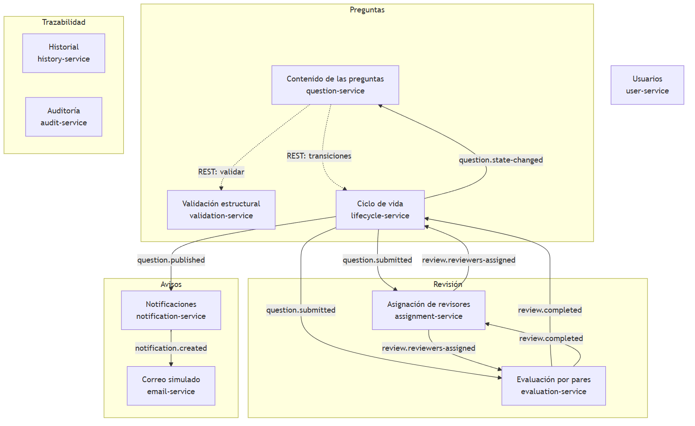

**Figura 6.** Diagrama de contextos delimitados y de los eventos entre ellos.

**Tabla 10.** Contextos y servicios.

| Contexto | Servicio | Alcance |
|---|---|---|
| Gestión de usuarios | `user-service` | Sincroniza los usuarios y roles de Keycloak y publica los eventos de acceso |
| Gestión de preguntas | `question-service` | HU-01 a HU-03: guardar, modificar, consultar y filtrar el contenido |
| Validación de preguntas | `validation-service` | Las reglas de calidad (validación estructural), sin estado |
| Ciclo de vida de preguntas | `lifecycle-service` | Estados, transiciones, historial de cambios y los eventos de la pregunta |
| Revisión por pares | `assignment-service` | HU-04: rondas, asignación de revisores y bandeja del revisor |
| Revisión por pares | `evaluation-service` | HU-05: evaluaciones, decisión por unanimidad y resultado |
| Avisos | `notification-service` | Bandeja de avisos de cada usuario |
| Avisos | `email-service` | El correo simulado de cada aviso, con reintentos y registro |
| Trazabilidad | `history-service` | Línea de tiempo de cada pregunta |
| Trazabilidad | `audit-service` | Auditoría de acciones e inicios de sesión |

Cada servicio tiene un solo motivo de cambio: la validación cambia cuando cambian los criterios de calidad; el ciclo de vida, cuando cambian los
estados; la asignación y la evaluación, cuando cambia cómo se reparte y cómo se decide la revisión; el correo, cuando cambia el canal de envío.

Dividir cuesta llamadas de red, y lo acotamos con eventos casi siempre. Las únicas llamadas REST síncronas son dos, y las dos pasan la identidad
de quien hizo la petición para que el servicio llamado vuelva a comprobar el rol:

**Tabla 11.** Llamadas síncronas entre servicios.

| Llamada | Por qué es síncrona |
|---|---|
| `question-service` a `validation-service` | El autor necesita saber ahora qué campos corregir; la respuesta decide si se guarda |
| `question-service` a `lifecycle-service` | Crear, enviar, reabrir y publicar deben cambiar el estado antes de contestarle al usuario |

Si uno de esos servicios no responde, la operación no se hace y se informa 503. La consulta de una pregunta sigue funcionando.

### 5.1 Eventos

Los servicios se comunican por RabbitMQ (exchange `bancopreguntas.events`, de tipo *topic*). Cada mensaje lleva un sobre común
`{eventId, type, occurredAt, data}` y un cuerpo pequeño con identificadores.

**Tabla 12.** Eventos, quién los publica y quién los consume.

| Evento | Lo publica | Lo consumen | Efecto |
|---|---|---|---|
| `question.submitted` | lifecycle-service | assignment, evaluation, notification, history, audit | Se abre el caso y la ronda de revisión pendiente de asignar |
| `question.reopened` | lifecycle-service | assignment, evaluation, history, audit | El autor corrige una pregunta rechazada: la ronda anterior se cierra |
| `question.state-changed` | lifecycle-service | question, history, audit | Traza del ciclo de vida; question-service actualiza su copia del estado |
| `question.published` | lifecycle-service | notification, history, audit | El administrador publica una pregunta aprobada; se avisa al autor |
| `review.reviewers-assigned` | assignment-service | evaluation, lifecycle, notification, history, audit | La pregunta pasa a "En revisión"; se registra a los revisores y se avisa |
| `review.evaluation-submitted` | evaluation-service | assignment, notification, history, audit | La bandeja del revisor lo marca como evaluado; se avisa al administrador |
| `review.completed` | evaluation-service | assignment, lifecycle, notification, history, audit | La pregunta pasa a Aprobada o Rechazada; se avisa al autor, al administrador y a los revisores |
| `notification.created` | notification-service | email | Se envía (de forma simulada) el correo del aviso |
| `auth.login-succeeded` y `auth.login-failed` | user-service | audit | Auditoría de inicios de sesión |

Los mensajes son persistentes y los consumidores son idempotentes: se ignora un `eventId` ya procesado. Los servicios que publican usan el
patrón Outbox, y un mensaje que falla tras cuatro reintentos va a la cola de mensajes muertos `bancopreguntas.dead-letter`. El esquema formal
de los eventos está en `docs/corte-2/api/eventos/eventos.schema.json`.

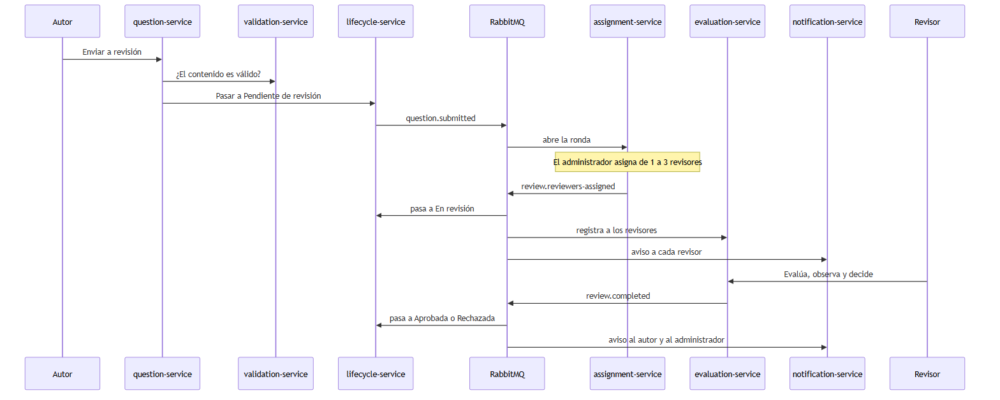

**Figura 7.** Flujo principal: del envío de una pregunta a la decisión de los revisores.

## 6. Arquitectura y diseño de software (modelo C4 y UML)

### 6.1 Estilo arquitectónico

Microservicios orientados a eventos con un API Gateway como único punto de entrada, una base de datos por servicio y un bus de mensajes.
El frontend y el backend están separados y se comunican solo por una API REST. La identidad la gestiona Keycloak y los servicios validan el
JWT que emite. Cada servicio se organiza por dentro en cuatro paquetes: `api`, `application`, `domain` e `infrastructure`. La capa de
aplicación declara interfaces (`application/port`) que la infraestructura implementa con JPA, RabbitMQ y clientes REST. Una prueba de
arquitectura con ArchUnit (`ArquitecturaTest`) hace fallar la compilación si el dominio depende de Spring, de JPA o de las otras capas.

### 6.2 C4 nivel 1: contexto

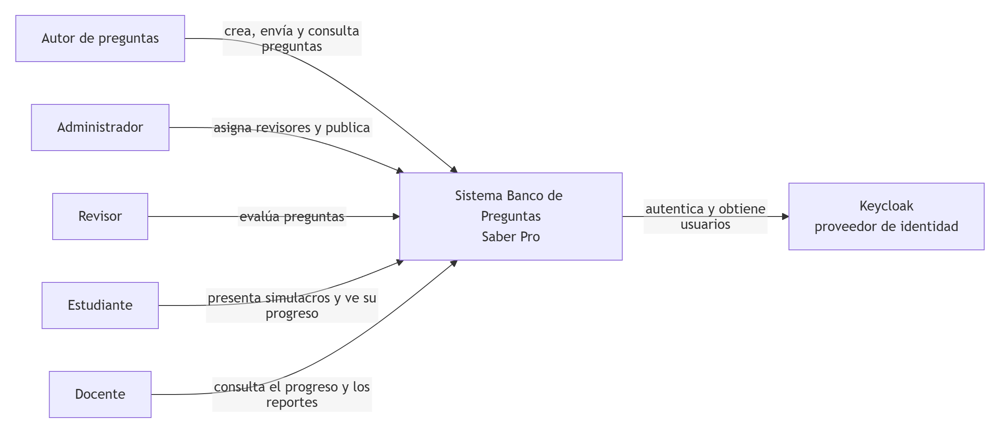

**Figura 8.** C4 nivel 1: el sistema, sus usuarios y el sistema externo de identidad.

El correo es simulado: el sistema deja el aviso en la bandeja de cada usuario y `email-service` registra el "envío". Por eso no aparece un
servidor de correo como sistema externo.

### 6.3 C4 nivel 2: contenedores

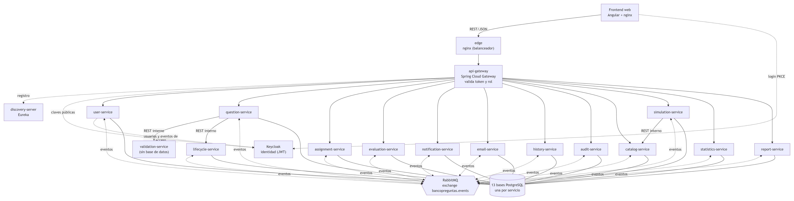

**Figura 9.** C4 nivel 2: contenedores del sistema.

**Tabla 13.** Contenedores y su responsabilidad.

| Contenedor | Responsabilidad | Puerto |
|---|---|---|
| frontend | Aplicación Angular servida por nginx | 4200 |
| edge | Balanceador nginx delante de las réplicas del gateway | 8080 |
| api-gateway | Enrutamiento por Eureka, validación del token, autorización por rol, circuit breaker y reintentos | interno |
| discovery-server | Registro de servicios (Eureka) | 8761 |
| keycloak | Proveedor de identidad: inicio de sesión, roles y token JWT | 8180 |
| user-service | Sincroniza usuarios y roles de Keycloak y publica los eventos de acceso | 8081 (solo depuración) |
| question-service | Contenido de las preguntas: crear, modificar, consultar y filtrar | 8082 (solo depuración) |
| assignment-service | Rondas de revisión, asignación de revisores y bandeja del revisor | 8083 (solo depuración) |
| notification-service | Crea los avisos de la bandeja y publica `notification.created` | 8084 (solo depuración) |
| history-service | Línea de tiempo de cada pregunta | 8085 (solo depuración) |
| email-service | Correo simulado de cada aviso, con reintentos y registro | 8090 (solo depuración) |
| audit-service | Auditoría de acciones e inicios de sesión | 8091 (solo depuración) |
| lifecycle-service | Estados de la pregunta, transiciones, historial y sus eventos (interno) | 8094 (solo depuración) |
| validation-service | Reglas de calidad del contenido (interno, sin estado) | 8095 (solo depuración) |
| evaluation-service | Evaluación de los revisores y decisión por unanimidad | 8096 (solo depuración) |
| RabbitMQ | Bus de eventos | 5672, panel 15672 |
| PostgreSQL (9 bases) | Una base por servicio, todos menos validation | 5433 a 5446 (solo depuración) |

### 6.4 C4 nivel 3: componentes

Los servicios siguen la misma organización interna. Se muestran los que tienen más lógica.

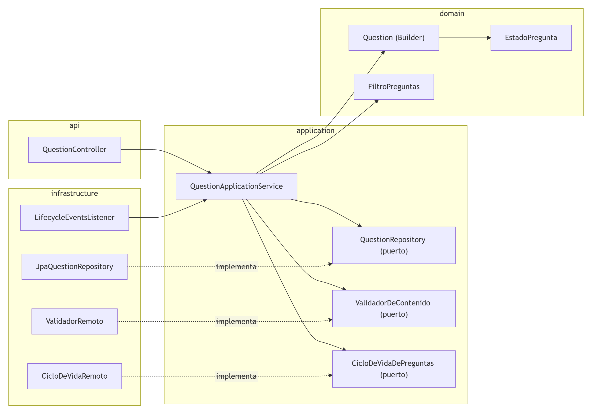

**Figura 10.** C4 nivel 3: `question-service`. El `Question` se arma con un Builder y consulta a validación y ciclo de vida por interfaces.

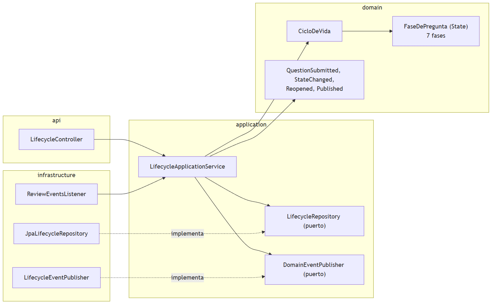

**Figura 11.** C4 nivel 3: `lifecycle-service`, dueño del estado de la pregunta (patrón State).

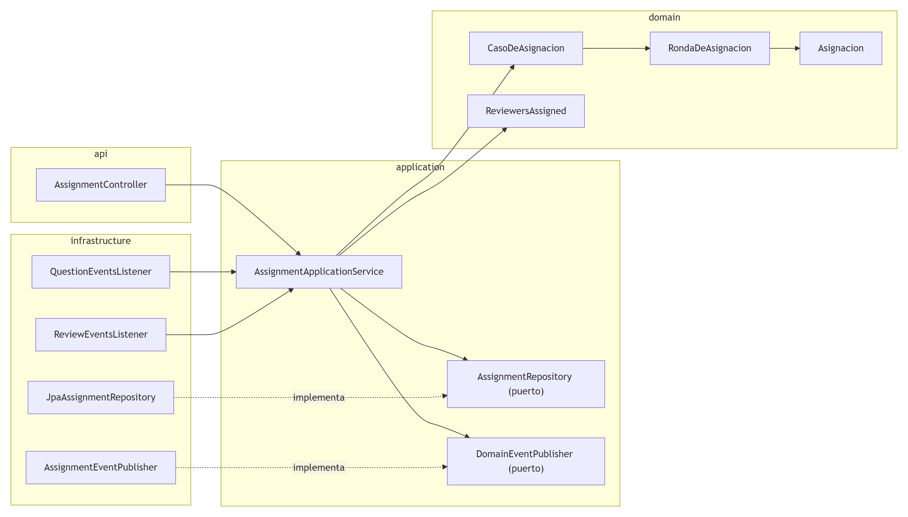

**Figura 12.** C4 nivel 3: `assignment-service`.

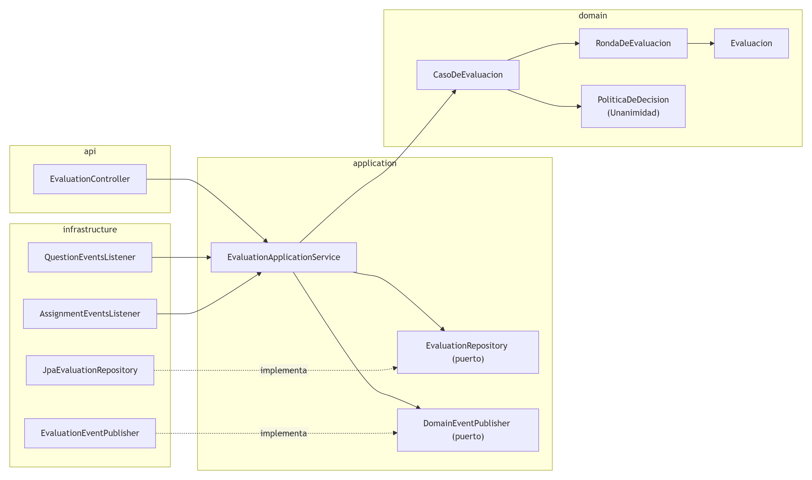

**Figura 13.** C4 nivel 3: `evaluation-service`, con la política de decisión por unanimidad.

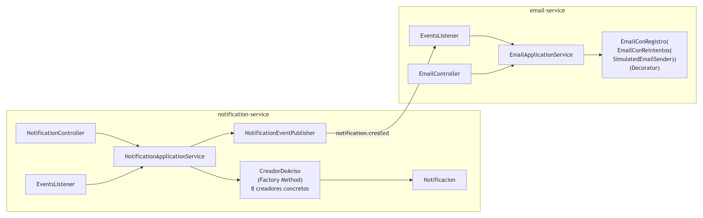

**Figura 14.** C4 nivel 3: `notification-service` y `email-service`.

### 6.5 UML: estados y secuencias

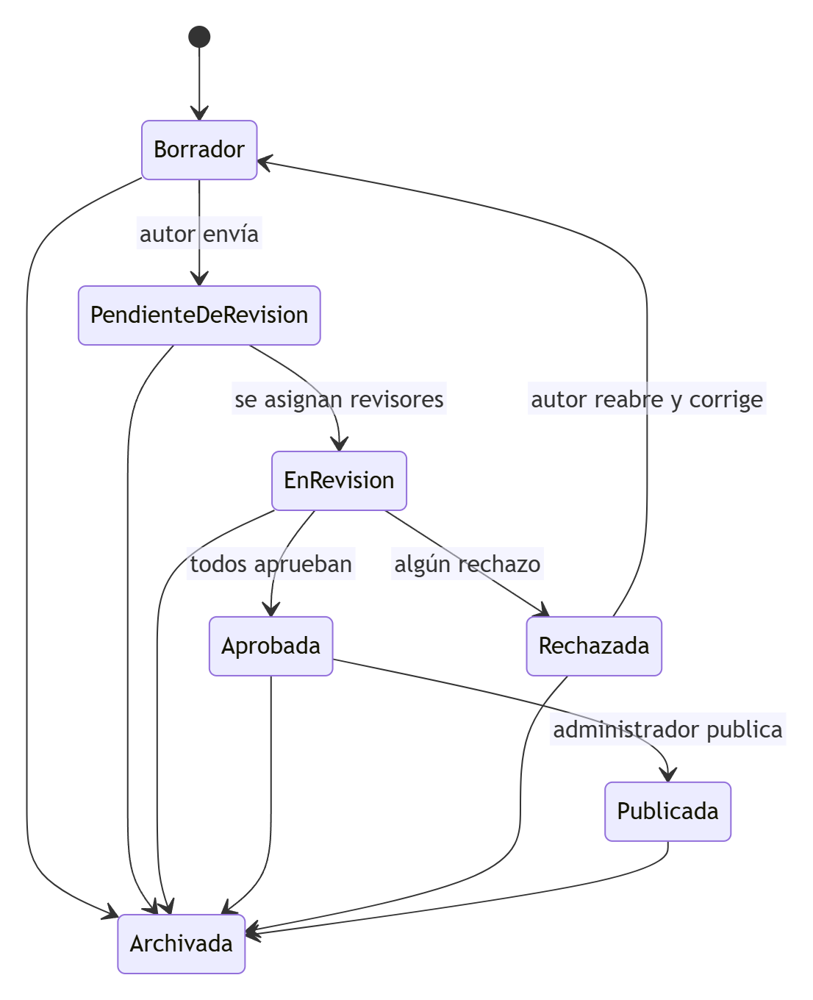

**Figura 15.** Máquina de estados de la pregunta (siete estados y sus transiciones válidas).

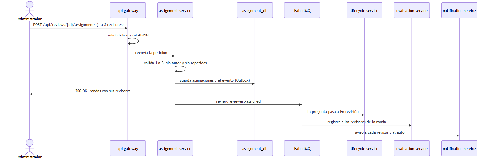

**Figura 16.** Secuencia de la HU-04: asignar revisores.

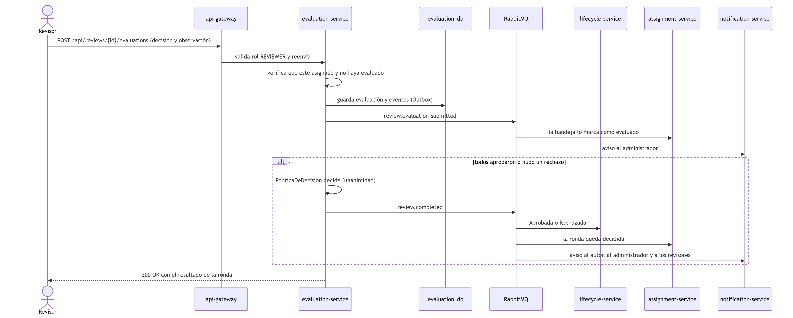

**Figura 17.** Secuencia de la HU-05: evaluar una pregunta.

El modelo de datos de cada servicio (un diagrama entidad-relación por base) está en [`03-arquitectura-c4-uml.md`](03-arquitectura-c4-uml.md).

### 6.6 Vista de ejecución

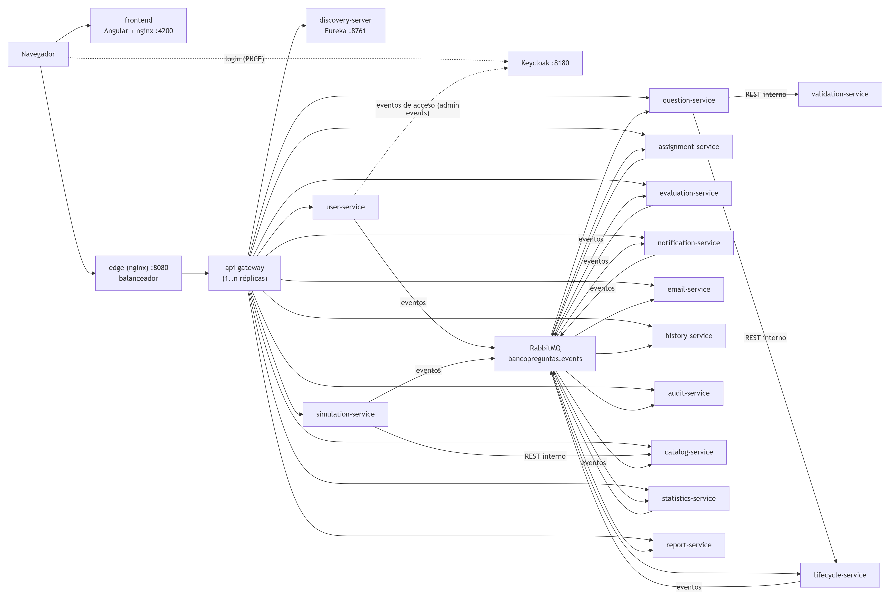

**Figura 18.** Despliegue con Docker Compose.

Todo se levanta con `docker compose up -d --build` desde `microservicios/`. Los servicios de negocio no publican puertos al exterior: se entra
solo por `edge` (puerto 8080) y por el frontend (puerto 4200). El archivo `docker-compose.debug.yml` publica los puertos de cada servicio
para depurar desde el IDE.

### 6.7 Tecnologías

Java 21 y Spring Boot 3.5 en todos los servicios; Spring Data JPA con PostgreSQL 16 y migraciones de Flyway; RabbitMQ 3.13; Spring Cloud
Gateway y Eureka; Keycloak para la identidad; Angular y nginx en el frontend; Docker y Docker Compose para el despliegue; JUnit 5, Mockito,
ArchUnit, Postman y k6 para las pruebas.

## 7. Patrones de diseño, principios SOLID y decisiones de diseño

### 7.1 Patrones de diseño implementados

La rúbrica pide al menos seis patrones GoF: dos creacionales, dos estructurales y dos de comportamiento. Implementamos nueve. Cada fila dice
en qué clases está y en qué servicio.

**Tabla 14.** Patrones de diseño implementados.

| Tipo | Patrón | Clases | Servicio |
|---|---|---|---|
| Creacional | Builder | `Question.Builder` | `question-service` |
| Creacional | Factory Method | `CreadorDeAviso` y sus ocho subclases (`AvisoRevisoresAsignados`, `AvisoPreguntaEnRevision`, `AvisoEvaluacionRecibida`, `AvisoRevisionAprobada`, `AvisoRevisionRechazada`, `AvisoResultadoDeRevision`, `AvisoObservacionTardia`, `AvisoPreguntaPublicada`); registro en `CreadoresDeAviso` | `notification-service` |
| Estructural | Adapter | Interfaces en `application/port` (`QuestionRepository`, `EmailSender`, `DomainEventPublisher`, `ValidadorDeContenido`) y sus adaptadores (`JpaQuestionRepository`, `SimulatedEmailSender`, `LifecycleEventPublisher`, `ValidadorRemoto`, `CicloDeVidaRemoto`) | todos |
| Estructural | Facade | `api-gateway` (Spring Cloud Gateway), con `GatewayRoutesConfig` y `RoleRules` | `api-gateway` |
| Estructural | Decorator | `EmailConReintentos` y `EmailConRegistro` decoran el puerto `EmailSender` | `email-service` |
| Comportamiento | Strategy | `PoliticaDeDecision` con la estrategia `Unanimidad` | `evaluation-service` |
| Comportamiento | State | `FaseDePregunta` y sus siete fases (`FaseBorrador`, `FasePendienteDeRevision`, `FaseEnRevision`, `FaseAprobada`, `FaseRechazada`, `FasePublicada`, `FaseArchivada`) | `lifecycle-service` |
| Comportamiento | Template Method | `ReglaPorOpcion.validar` y las reglas que la extienden | `validation-service` |
| Comportamiento | Observer | Eventos por RabbitMQ: los servicios publican (`LifecycleEventPublisher`, `AssignmentEventPublisher`, `EvaluationEventPublisher`) y los demás se suscriben con `@RabbitListener` | todos |

**Builder.** Una pregunta tiene más de quince campos. Un constructor con tantos parámetros es ilegible y se presta a errores. `Question.builder()`
arma el objeto campo por campo y valida al construir. `Question` es inmutable: cada cambio de estado devuelve una instancia nueva.
Pruebas: `QuestionTest`, `QuestionEstadoTest`.

**Factory Method.** Cada evento produce un aviso distinto, con su asunto y su cuerpo. Un `if` por tipo dentro del servicio obligaba a conocer todos los
textos. `CreadorDeAviso.crear` arma la notificación y declara el método fábrica `crearMensaje`, que cada subclase implementa. El servicio de
aplicación no conoce ninguna clase concreta. Para un tipo nuevo hace falta una subclase, un valor en `TipoNotificacion` y su registro. Prueba:
`CreadoresDeAvisoTest`, con una comprobación por cada tipo.

**Adapter.** El dominio y los casos de uso no deben depender de PostgreSQL, de RabbitMQ ni del servidor de correo. Cada servicio declara
interfaces en `application/port` y las adapta en `infrastructure`. Si el correo fuera real, solo cambiaría el adaptador. Pruebas: persistencia
sobre PostgreSQL embebido, mensajería y `ArquitecturaTest`.

**Facade.** El frontend no debe conocer diez servicios, sus direcciones ni sus réplicas. El gateway expone una sola interfaz bajo `/api`,
resuelve los servicios por Eureka, valida el JWT, aplica la tabla de roles y protege con circuit breaker, reintentos y bulkhead. Prueba:
`ApiGatewayTest`.

**Decorator.** Un servidor de correo real falla de vez en cuando y conviene dejar constancia de cada envío, pero eso no es tarea del caso de uso.
`EmailConReintentos` repite el envío hasta tres veces y `EmailConRegistro` cuenta los envíos correctos y fallidos. Ambos implementan `EmailSender`
y envuelven a otro `EmailSender`; se apilan en `ApplicationConfig`. Prueba: `DecoradoresDeCorreoTest`.

**Strategy.** Hoy una pregunta se aprueba por unanimidad; mañana podría pedirse mayoría. `PoliticaDeDecision.decidir` es la interfaz y `Unanimidad`
la estrategia vigente. `CasoDeEvaluacion` usa la interfaz, no la clase. Pruebas: `UnanimidadTest` y las de `CasoDeEvaluacion`.

**State.** Lo que se puede hacer con una pregunta depende de su estado: solo el borrador se modifica y se envía, solo la aprobada se publica, solo
la rechazada se reabre. Esas reglas estaban repartidas en condicionales. Ahora cada estado es una clase que implementa solo las operaciones que
admite y devuelve el estado siguiente; las demás lanzan `OperacionNoPermitidaException`. Para un estado nuevo hace falta una clase y una línea en
`FaseDePregunta.de`. Prueba: `FaseDePreguntaTest`.

**Template Method.** Dos reglas de validación recorrían las cuatro opciones con el mismo esqueleto y solo cambiaba lo que se comprueba en cada
una. `ReglaPorOpcion.validar` es el método plantilla (`final`): recorre las opciones A a D, omite las que descarta el gancho `omitir` y llama al
paso abstracto `evaluar`, que implementa cada regla. Prueba: `ReglaPorOpcionTest`.

**Observer.** `lifecycle-service` no debe llamar a revisión, notificaciones e historial cada vez que cambia una pregunta. Publica un evento y cada
interesado tiene su cola y su `@RabbitListener`. Agregar un observador nuevo, como `audit-service`, no cambia al publicador. Pruebas: los
`EventsListenerTest` de cada servicio y las de Outbox de `bp-platform`.

**Tabla 15.** Cobertura de la rúbrica.

| Categoría | Mínimo | Implementados |
|---|---|---|
| Creacionales | 2 | Builder, Factory Method |
| Estructurales | 2 | Adapter, Facade, Decorator |
| Comportamiento | 2 | Strategy, Observer, State, Template Method |

### 7.2 Principios SOLID

**Tabla 16.** Aplicación de los principios SOLID.

| Principio | Cómo se aplica |
|---|---|
| **S** · Responsabilidad única | Cada regla de validación es una clase y `QuestionValidator` solo reúne las violaciones. `EstadoPregunta` identifica el estado y cada clase de fase conoce solo lo que se puede hacer en él. Los servicios de aplicación orquestan casos de uso y no tocan HTTP, SQL ni RabbitMQ; los controladores solo traducen HTTP |
| **O** · Abierto/cerrado | Una regla de validación nueva es una clase que implementa `ValidationRule`. Un tipo de aviso nuevo es una subclase de `CreadorDeAviso`. Una forma distinta de decidir una ronda es otra `PoliticaDeDecision`. Un estado nuevo es otra `FaseDePregunta`. Una ruta protegida nueva es una línea en `RoleRules`. En ningún caso se toca el código que ya existe |
| **L** · Sustitución de Liskov | `Unanimidad` cumple el contrato de `PoliticaDeDecision`; los creadores de aviso se prueban todos a través de la clase base con el mismo contrato; `SimulatedEmailSender` y el doble `RecordingEmailSender` sustituyen a cualquier `EmailSender` |
| **I** · Segregación de interfaces | Las interfaces son pequeñas: `EmailSender` tiene un solo método, `ProcessedEvents` solo `registrarSiEsNuevo`, y `QuestionInfoRepository` está separada de `NotificationRepository` |
| **D** · Inversión de dependencias | Los casos de uso reciben sus interfaces, el reloj y el generador de identificadores por constructor, y `ApplicationConfig` los arma con los adaptadores. Por eso las pruebas usan dobles en memoria y reloj manual. `ArquitecturaTest` falla si el dominio depende de Spring, JPA o de otras capas |

### 7.3 Decisiones de diseño

**Tabla 17.** Decisiones de arquitectura y su motivo.

| # | Decisión | Motivo |
|---|---|---|
| D1 | Microservicios orientados a eventos con un gateway | La guía pide una solución distribuida que crezca por partes. Cada contexto cambia y escala por separado y la comunicación por eventos desacopla a quien produce de quien consume |
| D2 | Diez servicios pequeños, una responsabilidad cada uno | Se entienden enteros, se prueban y se reemplazan por separado; una caída del correo o de la auditoría no afecta el flujo principal |
| D3 | Solo dos llamadas síncronas (`question` a `validation` y a `lifecycle`) | El usuario espera esa respuesta. Las demás interacciones son por eventos |
| D4 | Una base PostgreSQL por servicio | Ningún servicio lee las tablas de otro, y así baja el acoplamiento |
| D5 | Patrón Outbox y consumidores idempotentes | Publicar tras el commit puede perder el evento si RabbitMQ está caído. El Outbox lo guarda en la misma transacción |
| D6 | Un solo rechazo cierra la ronda | Lo confirmó el docente. Las observaciones que lleguen después se guardan como tardías |
| D7 | Rondas por versión de la pregunta | Al corregir y reenviar se abre una ronda nueva con los mismos revisores y se conserva el historial |
| D8 | Correo simulado detrás de `EmailSender` | Lo recomendó el docente para no arriesgar cuentas de correo reales. Cambiar a SMTP real solo requiere otro adaptador |
| D9 | Máximo de revisores configurable (3 por defecto) | Los docentes piden 1 a 3 y aceptan más |
| D10 | `question-service` guarda una copia del estado con una secuencia y `lifecycle-service` es el dueño | Se puede listar y filtrar por estado sin llamar a otro servicio. La secuencia evita que un aviso atrasado haga retroceder la copia |
| D11 | Sin borrado físico (RNF-16) | Mantiene la trazabilidad: todo cambio de estado queda en el historial |
| D12 | Los eventos no cambiaron al dividir los servicios, solo ganaron campos | Los consumidores existentes siguen funcionando |

El detalle de cada decisión, las alternativas descartadas y los costos está en [`10-decisiones-y-solid.md`](10-decisiones-y-solid.md).

## 8. Seguridad y resiliencia

**Seguridad.** Keycloak autentica con OAuth2 y PKCE y entrega un JWT. El gateway valida el token y aplica la tabla de roles (`RoleRules`), y cada
servicio vuelve a validarlo y a exigir el rol, de modo que un error en una barrera no abre la operación. Los roles de esta iteración son `ADMIN`, `AUTHOR` y
`REVIEWER`; el realm también trae usuarios Docente y Estudiante, que se usan en el tercer corte. El gateway elimina las cabeceras `X-User-Id` y `X-User-Roles` de lo que llega de fuera para que nadie suplante a otro usuario. Las
contraseñas las guarda Keycloak con hash; los servicios no guardan ninguna. Los usuarios son los que importa el realm de prueba
(`microservicios/infraestructura/keycloak`) y solo sirven en el entorno local.

**Resiliencia.** El gateway tiene circuit breaker, reintentos de las consultas y un tope de llamadas simultáneas por servicio: si un servicio
no responde, contesta 503 de inmediato en lugar de dejar esperando al usuario. Los eventos se publican con el patrón Outbox, y un mensaje
que falla tras cuatro reintentos va a `bancopreguntas.dead-letter`. Se verificó a mano que detener RabbitMQ no impide guardar ni enviar a
revisión, y que detener una réplica no interrumpe el servicio.

El detalle está en [`08-implementacion-seguridad-y-resiliencia.md`](08-implementacion-seguridad-y-resiliencia.md).

## 9. Pruebas unitarias y organización del repositorio

### 9.1 Pruebas unitarias automatizadas

Hay pruebas para las entidades y los servicios del dominio de cada módulo, para los controladores, para la persistencia sobre PostgreSQL
embebido, para la mensajería y para las reglas de arquitectura. Se ejecutan con JUnit 5, Mockito y ArchUnit, sin Docker:

```bash
cd microservicios
./mvnw test
```

**Tabla 18.** Pruebas automatizadas por módulo.

| Módulo | Pruebas | Qué cubren |
|---|---|---|
| `bp-platform` | 70 | JWT y roles, anti-suplantación, propagación de la identidad, sobre de eventos, Outbox sobre PostgreSQL real, errores |
| `question-service` | 141 | `Question` y su Builder, filtros y paginación, casos de uso con dobles, clientes REST, API, persistencia, escucha de eventos |
| `validation-service` | 53 | Las siete reglas de validación, `QuestionValidator`, `ReglaPorOpcion`, API |
| `lifecycle-service` | 99 | Estados y fases (State), casos de uso, idempotencia, API, persistencia, publicador de eventos |
| `assignment-service` | 96 | Rondas, asignación, reasignación automática, bandeja del revisor, API, persistencia, escucha de eventos |
| `evaluation-service` | 107 | Evaluar, rondas, `Unanimidad`, concurrencia de revisores, API, persistencia, mensajería |
| `notification-service` | 85 | Factory Method de avisos, quién recibe qué, idempotencia, publicación de `notification.created`, API |
| `email-service` | 38 | Reintentos y registro (Decorator), casos de uso, API, persistencia, escucha de eventos |
| `history-service` | 54 | Entradas de historial, visibilidad por rol, API, persistencia, escucha de eventos |
| `audit-service` | 38 | Entradas de auditoría, filtros, API, persistencia, escucha de eventos |
| `user-service` | 62 | Perfiles, sincronización con Keycloak (simulado), eventos de acceso, API, persistencia |
| `api-gateway` | 25 | Rutas, 401 y 403 por rol, anti-suplantación, circuit breaker, CORS |
| `frontend` (Vitest) | 166 | Formularios y validación, listados, detalle, evaluación, selector de revisores, notificaciones, guardias de ruta |

Cada prueba sigue el estilo Given/When/Then y tiene un nombre que describe el comportamiento. Los servicios se prueban con dobles de sus
dependencias y reloj manual; los controladores, con MockMvc; la persistencia, con PostgreSQL embebido. `ArquitecturaTest` vigila las capas.
El plan de pruebas completo está en [`anexos/plan-de-pruebas.md`](anexos/plan-de-pruebas.md).

Verificación con la pila completa en Docker (26 de octubre de 2026): el recorrido funcional pasó con 71 comprobaciones y 0 fallos, las
7 colecciones de Postman con 107 peticiones y 172 verificaciones sin fallos, y k6 con 600 usuarios cumplió los tres umbrales.

### 9.2 Organización del repositorio

```text
banco-preguntas-saberpro/
├── README.md                 Descripción del proyecto
├── docs/                     Documentación (general, corte-1, corte-2, corte-3)
├── monolito/                 Primer corte (también en la rama corte-1)
├── frontend/                 Angular
└── microservicios/
    ├── plataforma/bp-platform/   Biblioteca común (seguridad, eventos, Outbox, errores)
    ├── servicios/                Los servicios de negocio, uno por carpeta
    ├── infraestructura/          api-gateway, discovery-server, edge (nginx) y keycloak
    ├── pruebas-de-carga/         k6
    ├── pruebas-funcionales/      Recorrido de las historias contra Docker
    ├── docker-compose.yml        Toda la pila con un comando
    └── .env.example              Variables de entorno de desarrollo
```

Cada servicio tiene su `pom.xml`, su `Dockerfile` y los paquetes `api`, `application`, `domain` e `infrastructure`. Las ramas son `main`
(la entrega), `corte-1` (el monolito congelado) y `corte-2` (el trabajo de esta iteración).

### 9.3 Trabajo en equipo

El tablero con las historias, sus criterios y sus subtareas está en Jira (Sprint 2). Cada integrante trabaja con su propia identidad de Git, así que
cada commit queda a nombre de quien lo hizo. Los mensajes de commit describen el cambio en una línea.

## 10. Cómo ejecutar el sistema

Requisitos: JDK 21, Docker Desktop y Python 3 (solo para el recorrido funcional).

```bash
cd microservicios
docker compose up -d --build          # espera a que todos los contenedores estén healthy
python pruebas-funcionales/recorrido_funcional.py
```

Direcciones: la aplicación en `http://localhost:4200`, el Swagger de todos los servicios en `http://localhost:8080/swagger-ui.html`, el panel de
RabbitMQ en `http://localhost:15672` y Keycloak en `http://localhost:8180`. Los usuarios de demostración (`admin`, `autor1`, `autor2`,
`revisor1` a `revisor5`) y su clave están en el realm de prueba (`microservicios/infraestructura/keycloak/README.md`).

## 11. Enlaces

**Tabla 19.** Enlaces del proyecto.

| Recurso | URL |
|---|---|
| Video de sustentación (YouTube) | [https://youtu.be/I4QajDGMzMU](https://youtu.be/I4QajDGMzMU) |
| Repositorio Git del proyecto | [https://github.com/DVLASZ/banco-preguntas-saberpro](https://github.com/DVLASZ/banco-preguntas-saberpro) |
| Tablero de Jira (Sprint 2) | [https://dvlasz.atlassian.net/jira/software/projects/SCRUM/boards/1](https://dvlasz.atlassian.net/jira/software/projects/SCRUM/boards/1) |
| Prototipos en Figma | [Banco de Preguntas Saber Pro - Prototipos](https://www.figma.com/design/kk6g0a8B4gv7wqCsYRb4Xd/Banco-de-Preguntas-Saber-Pro---Prototipos?node-id=165-2) |
