# Documento de arquitectura

## Introducción

Este documento reúne la arquitectura y el diseño del Sistema de Banco de Preguntas Saber Pro en sus tres iteraciones. En la primera era una
aplicación de escritorio en Java con Swing, organizada en módulos Maven. En la segunda la rehicimos como microservicios con Spring Boot, comunicados
por REST y por eventos de RabbitMQ, detrás de un API Gateway, con Keycloak para la identidad y un frontend web en Angular. En la tercera agregamos la
historia del historial de revisiones, aplicamos arquitectura hexagonal con DDD en evaluation-service, sumamos los simulacros y el seguimiento de los
estudiantes (con los roles de estudiante y docente) y llevamos todo a contenedores con Docker Compose.

Al final son doce servicios de negocio, más el API Gateway, el servidor de descubrimiento, Keycloak, RabbitMQ y una base PostgreSQL por servicio, en 29
contenedores que se levantan con un solo comando.

El documento sigue el orden de la guía de entrega: las historias de usuario con sus criterios de las tres iteraciones, la planificación de los Sprint 1, 2
y 3 en Jira, los escenarios de calidad de modificabilidad y escalabilidad, la arquitectura con el modelo C4 y la seguridad a la vista, la evidencia de
Docker Compose con volúmenes, los patrones de diseño y la dirección del repositorio. Las pruebas y la manera en que el trabajo queda registrado en Git y
en Jira van en secciones aparte, porque las pidió el docente al revisar el avance.

## 1. Historias de usuario de las tres iteraciones

Cada iteración trabaja los requisitos funcionales de alto valor de su corte. Las historias de usuario (HU) tienen su criterio de aceptación y su lugar en
el tablero de Jira. Una pregunta lleva siempre nombre, contexto, pregunta directa, cuatro opciones (A a D) de las que una es la correcta, justificación,
bibliografía, competencia, tema, subtema y nivel de dificultad.

**Tabla 1.** Historias de usuario por iteración.

| Iteración | Historia | Rol | Qué pide |
|---|---|---|---|
| 1 | HU-01 Crear pregunta | Autor | Pregunta de selección múltiple con única respuesta y validación estructural |
| 1 | HU-02 Enviar a revisión | Autor | Pasar de Borrador a Pendiente de revisión, con estados de colores |
| 1 | HU-03 Listar preguntas | Autor | Listado propio con paginación y filtros |
| 1 | HU-04 Asignar revisores | Administrador | Asignar revisores a las preguntas pendientes |
| 2 | HU-04 ajustada | Administrador | De 1 a 3 revisores, con aviso por correo a los implicados |
| 2 | HU-05 Evaluar preguntas | Revisor | Listar lo asignado, evaluar, dejar observaciones y aprobar o rechazar |
| 3 | HU-06 Historial de revisiones | Autor | Ver rondas y observaciones, corregir y reenviar |
| 3 | Simulacros y seguimiento | Estudiante y docente | Simulacros al azar con tiempo, calificación, historial, estadísticas y reporte del grupo |

### 1.1 Primera iteración
#### HU-01: Crear pregunta de selección múltiple

Como autor de preguntas quiero crear una pregunta de selección múltiple con
única respuesta para alimentar el banco de preguntas Saber Pro.

Criterios de aceptación

1. Con todos los campos obligatorios diligenciados (contexto, pregunta, opciones,
   respuesta correcta, justificación, competencia, tema, nivel) y clic en Guardar,
   la pregunta queda en "Borrador" con mensaje de confirmación.
2. Si falta un campo obligatorio, se resaltan los campos vacíos.
3. Si no cumple una regla estructural (sin contexto, sin las cuatro opciones, más de
   una respuesta marcada, o usa "todas/ninguna de las anteriores"), no se guarda y se
   muestra el error.
4. Al cancelar se pide confirmación antes de descartar lo escrito.

Reglas de validación estructural (RF-08 a RF-13). Cada una es una clase
independiente (ValidationRule) y el QuestionValidator las ejecuta todas para
mostrarle al autor lo que debe corregir de una sola vez:

**Tabla 2.** HU-01: Crear pregunta de selección múltiple.

| Regla | Requisito | Clase |
|---|---|---|
| Campos obligatorios | HU-01 | CamposObligatoriosRule |
| Debe haber contexto | RF-08 | ContextoObligatorioRule |
| Una única pregunta directa (un solo signo de interrogación) | RF-09 | PreguntaDirectaUnicaRule |
| Las cuatro opciones, no vacías ni repetidas | RF-10 | CuatroOpcionesRule |
| Una única respuesta correcta (A, B, C o D) | RF-11 | RespuestaCorrectaUnicaRule |
| Sin "todas las anteriores" ni "ninguna de las anteriores" | RF-12 | ExpresionesProhibidasRule |
| Longitud (3 a 250 caracteres) y estructura de las opciones | RF-13 | LongitudYEstructuraOpcionesRule |

#### HU-02: Cambiar el estado de "Borrador" a "Pendiente de revisión"

Como autor de preguntas quiero cambiar el estado de mis preguntas a
"Pendiente de revisión" para que el administrador asigne un revisor.

Criterios de aceptación

1. Si la pregunta está en "Borrador" y pasa la validación estructural, al hacer clic
   en Enviar a revisión el estado cambia a "Pendiente de revisión" (color amarillo en
   el listado).
2. Si la pregunta no pasa la validación estructural, no se cambia el estado y se
   indica al autor qué corregir.
3. Antes de aplicar el cambio aparece un diálogo de confirmación.
4. Al cancelar el diálogo, la pregunta sigue en "Borrador".

Los estados se muestran con color en todo el sistema: Borrador (gris), Pendiente de
revisión (amarillo), En revisión (azul), Aprobada (verde azulado), Rechazada (rojo),
Publicada (verde) y Archivada (pizarra). Las transiciones válidas entre estados
están definidas en EstadoPregunta.puedePasarA (RF-14 y RF-15).

#### HU-03: Listar preguntas creadas

Como autor de preguntas quiero ver el listado de las preguntas que he creado
para poder verlas o editarlas más adelante.

Criterios de aceptación

1. Con al menos una pregunta creada, al entrar a "Mis preguntas" se muestra la tabla
   paginada de a 10 (también se puede ver de a 5 o de a 20).
2. Al seleccionar estado y/o competencia, o escribir un texto (nombre, tema, subtema o
   pregunta), y dar clic en Buscar, la tabla se actualiza según los filtros.
3. Si los filtros no coinciden con ninguna pregunta, se muestra "No se encontraron
   preguntas" y la opción de limpiar filtros.
4. Solo se puede editar una pregunta si está en "Borrador"; en otros estados solo se
   puede ver.

#### HU-04: Asignar revisor a preguntas pendientes de revisión

Como administrador quiero asignar al menos un revisor a una pregunta
"Pendiente de revisión" para que otro docente la revise. Una vez asignados los
revisores, el sistema envía un correo para notificarlos (simulado).

Criterios de aceptación

1. Al entrar a "Asignación de Revisores" se muestran las preguntas "Pendiente de
   revisión" con su autor.
2. Con una pregunta y al menos un revisor seleccionado, al hacer clic en Asignar se
   guarda el revisor, la pregunta pasa a "En revisión" y se notifica (simulado).
3. Si no se marcó ningún revisor, se muestra el mensaje "Debe seleccionar al menos un
   revisor".
4. El autor de la pregunta no se ofrece como revisor (no aparece en la lista de
   revisores disponibles).

### 1.2 Segunda iteración

En la segunda iteración la HU-01 a la HU-03 se migran a question-service sin cambiar sus criterios. La HU-04 se ajusta y aparece la HU-05.
#### HU-04 · Asignar revisores (ajustada)

Como administrador quiero asignar entre 1 y 3 revisores a las preguntas en estado "Pendiente de revisión",
para que otros docentes las revisen.

1. Solo se listan las preguntas en estado "Pendiente de revisión".
2. Se pueden asignar mínimo 1 y máximo 3 revisores; con 0 o más de 3 no se guarda y se muestra el motivo.
3. El autor de la pregunta nunca aparece entre los revisores disponibles y no se repite un revisor.
4. Al asignar, la pregunta pasa automáticamente a "En revisión".
5. Cada revisor asignado recibe una notificación en su bandeja y un correo (simulado), y el autor recibe el
   aviso de que su pregunta entró en revisión.

#### HU-05 · Evaluar preguntas asignadas (nueva)

Como revisor quiero listar las preguntas que me asignó el administrador para leerlas, dejar la evaluación
y cambiar el estado a Aprobada o Rechazada.

1. El revisor ve solo las preguntas que tiene asignadas y pendientes de evaluar.
2. Puede abrir una pregunta, leerla completa y registrar su evaluación: decisión (aprobar o rechazar) y
   observaciones.
3. Las observaciones de todos los revisores de la misma pregunta son visibles entre ellos, para llegar a
   un consenso. No hay puntaje rígido; se aplica el criterio libre del comité.
4. La pregunta se aprueba solo si todos los revisores asignados aprueban (unanimidad). Con un solo
   rechazo la ronda se cierra y la pregunta queda en estado Rechazada (decisión de los docentes, consulta 29); las
   observaciones que lleguen después se guardan marcadas como tardías.
5. El autor puede leer las observaciones de los revisores en el detalle de su pregunta.
6. Se notifica a los implicados (bandeja y correo simulado): al revisor, su asignación; al administrador que
   asignó, cada evaluación recibida; al autor, el resultado con las observaciones; y al administrador y a los
   revisores que evaluaron, el resultado de la revisión. Detalle en
   [notificaciones y correos](../corte-2/anexos/notificaciones-y-correos.md).
7. Una vez enviada, la evaluación queda en el historial y no se borra físicamente.

### 1.3 Tercera iteración

La HU-06 es la historia nueva del tercer corte. Los criterios son estos:

1. El autor ve las rondas de revisión de su pregunta, con la decisión y las observaciones de cada revisor.
2. Ve la línea de tiempo de la pregunta: envíos, reaperturas, asignaciones, evaluaciones, resultados y publicación.
3. Una pregunta rechazada se puede reabrir: vuelve a Borrador como una versión nueva, se corrige y se envía de nuevo, lo que abre una ronda nueva con
   los mismos revisores.
4. Recibe una notificación por cada cambio relevante: resultado, observación tardía y publicación.
5. Nada se borra: cada ronda y cada evaluación quedan en el historial.

Los criterios de HU-06 los comprueba el recorrido funcional con tokens reales (sección 5.3). Junto con HU-06, esta iteración trae los simulacros y el
seguimiento académico, que los docentes ubicaron en el tercer corte aunque los entregables no los listan como requisito. Están en simulation-service y
tracking-service y cubren los requisitos RF-21 a RF-28:

**Tabla 3.** Del documento.

| Requisito | Qué dice | Dónde se cumple |
|---|---|---|
| RF-21 | Generar simulacros con preguntas publicadas | simulation-service: el catálogo se alimenta del evento question.published |
| RF-22 | Simulacros aleatorios por competencia, tema o dificultad | simulation-service: SelectorDePreguntas y SeleccionAleatoria (patrón Strategy) |
| RF-23 | Controlar el tiempo máximo | simulation-service: Simulacro y una tarea que cierra los vencidos |
| RF-24 | Calificar automáticamente | simulation-service: la calificación al finalizar o al vencer el tiempo |
| RF-25 | Historial de simulacros de cada estudiante | tracking-service: una entrada por simulation.completed |
| RF-26 | Estadísticas individuales | tracking-service: promedio, mejor y peor puntaje, tiempo medio y tendencia |
| RF-27 | Fortalezas y debilidades por competencia | tracking-service: umbrales de 70 % y 50 %, con un mínimo de 5 respuestas |
| RF-28 | Reportes para docentes | tracking-service: reporte del grupo en JSON y en CSV |


## 2. Planificación de tareas de los Sprint 1, 2 y 3

La planificación se lleva en Jira, proyecto SCRUM, en un solo tablero con tres sprints. Cada historia se divide en subtareas técnicas (diseñar, implementar, escribir las pruebas y verificar los criterios de aceptación).

**Tabla 4.** Los tres sprints.

| Sprint | Fechas | Objetivo |
|---|---|---|
| SCRUM Sprint 1 | 17 al 26 de septiembre de 2026 | Primer corte: HU-01 a HU-03 y el comienzo de HU-04 |
| SCRUM Sprint 2 | 13 al 30 de octubre de 2026 | Segundo corte: microservicios, eventos y HU-05 |
| SCRUM Sprint 3 | 4 de noviembre al 18 de noviembre de 2026 | Tercer corte: HU-06, hexagonal con DDD, cobertura, seguridad, documento y sustentación |

### 2.1 Sprint 1


**Tabla 5.** Del documento.

| Historia | Descripción | Puntos | Responsable |
|---|---|---|---|
| HU-01 (SCRUM-7) | Crear pregunta de selección múltiple | 5 | Edward Esteban Dávila Salazar |
| HU-02 (SCRUM-8) | Cambiar el estado de "Borrador" a "Pendiente de revisión" | 3 | Edward Esteban Dávila Salazar |
| HU-03 (SCRUM-9) | Listar preguntas creadas | 5 | Edward Esteban Dávila Salazar |
| HU-04 (SCRUM-24) | Asignar revisor a preguntas pendientes de revisión | 5 | Kevin Yesid Castaño Herrera |
| HU-T6 (SCRUM-30) | Exponer el CRUD de preguntas como microservicio REST (Taller 6) | 5 | Laura Isabel Sánchez Fernández |

Cada historia se divide en subtareas técnicas (diseñar la pantalla, implementar la
validación, implementar la lógica, escribir las pruebas y verificar manualmente los
criterios de aceptación).


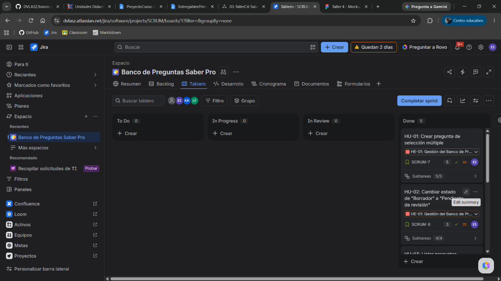

**Figura 1.** Tablero del Sprint 1 en Jira.

### 2.2 Sprint 2

El Sprint 2 reúne once historias y sus subtareas. Lo obligatorio del segundo corte tiene prioridad alta y las adiciones tienen prioridad baja y quedan en el backlog.


**Tabla 6.** Del documento.

| Clave | Historia | Prioridad | Responsable | Subtareas |
|---|---|---|---|---|
| SCRUM-40 | HU-05 Evaluar preguntas asignadas, dejar observaciones y aprobar o rechazar | Alta | Kevin | Sin subtareas propias; se desarrolla en SCRUM-76, 77 y 80 a 83 |
| SCRUM-41 | HU-04b Asignar de 1 a 3 revisores por pregunta (ajuste del corte 2) | Media | Kevin | Sin subtareas propias; se desarrolla en SCRUM-76 y 77 |
| SCRUM-42 | HU-T7 Infraestructura base con Docker Compose | Alta | Edward | SCRUM-51 a 54 |
| SCRUM-43 | HU-T8 question-service | Alta | Edward | SCRUM-55 a 60 |
| SCRUM-44 | HU-T9 review-service | Alta | Kevin | SCRUM-76 y 77 |
| SCRUM-45 | HU-T10 user-service | Alta | Laura | SCRUM-61 a 63 |
| SCRUM-46 | HU-T11 notification-service | Alta | Edward | SCRUM-78 y 79 |
| SCRUM-47 | HU-T12 API Gateway y Swagger agregado | Alta | Edward | SCRUM-64 a 66 |
| SCRUM-48 | HU-T13 Prueba de escalabilidad con k6 | Baja | Edward | SCRUM-67 y 68 |
| SCRUM-49 | HU-T14 Frontend web separado | Alta | Edward | SCRUM-80 a 83 |
| SCRUM-50 | HU-T15 Modelado y prototipos | Alta | Laura | SCRUM-69 a 71 |


Cada integrante responde por servicios completos, y su trabajo queda registrado con su autoría en los commits
del repositorio y como asignación en Jira.

**Tabla 7.** Del documento.

| Integrante | Responsabilidad |
|---|---|
| Edward Dávila | Infraestructura con Docker Compose, question-service, notification-service, API Gateway, frontend web y prueba de escalabilidad |
| Kevin Castaño | review-service, evaluación por los revisores, asignación de 1 a 3 revisores y, como adición, history-service |
| Laura Sánchez | user-service, modelado y prototipos del corte 2 y documentación de variables de entorno y arranque |

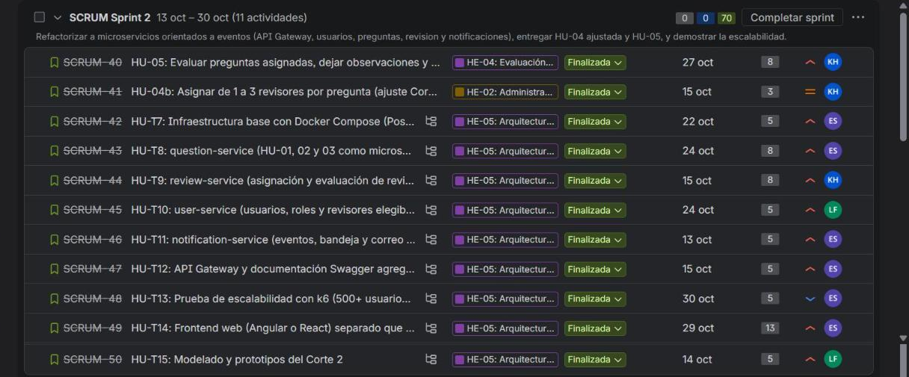

**Figura 2.** Backlog del Sprint 2 en Jira, al cerrar el sprint el 3 de noviembre de 2026.

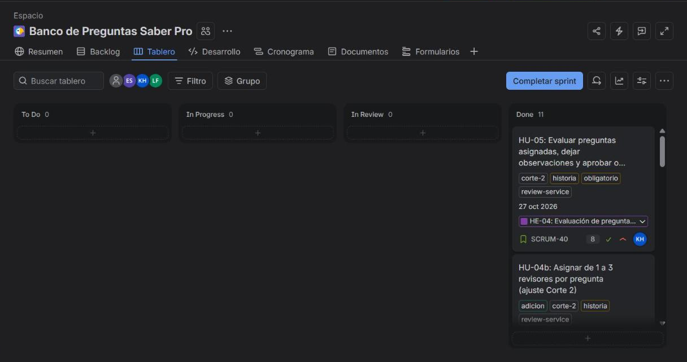

**Figura 3.** Tablero del Sprint 2 en Jira, al cerrar el sprint el 3 de noviembre de 2026.

### 2.3 Sprint 3

El Sprint 3 va del 4 de noviembre al 18 de noviembre de 2026. Reúne las historias del tercer corte, las que quedaron abiertas del segundo y las de la épica HE-06. Está en
https://dvlasz.atlassian.net/jira/software/projects/SCRUM/boards/1.

**Tabla 8.** Historias del Sprint 3.

| Clave | Historia | Responsable | Estado |
|---|---|---|---|
| SCRUM-104 | HU-06 El autor ve el historial de revisiones y sus observaciones | Kevin | Finalizada |
| SCRUM-105 | HU-T31 Arquitectura hexagonal con DDD en evaluation-service | Kevin | Finalizada |
| SCRUM-106 | HU-T32 Pruebas del dominio de todos los servicios y cobertura con JaCoCo | Laura | Finalizada |
| SCRUM-107 | HU-T33 Seguridad con Keycloak y JWT documentada y verificada con todos los roles | Laura | Finalizada |
| SCRUM-108 | HU-T34 Documento final de arquitectura en PDF y README del repositorio | Edward | En curso |
| SCRUM-109 | HU-T35 Sustentación presencial del tercer corte | Edward, Laura y Kevin | Por hacer |
| SCRUM-92 | HU-T20 simulation-service | Kevin | Finalizada |
| SCRUM-93 | HU-T21 tracking-service | Laura | Finalizada |
| SCRUM-96 | HU-T24 Frontend de estudiante y docente | Edward | Finalizada |
| SCRUM-74 | HU-T18 Seguridad con Keycloak (PKCE, realm y entrada con nginx) | Edward | Finalizada |
| SCRUM-95 | HU-T23 Cierre de brechas de requisitos y documentación | Edward | Finalizada |
| SCRUM-97 | HU-T25 Informe de decisiones de arquitectura y SOLID | Edward | Finalizada |
| SCRUM-99 | HU-T27 JPA y DTO verificados en todos los servicios | Laura | Finalizada |

Cada historia de la épica HE-06 tiene sus subtareas técnicas en Jira. Las historias SCRUM-98 y SCRUM-101, que hablaban de una redistribución en 14
microservicios, no se hicieron: se decidió publicar los doce servicios que ya estaban probados, y quedan en el backlog con una nota que lo explica.
La prueba de usabilidad con usuarios (SCRUM-102) quedó fuera de este documento porque la guía del tercer corte ya no la pide.
Estado del backlog y del tablero del Sprint 3 al preparar este documento:

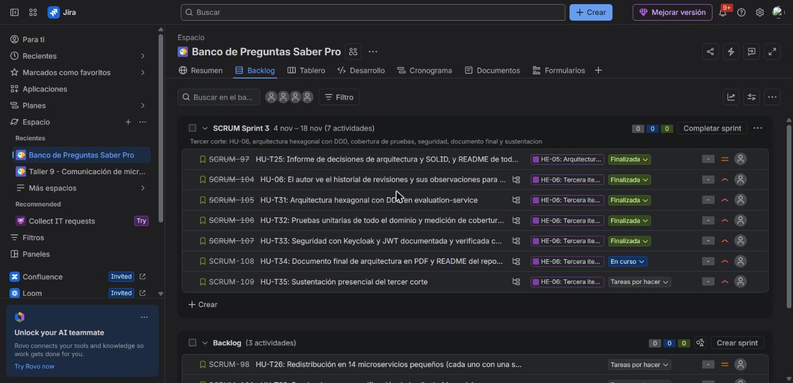

**Figura 4.** Backlog del Sprint 3 en Jira.

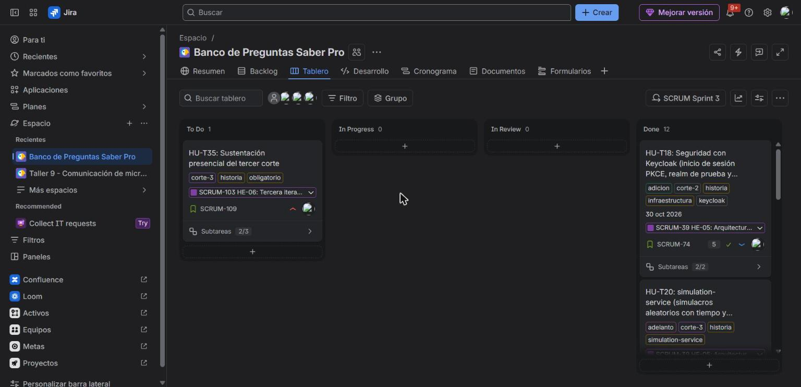

**Figura 5.** Tablero del Sprint 3 en Jira.

## 3. Escenarios de calidad

El documento cubre los dos atributos de calidad que pide la guía. La modificabilidad se mide con seis escenarios sobre el código. La escalabilidad se mide con una prueba de carga. Cada escenario dice quién pide el cambio (fuente), qué lo provoca (estímulo), en qué condiciones (entorno), qué parte del sistema toca (artefacto), cómo responde el diseño, cómo se mide y qué resultado se espera.

### 3.1 Modificabilidad


La modificabilidad es la facilidad para cambiar el sistema sin romper lo que ya funciona. Los requisitos RNF-10 a RNF-14 piden separar la lógica de negocio de
la interfaz y de la persistencia, bajo acoplamiento y poder incorporar nuevos tipos, criterios o módulos sin tocar mucho de lo existente.

Cada escenario sigue el formato del curso: fuente, estímulo, entorno, artefacto, respuesta, medida y resultado esperado. Los cambios que describen no se
hicieron, pero el diseño ya está preparado para ellos y cada escenario dice en qué clases se apoya.

#### Escenario 1: cambiar la regla con la que se decide una revisión

**Tabla 9.** Escenario 1: cambiar la regla con la que se decide una revisión.

| Elemento | Contenido |
|---|---|
| Fuente | Los docentes |
| Estímulo | Piden que una pregunta se apruebe por mayoría y no por unanimidad |
| Entorno | Sistema en operación, con revisiones en curso |
| Artefacto | evaluation-service |
| Respuesta | Se escribe una clase nueva, Mayoria, que implementa PoliticaDeDecision, y se cambia el objeto que arma ApplicationConfig |
| Medida | Clases nuevas, clases existentes modificadas y líneas cambiadas |
| Resultado esperado | Una clase nueva, una línea cambiada en la configuración y ninguna modificación en CasoDeEvaluacion, en los puertos ni en los adaptadores |

La razón es que el caso de evaluación recibe la política como parámetro (patrón Strategy) y no sabe cuál es. UnanimidadTest sirve de molde para la prueba de la nueva clase.

#### Escenario 2: agregar un tipo de aviso

**Tabla 10.** Escenario 2: agregar un tipo de aviso.

| Elemento | Contenido |
|---|---|
| Fuente | El administrador |
| Estímulo | Quiere un aviso nuevo, por ejemplo cuando una pregunta se archiva |
| Entorno | Desarrollo |
| Artefacto | notification-service |
| Respuesta | Una subclase de CreadorDeAviso (Factory Method), un valor en TipoNotificacion y su registro en CreadoresDeAviso |
| Medida | Clases existentes que cambian |
| Resultado esperado | El servicio de aplicación no cambia. CreadoresDeAvisoTest falla si un tipo queda sin creador, así que no se puede olvidar el registro |

#### Escenario 3: agregar una regla de calidad a la validación

**Tabla 11.** Escenario 3: agregar una regla de calidad a la validación.

| Elemento | Contenido |
|---|---|
| Fuente | El equipo de calidad del banco |
| Estímulo | Quieren rechazar, por ejemplo, opciones demasiado parecidas entre sí |
| Entorno | Desarrollo |
| Artefacto | validation-service |
| Respuesta | Una clase nueva que extiende ReglaPorOpcion (Template Method) o implementa la regla de contenido, y su registro en la lista de reglas |
| Medida | Servicios que cambian |
| Resultado esperado | Solo cambia validation-service. question-service sigue llamándolo igual y recibe todas las violaciones juntas |

#### Escenario 4: pasar del correo simulado al correo real

**Tabla 12.** Escenario 4: pasar del correo simulado al correo real.

| Elemento | Contenido |
|---|---|
| Fuente | El docente |
| Estímulo | Pide enviar correos reales |
| Entorno | Despliegue |
| Artefacto | email-service |
| Respuesta | Una implementación nueva del puerto EmailSender que use SMTP. Los decoradores EmailConReintentos y EmailConRegistro siguen envolviéndola |
| Medida | Casos de uso modificados |
| Resultado esperado | Cero. Cambia el adaptador y la configuración del servicio. Los reintentos y el registro se conservan |

#### Escenario 5: agregar un servicio que reaccione a lo que pasa en las revisiones

**Tabla 13.** Escenario 5: agregar un servicio que reaccione a lo que pasa en las revisiones.

| Elemento | Contenido |
|---|---|
| Fuente | El equipo de desarrollo |
| Estímulo | Se quiere un servicio de estadísticas de revisión |
| Entorno | Desarrollo |
| Artefacto | RabbitMQ y los servicios existentes |
| Respuesta | El servicio nuevo declara su cola y se suscribe a los eventos review.completed y question.state-changed |
| Medida | Servicios existentes que hay que modificar |
| Resultado esperado | Ninguno. Así se sumaron history-service y audit-service sin tocar a quienes publican |

#### Escenario 6: cambiar la base de datos de un servicio

**Tabla 14.** Escenario 6: cambiar la base de datos de un servicio.

| Elemento | Contenido |
|---|---|
| Fuente | El equipo de infraestructura |
| Estímulo | Un servicio debe pasar de PostgreSQL a otra base |
| Entorno | Desarrollo |
| Artefacto | Cualquier servicio con persistencia, por ejemplo evaluation-service |
| Respuesta | Se escribe otro adaptador de salida que implemente EvaluationRepository |
| Medida | Paquetes modificados |
| Resultado esperado | Solo cambia adapter.out.persistence. El dominio y la aplicación no se tocan. ArquitecturaTest falla si alguien rompe esa frontera |

#### Cómo se protege

- Cada servicio tiene su propia base de datos y solo se comunica con otros por eventos o por una llamada REST puntual, así que un cambio no se propaga.
- ArchUnit comprueba en cada servicio que el dominio no dependa de Spring, de JPA ni de la mensajería. En evaluation-service comprueba también el hexágono completo.
- Las pruebas de cada clase del dominio avisan si un cambio rompe una regla. La cobertura está en [cobertura de pruebas](cobertura-de-pruebas.md).
- Los patrones que hacen posibles estos cambios están en [patrones y principios](patrones-y-principios.md).


### 3.2 Escalabilidad


#### Atributos de calidad relevantes

Para esta iteración el atributo principal es la escalabilidad (RNF-17 y RNF-18). La modificabilidad
del primer corte se mantiene gracias a la separación en servicios y a la comunicación por eventos.

#### Escenario de calidad

**Tabla 15.** Escenario de calidad.

| Elemento | Contenido |
|---|---|
| Fuente | Estudiantes, autores, revisores y administradores usando el sistema al mismo tiempo |
| Estímulo | 600 usuarios concurrentes (60 % autores, 25 % revisores, 15 % administradores) consultando y escribiendo a través del gateway |
| Entorno | Operación normal bajo carga pico, sistema completo desplegado con Docker Compose en una sola máquina (16 CPU, 11,4 GB para Docker) |
| Artefacto | edge, api-gateway y los servicios de negocio |
| Respuesta | Se agregan réplicas del servicio saturado detrás del gateway sin modificar la lógica de negocio; las notificaciones y la trazabilidad se procesan de forma asíncrona y no bloquean al usuario |
| Medida | Tiempo de respuesta (p95), tasa de error y peticiones por segundo |
| Resultado esperado | Con 500 usuarios concurrentes, p95 de las consultas menor a 3 s (RNF-17) y error menor al 1 % |

Por qué la arquitectura lo hace posible: los servicios no guardan estado de sesión (el token es autocontenido),
cada uno tiene su base de datos y el trabajo lento (correo, trazabilidad) sale del camino de la petición mediante
eventos. Las réplicas se registran solas en Eureka y el gateway las reparte.

#### La prueba

Herramienta: k6 en su imagen de Docker (microservicios/pruebas-de-carga/escalabilidad.js), con tokens reales de
Keycloak (se piden una vez al inicio, para medir a los servicios y no a la pantalla de login). Cada usuario virtual
sigue el recorrido de su rol: los autores listan sus preguntas, crean borradores, consultan el historial y las
notificaciones; los revisores consultan su bandeja; los administradores consultan pendientes, todas las preguntas,
revisores y auditoría. Umbrales: p95 < 1500 ms, error < 1 %, comprobaciones > 99 %.

```bash
docker run --rm -i -e PW=<clave de prueba> -e VUS=600 -e HOLD=1m \
  -e BASE=http://host.docker.internal:8080 -e KC=http://host.docker.internal:8180 \
  grafana/k6 run - < pruebas-de-carga/escalabilidad.js
```

PAUSA fija el tiempo de lectura entre acciones: 1 (por defecto) imita a una persona; 0.05 convierte la prueba
en una de estrés.

#### Resultados (26 de octubre de 2026, una réplica de cada servicio)

Con los diez servicios de la entrega, el gateway, edge, Keycloak y RabbitMQ en la misma máquina (16 CPU, 11,4 GB para Docker).

**Tabla 16.** Resultados (26 de octubre de 2026, una réplica de cada servicio).

| Corrida | Usuarios | Pausa | Peticiones | Peticiones/s | p95 | p99 | Error |
|---|---|---|---|---|---|---|---|
| Ritmo humano | 600 | 1 s | 33 204 | 223 | 30 ms | 69 ms | 0 % |
| Estrés | 600 | 0,05 s | 130 012 | 921 | 826 ms | 1,1 s | 0 % |

Se cumplen los tres umbrales (p95 menor de 1500 ms, error menor del 1 % y comprobaciones por encima del 99 %: todas las comprobaciones
salieron bien en las dos corridas). Con 600 usuarios a ritmo humano se supera con mucho el objetivo de 3 s. Con la pausa reducida 20 veces el
sistema sostiene 921 peticiones por segundo sin un solo error y con p95 por debajo de 0,9 s: no se llega al límite de la máquina con 600
usuarios; el cuello de botella pasa a ser el CPU compartido.

#### Qué se encontró y se corrigió al medir

**Tabla 17.** Qué se encontró y se corrigió al medir.

| Hallazgo | Causa | Corrección |
|---|---|---|
| Consultas de preguntas muy lentas con muchas filas | El filtro opcional con OR ... IS NULL impedía usar índices | Búsqueda dinámica con consulta construida según los filtros + índices (autor, fecha, id), (fecha, id) y (estado, fecha, id) (migración question V3) |
| El gateway rechazaba llamadas sanas con carga | El bulkhead por defecto admite 25 llamadas simultáneas | Tope de 1000 con espera máxima de 200 ms |
| Errores por agotamiento de puertos en edge | Una conexión nueva por petición hacia el gateway | Upstream con keepalive |
| edge descartaba réplicas sanas | Tomaba los 503 del circuit breaker como réplica caída | Solo error y timeout activan el reintento; max_fails=3 fail_timeout=3s |

#### Réplicas: ¿más réplicas rinden más?

Se comprobó (8 de octubre de 2026) que añadir réplicas funciona (Eureka las descubre, el gateway las reparte, y al detener una el
sistema sigue respondiendo sin errores), pero en esta máquina no mejora el rendimiento: los contenedores
comparten los mismos 16 CPU, así que más réplicas solo reparten el mismo cómputo y añaden cambios de contexto.
La escalabilidad horizontal tiene sentido cuando cada réplica dispone de recursos propios (varios nodos). Es un
resultado honesto de la medición y se explica en la sustentación; el diseño (servicios sin estado, base por
servicio, balanceo y descubrimiento) es el que hace posible ese escalado en un entorno con más hardware.

#### Tolerancia a fallos (extra)

Verificado a mano: detener una réplica del gateway o de un servicio no interrumpe el servicio; detener RabbitMQ no
impide guardar ni enviar a revisión (Outbox, ver [08](../corte-2/08-implementacion-seguridad-y-resiliencia.md)); un servicio
caído devuelve 503 inmediato por el circuit breaker en lugar de dejar al usuario esperando.


## 4. Arquitectura y diseño de software

### 4.1 Estilo arquitectónico

La solución son microservicios orientados a eventos, con un API Gateway como única entrada, una base de datos por servicio y RabbitMQ como bus de eventos.
Keycloak, un sistema externo, maneja la identidad y emite el token JWT. El frontend y el backend están separados y solo se hablan por la API REST. Dentro de cada servicio hay capas
con puertos y adaptadores, y en evaluation-service esa idea se lleva al extremo con arquitectura hexagonal y DDD.

Los diagramas siguen la notación del modelo C4: persona, sistema, contenedor, componente, base de datos, cola y límite del sistema, cada uno con su leyenda. Los dibujamos con una
disposición propia y no con un generador automático, porque las primeras pruebas con el generador de Mermaid dejaron etiquetas encimadas y flechas cruzadas. El nivel 4 es un diagrama
de clases de UML.

### 4.2 Segunda iteración

En la segunda iteración el sistema ya es distribuido y con seguridad: los usuarios entran por Keycloak y todo el tráfico pasa por el gateway, que valida el token.

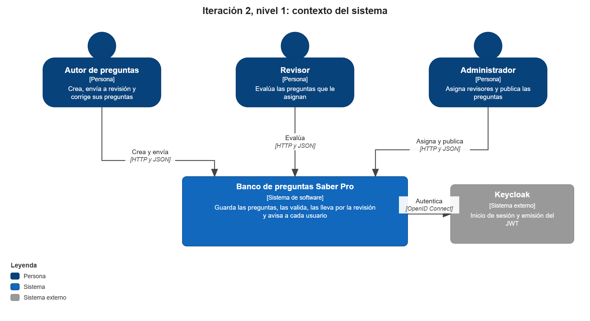

**Figura 6.** Nivel 1 de la segunda iteración: contexto del sistema.

El sistema tiene tres tipos de usuario, el autor, el revisor y el administrador, y un sistema externo, Keycloak. El correo es simulado por decisión del docente y por eso no aparece
un servidor de correo.

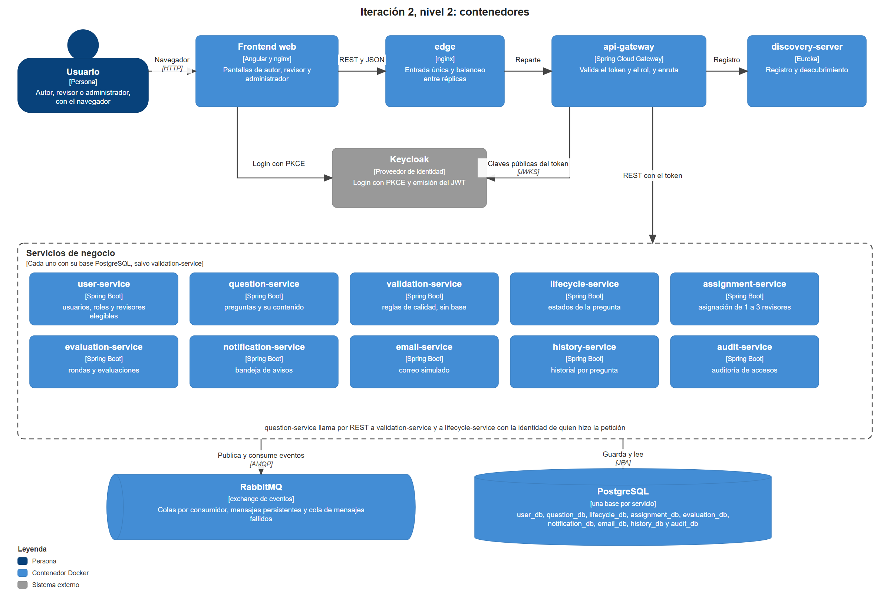

**Figura 7.** Nivel 2 de la segunda iteración: contenedores.

El frontend habla con el gateway a través de edge, que reparte entre réplicas. El gateway valida el token con las claves públicas de Keycloak y reparte las llamadas a los diez servicios. Los
servicios publican y consumen eventos por RabbitMQ y cada uno guarda en su propia base PostgreSQL, salvo validation-service, que no guarda datos.

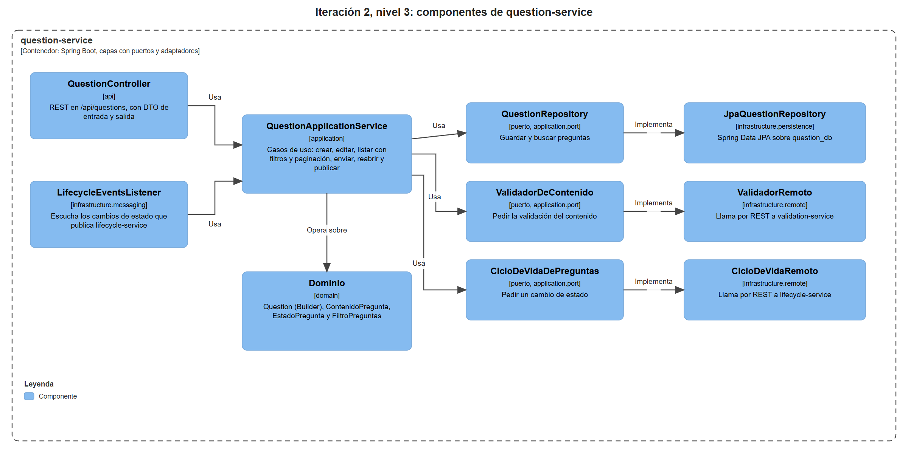

**Figura 8.** Nivel 3 de la segunda iteración: componentes de question-service.

question-service es el servicio con más historias. La aplicación depende de tres puertos, el repositorio, el validador y el ciclo de vida, y la infraestructura los implementa con JPA y con llamadas
REST a validation-service y a lifecycle-service. Los demás servicios siguen la misma forma de capas.

### 4.3 Tercera iteración

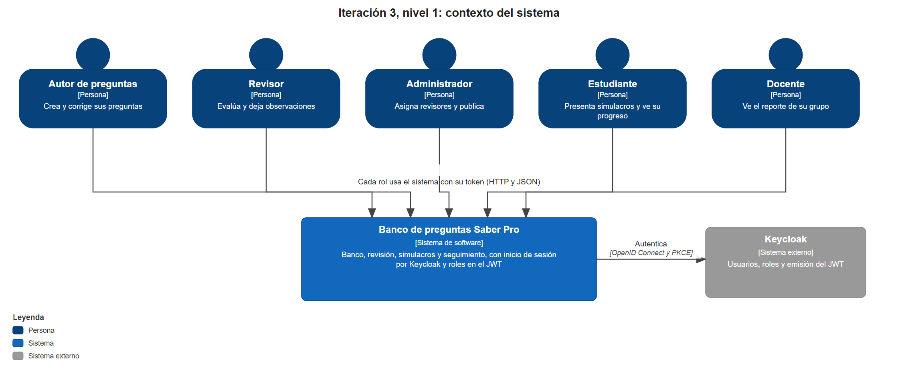

**Figura 9.** Nivel 1 de la tercera iteración: contexto del sistema.

Se suman los roles de estudiante y docente. Cada rol usa el sistema con el token que le da Keycloak, y los roles del token deciden qué ve y qué puede hacer.

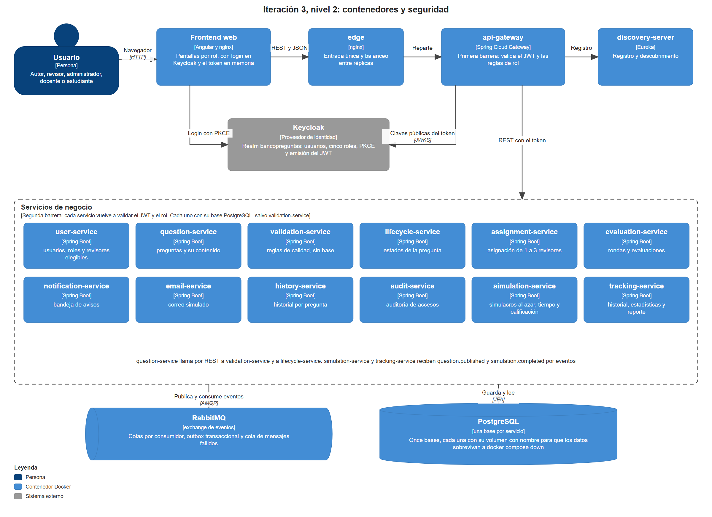

**Figura 10.** Nivel 2 de la tercera iteración: contenedores y seguridad.

Se agregan simulation-service y tracking-service, que llegan a doce servicios de negocio. La seguridad queda a la vista con dos barreras: el gateway valida el JWT y las reglas de rol, y cada servicio
vuelve a validar el token y el rol de la operación. Los datos de los once servicios con base viven en volúmenes con nombre.

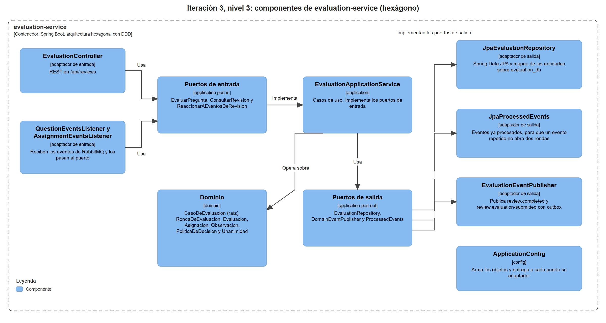

**Figura 11.** Nivel 3 de la tercera iteración: componentes de evaluation-service con arquitectura hexagonal.

evaluation-service es el servicio con más reglas de negocio: decide por unanimidad si una pregunta se aprueba o se rechaza, deja que un solo rechazo cierre la ronda y conserva el historial de
rondas. Por eso es el que lleva la arquitectura hexagonal con DDD. A la izquierda están los adaptadores de entrada, en el centro los puertos, la aplicación y el dominio, y a la derecha los adaptadores de salida.
Una prueba de arquitectura con ArchUnit falla el build si alguien rompe esa forma.

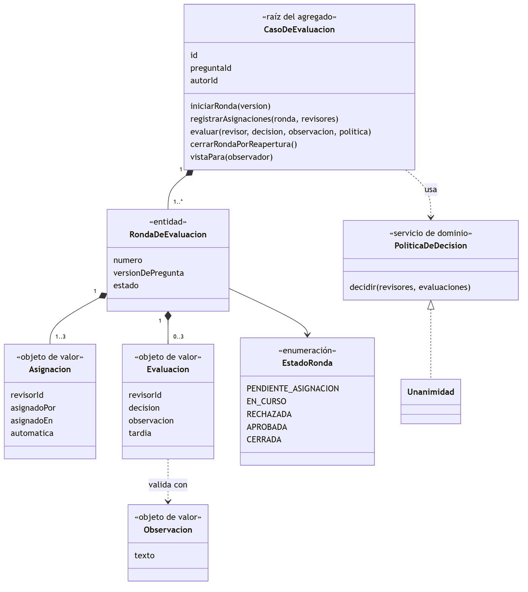

**Figura 12.** Nivel 4: el agregado de evaluation-service, con sus entidades y objetos de valor.
Los términos del dominio son los mismos en el negocio, en el código y en las pruebas:


Estas son las palabras que usan el negocio, el código y las pruebas. Cada término es el nombre de una clase o de un método.

**Tabla 18.** Del documento.

| Término | Qué significa | En el código |
|---|---|---|
| Caso de evaluación | Todo lo que se ha revisado de una pregunta, a lo largo de todas sus versiones | CasoDeEvaluacion |
| Ronda | Una vuelta completa de revisión de una versión de la pregunta | RondaDeEvaluacion |
| Asignación | Un revisor puesto en una ronda, con quién lo asignó y cuándo | Asignacion |
| Evaluación | La decisión de un revisor con su observación. Es definitiva | Evaluacion |
| Observación | El comentario que acompaña la decisión. Obligatoria al rechazar | Observacion |
| Decisión | Aprobar o rechazar | Decision |
| Política de decisión | La regla que dice cuándo una ronda queda aprobada o rechazada | PoliticaDeDecision, Unanimidad |
| Observación tardía | La que llega cuando la ronda ya se rechazó. El autor la lee, pero no cambia el resultado | Evaluacion.tardia() |
| Observador | Quien consulta el caso: administrador, autor o revisor, y cada uno ve lo que le toca | Observador, VistaDelCaso |

Las reglas del negocio viven dentro del agregado y cada una tiene su prueba:


**Tabla 19.** Del documento.

| Regla | Quién la hace cumplir | Dónde se prueba |
|---|---|---|
| Para rechazar hay que escribir una observación | CasoDeEvaluacion.evaluar con Observacion | CasoDeEvaluacionTest, ObservacionTest |
| Una observación no pasa de 4000 caracteres y no queda con espacios sobrantes | Observacion | ObservacionTest |
| Solo evalúa un revisor asignado a la ronda vigente | CasoDeEvaluacion.evaluar | CasoDeEvaluacionTest |
| Un revisor evalúa una sola vez y la evaluación es definitiva | CasoDeEvaluacion.evaluar | CasoDeEvaluacionTest |
| La ronda se aprueba solo si todos los asignados aprueban | Unanimidad | UnanimidadTest |
| Un solo rechazo cierra la ronda, sin esperar a los demás | Unanimidad y CasoDeEvaluacion | UnanimidadTest, CasoDeEvaluacionTest |
| Tras el rechazo, las evaluaciones que faltan quedan como tardías y no cambian el resultado | CasoDeEvaluacion.evaluar | CasoDeEvaluacionTest |
| Una pregunta aprobada no admite otra ronda, y una ronda abierta bloquea la siguiente | CasoDeEvaluacion.iniciarRonda | CasoDeEvaluacionTest |
| Un evento repetido no abre dos rondas de la misma versión | CasoDeEvaluacion.iniciarRonda | CasoDeEvaluacionTest |
| Una asignación necesita revisor, quién asigna y fecha | Asignacion | AsignacionTest |
| Cada rol ve solo lo que le corresponde del caso | CasoDeEvaluacion.vistaPara | CasoDeEvaluacionTest |

Que sean de 1 a 3 revisores lo hace cumplir assignment-service, que es quien los asigna. Este servicio los recibe por evento y los registra.


### 4.4 Seguridad: Keycloak y JWT

El tercer corte pide autenticación y autorización con tokens JWT y un sistema externo. Usamos Keycloak 26. El frontend no guarda contraseñas ni las ve: redirige a Keycloak con el flujo de código
de autorización y PKCE, Keycloak devuelve un JWT firmado con los roles del usuario y de ahí en adelante cada petición lleva ese token, que dura 15 minutos.

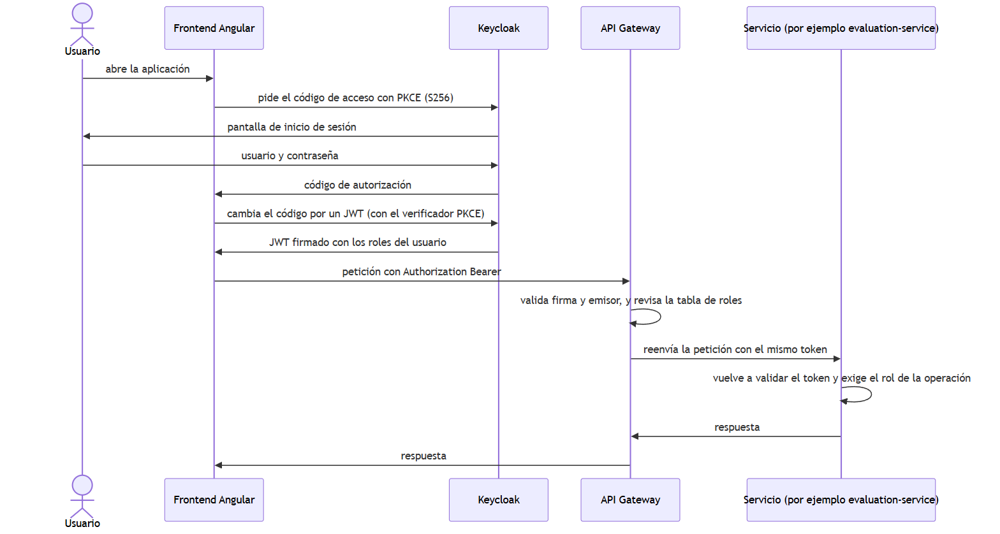

**Figura 13.** Secuencia del inicio de sesión y de la autorización de una petición.

La autorización se revisa dos veces, como acordamos con los docentes. El gateway aplica una tabla de reglas, de método y camino contra roles, y si el token no tiene el rol la petición no pasa. Después
cada servicio vuelve a validar la firma y el emisor del token con la clave pública de Keycloak y exige el rol de la operación, de modo que si el gateway tuviera un error el servicio no abre la operación.
El gateway también borra las cabeceras X-User-Id y X-User-Roles de la petición que llega de afuera, para que nadie se haga pasar por otro usuario escribiendo una cabecera.

**Tabla 20.** Qué puede hacer cada rol.

| Rol | Puede |
|---|---|
| AUTHOR | Crear, modificar, enviar a revisión y reabrir sus preguntas. Ver su historial de revisiones y sus notificaciones |
| REVIEWER | Ver las preguntas que le asignaron y enviar su evaluación |
| ADMIN | Ver todas las preguntas, asignar de 1 a 3 revisores, publicar, ver usuarios, auditoría y correos simulados, y el reporte del grupo |
| STUDENT | Crear y presentar simulacros, y ver su propio progreso, fortalezas y debilidades |
| TEACHER | Ver el seguimiento de cualquier estudiante y el reporte del grupo, con descarga en CSV |

La gestión de usuarios y roles se hace en Keycloak, que es lo que pide el enunciado. El realm versionado en el repositorio trae usuarios de prueba para cada rol.

Esta es la evidencia con el sistema corriendo en contenedores. Primero la pantalla de inicio de sesión de la aplicación, que lleva a Keycloak con el botón de acceso institucional:

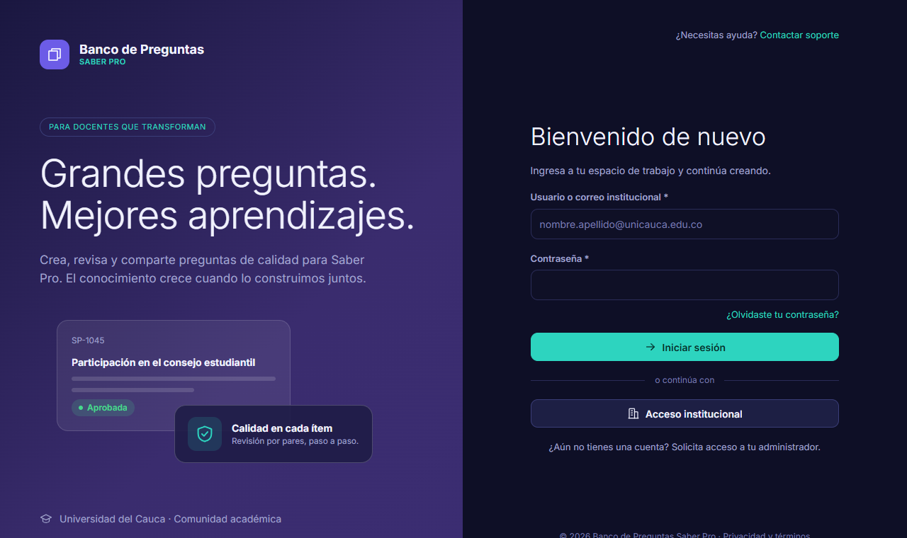

**Figura 14.** Pantalla de inicio de sesión del frontend.

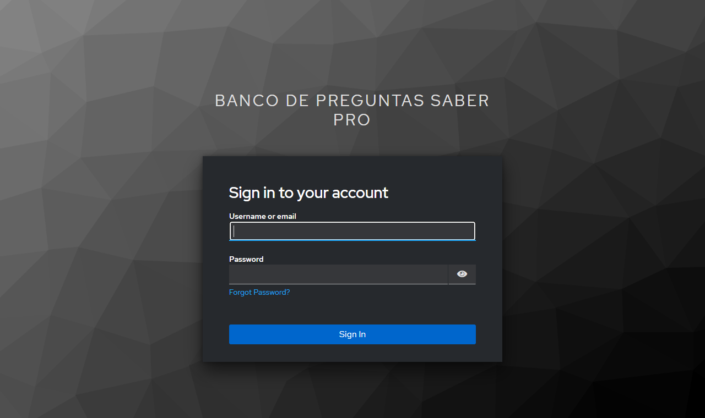

**Figura 15.** Pantalla de inicio de sesión de Keycloak, que es quien guarda y valida las contraseñas.

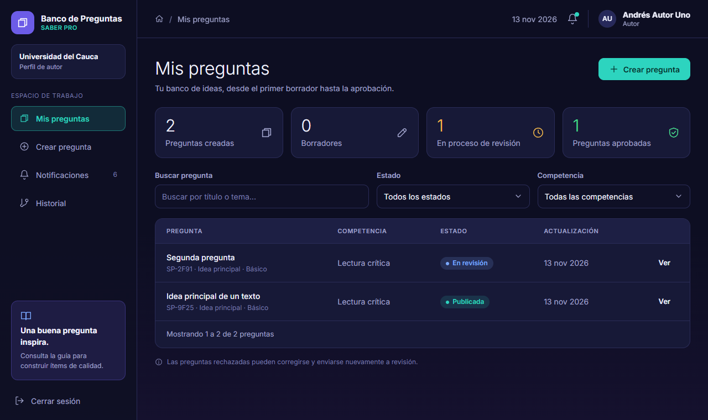

**Figura 16.** Sesión del autor después de entrar: ve solo sus preguntas, con los estados en colores, paginación y filtros.

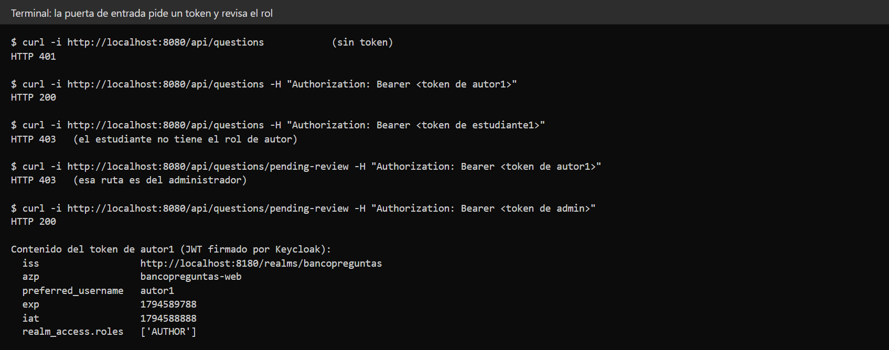

**Figura 17.** El gateway responde 401 sin token, 403 con un rol que no corresponde y 200 con el rol correcto. Abajo, el contenido del token del autor.

Los servicios también propagan el token en las llamadas entre ellos, así que un servicio intermedio no da permisos que el usuario no tiene. Las contraseñas las guarda Keycloak con hash y los inicios de sesión
correctos y fallidos llegan a audit-service, que el administrador ve en la pantalla de auditoría. Los secretos de desarrollo van en un archivo .env que no se versiona.

**Tabla 21.** Pruebas de la seguridad.

| Qué se comprueba | Prueba |
|---|---|
| El servicio rechaza tokens inválidos o sin rol y acepta los correctos | JwtSecurityTest en bp-platform y EvaluationServiceJwtTest |
| La identidad sale del token y no de las cabeceras | AuthenticatedUserTest y HeaderUserArgumentResolverTest |
| El gateway aplica la tabla de roles | ApiGatewayTest |
| Recorrido completo con tokens reales de Keycloak | pruebas-funcionales/recorrido_funcional.py, con los roles de cada historia |

Una limitación que dejamos escrita: si no se configura nada, bp-platform arranca en un modo de cabeceras que sirve para pruebas y desarrollo. El docker-compose.yml lo fija en jwt con la variable
SECURITY_MODE y un despliegue real tiene que dejarlo así.

## 5. Dockerización con Docker Compose y volúmenes

### 5.1 Qué se levanta

Todo el sistema se levanta con un archivo, microservicios/docker-compose.yml, y un comando, docker compose up -d --build. Son 29 contenedores: doce servicios de negocio, el API Gateway, edge, el
servidor Eureka, Keycloak, RabbitMQ, el frontend y once bases PostgreSQL, una por servicio con datos. Cada servicio espera a que su base, RabbitMQ y los servicios de los que depende estén sanos
(depends_on con service_healthy) antes de arrancar, y cada contenedor tiene su healthcheck.

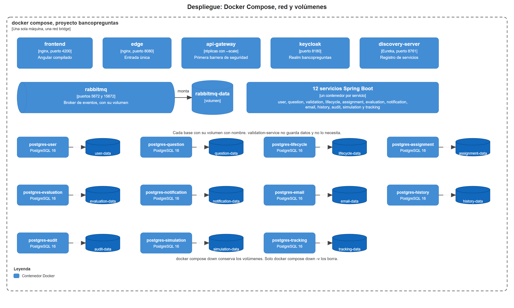

**Figura 18.** Vista de despliegue: contenedores, red y volúmenes.

### 5.2 Volúmenes para las bases de datos

Cada base PostgreSQL guarda sus datos en un volumen con nombre, declarado en la sección volumes del compose. El mismo patrón se repite en las once bases. La de question-service es así:

```text
postgres-question:
  <<: *postgres
  container_name: bp-postgres-question
  environment:
    POSTGRES_DB: question_db
    POSTGRES_USER: ${QUESTION_DB_USER:-question}
    POSTGRES_PASSWORD: ${QUESTION_DB_PASSWORD:-question}
  volumes:
    - question-data:/var/lib/postgresql/data
```

RabbitMQ tiene el suyo, rabbitmq-data, de modo que son doce volúmenes. docker compose down borra los contenedores y la red pero conserva los volúmenes, y solo docker compose down -v los
borra. La prueba de abajo lo muestra.

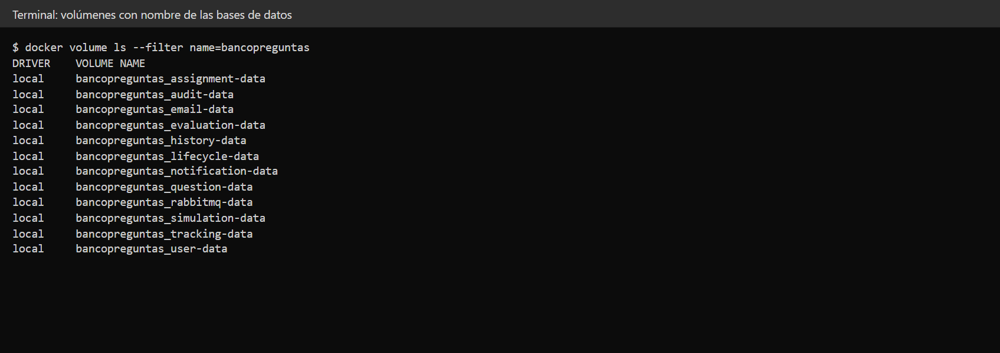

**Figura 19.** Los doce volúmenes con nombre del proyecto.

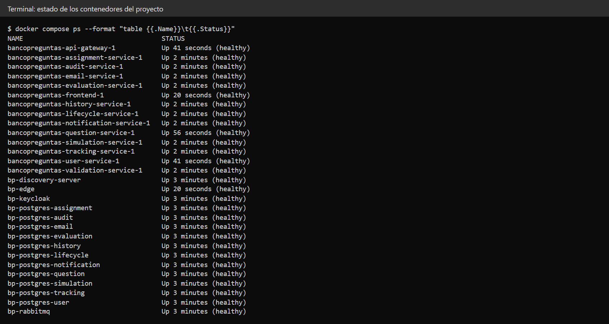

**Figura 20.** Estado de los contenedores del proyecto, todos en ejecución y sanos.

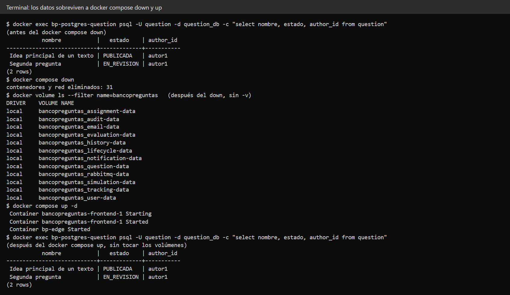

**Figura 21.** Las preguntas guardadas en question_db antes de apagar el sistema, con docker compose down sin la opción -v, y las mismas después de volver a levantarlo.

### 5.3 Recorrido funcional sobre los contenedores

Con el sistema levantado corrimos el recorrido funcional, un script que usa tokens reales de Keycloak y recorre las historias de usuario de punta a punta: crear y validar una pregunta, enviarla a revisión, asignar
revisores, evaluar, la ronda con un rechazo y una observación, la reapertura y el reenvío de HU-06, los simulacros con sus estadísticas, el historial y la auditoría, y las comprobaciones de seguridad (401 sin token y 403
con el rol equivocado).

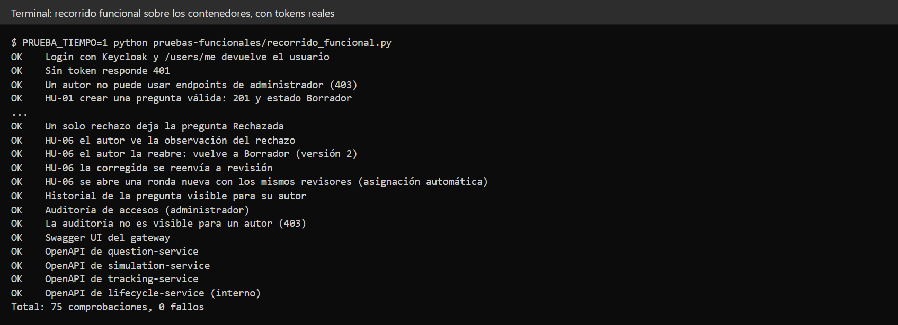

**Figura 22.** Recorrido funcional: 75 comprobaciones y ningún fallo, incluido el cierre por tiempo agotado de un simulacro.

El README de microservicios explica cómo levantar solo una parte, cómo escalar el gateway con --scale detrás de edge y cómo usar las variables de entorno.

## 6. Patrones de diseño

Están implementados nueve patrones GoF, con sus clases y pruebas, y los patrones de arquitectura y de dominio que pide la arquitectura hexagonal con DDD. Para cada uno se dice cómo y en qué contexto del problema se aplicó.

### 6.1 Patrones GoF

**Tabla 22.** Del documento.

| Tipo | Patrón | Dónde (clases reales) | Servicio |
|---|---|---|---|
| Creacional | Builder | Question.Builder | question-service |
| Creacional | Factory Method | CreadorDeAviso (creador) y sus ocho subclases (AvisoRevisoresAsignados, AvisoPreguntaEnRevision, AvisoEvaluacionRecibida, AvisoRevisionAprobada, AvisoRevisionRechazada, AvisoResultadoDeRevision, AvisoObservacionTardia, AvisoPreguntaPublicada); registro CreadoresDeAviso | notification-service |
| Estructural | Adapter | Puertos y adaptadores: JpaQuestionRepository, JpaLifecycleRepository, JpaAssignmentRepository, JpaEvaluationRepository, JpaNotificationRepository; mensajería (LifecycleEventPublisher, AssignmentEventPublisher, EvaluationEventPublisher, UserEventPublisher); clientes REST de otros servicios (ValidadorRemoto, CicloDeVidaRemoto); correo (SimulatedEmailSender detrás del puerto EmailSender) | todos |
| Estructural | Facade | api-gateway (Spring Cloud Gateway): una sola entrada que oculta la topología interna y centraliza token, autorización, circuit breaker y CORS | api-gateway |
| Comportamiento | Strategy | PoliticaDeDecision con la estrategia Unanimidad; el servicio la recibe por constructor (ApplicationConfig) | evaluation-service |
| Comportamiento | State | FaseDePregunta y sus siete fases (FaseBorrador, FasePendienteDeRevision, FaseEnRevision, FaseAprobada, FaseRechazada, FasePublicada, FaseArchivada) | lifecycle-service |
| Comportamiento | Template Method | ReglaPorOpcion con las reglas ExpresionesProhibidasRule y LongitudYEstructuraOpcionesRule | validation-service |
| Estructural | Decorator | EmailConReintentos y EmailConRegistro decoran el puerto EmailSender | email-service |
| Comportamiento | Observer | Publicación y suscripción de eventos por RabbitMQ: los servicios publican (AmqpEventPublisher, OutboxEventPublisher) y los demás se suscriben con @RabbitListener (EventsListener) | todos |


#### Builder · Question.Builder

- Problema: una pregunta tiene más de quince campos (contexto, enunciado, cuatro opciones, justificación,
  competencia, tema, estado, versión, fechas...). Un constructor con tantos parámetros es ilegible y propenso a errores.
- Solución: Question.builder() arma el objeto campo por campo y valida al construir. Question es inmutable:
  cada cambio de estado (conEstado, reabrir) devuelve una instancia nueva.
- Prueba: QuestionTransicionTest, QuestionTest.

#### Factory Method · CreadorDeAviso

- Problema: cada evento genera un aviso distinto (asignación a un revisor, aprobación, rechazo, observación
  tardía, publicación) con su propio asunto y cuerpo. Un if por tipo dentro del servicio de aplicación lo obliga a
  conocer todos los textos y cambiar cada vez que se agrega uno.
- Solución: CreadorDeAviso es la clase creadora. Define la operación crear(...), que arma la Notificacion,
  y declara el método fábrica crearMensaje(ContextoDeAviso), que cada subclase implementa para fabricar su
  Mensaje. CreadoresDeAviso.para(tipo) entrega el creador que corresponde a cada TipoNotificacion.
  NotificationApplicationService no conoce ninguna clase concreta.
- Para agregar un tipo de aviso nuevo: una subclase, un valor en TipoNotificacion y su registro; el servicio
  de aplicación no cambia (principio abierto/cerrado).
- Prueba: CreadoresDeAvisoTest (17 pruebas, entre ellas una por cada tipo de notificación, que falla si falta
  un creador).

#### Adapter · puertos y adaptadores

- Problema: el dominio y los casos de uso no deben depender de PostgreSQL, RabbitMQ ni del servidor de correo.
- Solución: cada servicio declara puertos en application/port (QuestionRepository, NotificationRepository,
  EmailSender, DomainEventPublisher...) y los adapta en infrastructure: JPA, RabbitMQ y el envío de correo. El correo es
  simulado porque así lo decidió el docente (consulta 16); si se pidiera correo real solo cambia el adaptador.
- Prueba: pruebas de persistencia sobre PostgreSQL real, de mensajería y ArquitecturaTest (ArchUnit), que
  falla si el dominio depende de Spring, de JPA o de las capas externas.

#### Facade · api-gateway

- Problema: el frontend no debe conocer diez servicios, sus direcciones ni sus réplicas.
- Solución: el gateway expone una sola interfaz bajo /api, resuelve los servicios por Eureka, valida el JWT,
  aplica la tabla de roles y protege con circuit breaker, reintentos y bulkhead (documento 08).
- Prueba: las 25 pruebas de api-gateway.

#### Strategy · PoliticaDeDecision

- Problema: hoy una pregunta se aprueba por unanimidad; mañana podría pedirse mayoría u otra regla.
- Solución: PoliticaDeDecision.decidir(revisores, evaluaciones) es la interfaz y Unanimidad la estrategia
  vigente (con un rechazo se cierra la ronda). CasoDeEvaluacion usa la interfaz, no la clase.
- Prueba: UnanimidadTest y las pruebas de CasoDeEvaluacion.

#### State · FaseDePregunta

- Problema: lo que se puede hacer con una pregunta depende de su estado: solo el borrador se modifica y se envía,
  solo la aprobada se publica, solo la rechazada se reabre. Esas reglas estaban repartidas en condicionales
  (if (estado != BORRADOR)) por el servicio de aplicación.
- Solución: cada estado es una clase (FaseBorrador, FaseEnRevision...) que implementa solo las operaciones que admite
  (enviarARevision, iniciarRevision, aprobar, rechazar, reabrir, publicar, archivar) y devuelve el estado
  siguiente; las demás lanzan OperacionNoPermitidaException con el mensaje de siempre. Question delega en su fase
  (esEditable, enviarARevision, reabrir...) y EstadoPregunta.puedePasarA también. EstadoPregunta sigue siendo el
  identificador que se guarda y viaja en los eventos.
- Para agregar un estado nuevo: una clase más y una línea en FaseDePregunta.de.
- Prueba: FaseDePreguntaTest (cada operación solo desde su estado, coincidencia con la tabla de RF-15, la pregunta
  delega en su fase) y EstadoPreguntaTest.

#### Template Method · ReglaPorOpcion

- Problema: dos de las reglas de validación recorrían las cuatro opciones con el mismo esqueleto (obtener las opciones,
  saltar las vacías, armar el mensaje con la letra) y solo cambiaba lo que se comprueba en cada una.
- Solución: ReglaPorOpcion.validar es el método plantilla (final): recorre A a D, omite las opciones que descarta
  el gancho omitir y llama al paso abstracto evaluar, que implementa cada regla. Las subclases no repiten el recorrido.
- Prueba: ReglaPorOpcionTest (el esqueleto con una regla espía y el gancho cambiado) y ReglasDeValidacionTest.

#### Decorator · EmailConReintentos y EmailConRegistro

- Problema: un servidor de correo real falla de vez en cuando por causas pasajeras y conviene dejar constancia de cada
  envío, pero eso no es responsabilidad del caso de uso ni del adaptador que habla con el servidor.
- Solución: ambos decoradores implementan el puerto EmailSender y envuelven a otro EmailSender. EmailConReintentos
  repite el envío hasta notification.email-attempts veces (3 por defecto); EmailConRegistro registra y cuenta los envíos
  correctos y fallidos. Se apilan en ApplicationConfig: el registro envuelve a los reintentos y estos al envío simulado.
- Prueba: DecoradoresDeCorreoTest (reintento hasta que pasa, última excepción si no, conteo y apilado).

#### Observer · eventos por RabbitMQ

- Problema: lifecycle-service no debe llamar directamente a revisión, notificaciones, historial y catálogo cada vez
  que cambia una pregunta.
- Solución: el servicio publica un evento (sujeto) en el exchange bancopreguntas.events; cada interesado tiene
  su cola y su @RabbitListener (observador). Agregar un observador nuevo, como audit-service, no cambia al
  publicador. Los consumidores son idempotentes y el publicador usa el patrón Outbox.
- Prueba: las pruebas de los escuchas de eventos (EventsListenerTest, ReviewEventsListenerTest y equivalentes) y las de Outbox de bp-platform.


### 6.2 Patrones de arquitectura y de dominio


**Tabla 23.** Del documento.

| Patrón | Qué resuelve | Dónde se ve |
|---|---|---|
| Puertos y adaptadores (hexagonal) | Que el negocio no dependa de la web, de la base de datos ni del broker | evaluation-service: application.port.in, application.port.out y adapter |
| Agregado y raíz del agregado | Que todas las reglas de un grupo de objetos pasen por un solo punto | CasoDeEvaluacion |
| Objeto de valor | Valores inmutables que validan al crearse y se comparan por sus datos | Observacion, Asignacion, Evaluacion |
| Servicio de dominio | Una regla que no pertenece a una sola entidad | PoliticaDeDecision y Unanimidad |
| Repositorio | Esconder cómo se guarda un agregado | EvaluationRepository, que implementa JpaEvaluationRepository |
| Evento de dominio | Avisar a otros servicios sin conocerlos | EvaluationSubmitted y ReviewCompleted |
| Outbox transaccional | Que el evento y el cambio se guarden juntos | lifecycle-service y simulation-service |
| Consumidor idempotente | Que un evento repetido no se procese dos veces | ProcessedEvents en los servicios que escuchan |
| API Gateway | Una sola entrada con seguridad, circuit breaker y reintentos | api-gateway |


### 6.3 Principios SOLID


**Tabla 24.** Del documento.

| Principio | Cómo se aplica en este corte |
|---|---|
| Responsabilidad única | simulation-service arma y califica simulacros; tracking-service solo acumula resultados y calcula estadísticas |
| Abierto y cerrado | Cambiar la política de decisión o la manera de escoger preguntas es una clase nueva, sin tocar las existentes |
| Sustitución de Liskov | Unanimidad cumple el contrato de PoliticaDeDecision; SeleccionAleatoria el de SelectorDePreguntas |
| Segregación de interfaces | evaluation-service tiene tres puertos de entrada pequeños (EvaluarPregunta, ConsultarRevision y ReaccionarAEventosDeRevision) en lugar de una interfaz grande |
| Inversión de dependencias | El dominio y la aplicación dependen de puertos; los adaptadores los implementan. ArquitecturaTest lo comprueba |


## 7. Pruebas unitarias automatizadas

### 7.1 Cómo se mide

JaCoCo está configurado en el pom.xml de microservicios/, así que se activa solo al correr las pruebas:

```bash
cd microservicios
./mvnw test
```

Cada módulo deja su informe en target/site/jacoco/index.html (para verlo) y target/site/jacoco/jacoco.csv (para procesarlo). Para un solo
servicio:

```bash
./mvnw -pl servicios/evaluation-service -am test
```

La corrida completa tarda cerca de 25 minutos porque las pruebas de persistencia levantan un PostgreSQL embebido por servicio.

### 7.2 Resultado

Última corrida completa: 13 de noviembre de 2026, los 16 módulos en verde, 1102 pruebas en total y cuatro omitidas a propósito (el contrato OpenAPI de question, assignment, evaluation y lifecycle,
que solo corre cuando se le pasa la propiedad openapi.export para exportar el contrato).

Se mide el paquete domain de cada servicio: entidades, objetos de valor, enumeraciones, políticas y servicios de dominio. Las clases de excepción no
se cuentan, porque son declaraciones sin lógica.

**Tabla 25.** Resultado.

| Servicio | Clases del dominio | Pruebas del servicio | Cobertura del dominio |
|---|---|---|---|
| user-service | 7 | 62 | 98,9 % |
| question-service | 11 | 148 | 98,0 % |
| validation-service | 14 | 53 | 100,0 % |
| lifecycle-service | 16 | 143 | 98,4 % |
| assignment-service | 11 | 101 | 98,6 % |
| evaluation-service | 18 | 122 | 99,1 % |
| notification-service | 18 | 85 | 99,1 % |
| email-service | 4 | 38 | 97,2 % |
| history-service | 7 | 54 | 100,0 % |
| audit-service | 6 | 38 | 99,4 % |
| simulation-service | 13 | 93 | 99,0 % |
| tracking-service | 11 | 67 | 99,8 % |

Ninguna clase del dominio queda por debajo del 80 %. Las instrucciones sin cubrir son pocas y sueltas; el informe de JaCoCo las muestra línea por línea.

### 7.3 Qué se agregó en este corte

Al medir aparecieron clases con menos del 80 %. Se les escribió prueba propia:

**Tabla 26.** Qué se agregó en este corte.

| Clase | Servicio | Prueba nueva |
|---|---|---|
| Observacion | evaluation-service | ObservacionTest |
| Asignacion | evaluation-service y assignment-service | AsignacionTest en cada uno |
| Evaluacion | evaluation-service | EvaluacionTest |
| Observador | evaluation-service | ObservadorTest |
| EstadoRonda | assignment-service | EstadoRondaTest |
| CambioEstado | question-service y lifecycle-service | CambioEstadoTest en cada uno |

Después de esa primera medición se agregaron pruebas directas para lo que seguía probándose solo de rebote:

**Tabla 27.** Qué se agregó en este corte.

| Clase | Servicio | Prueba nueva |
|---|---|---|
| Las siete clases Fase* (patrón State) | lifecycle-service | un Fase<Estado>Test por clase, con el helper OperacionesDeFase |
| SelectorDePreguntas (contrato de la estrategia) | simulation-service | SelectorDePreguntasTest |
| Desempeno | tracking-service | DesempenoTest |

FaseDePreguntaTest se mantiene, porque comprueba que la fábrica entrega la fase correcta para cada estado.


## 8. Cómo queda el trabajo en Git y en Jira

Los avances del proyecto se publican en GitHub, en https://github.com/DVLASZ/banco-preguntas-saberpro, y cada avance deja un rastro en las dos herramientas. En Jira está la planificación: épicas, historias, subtareas y sprints. En Git está el código y su historia: una rama por corte y, dentro de cada rama, commits pequeños de una sola línea, cada uno con la firma de quien lo hizo. Esta sección cuenta cómo se enlazan.

### 8.1 Ramas y cortes

Cada corte vive en su rama, que se integra a main cuando se entrega. Las ramas de los cortes anteriores no se tocan más. Dentro de un corte, cada integrante trabaja con su propia identidad de Git, y los cambios que pasaron por Pull Request se integraron con merge para que cada commit conserve a su autor.

**Tabla 28.** Ramas del repositorio.

| Rama | Para qué sirve | Contenido |
|---|---|---|
| main | Entregas estables. Recibe cada corte con un merge | Rama de integración |
| corte-1 | Monolito del primer corte, congelado | 31 commits, del 2026-09-07 al 2026-10-19 |
| corte-2 | Microservicios y frontend del segundo corte | 103 commits en total, 74 sobre corte-1, hasta el 2026-11-03 |
| corte-3 | Tercer corte: hexagonal con DDD, simulacros y seguimiento, cobertura, seguridad, Docker y documentos | 53 commits sobre corte-2 |

Los commits del tercer corte se prepararon en la rama local y se publican por partes, como pide el flujo de trabajo del equipo: primero la documentación y después cada servicio, de modo que cada parte compile.

### 8.2 Aporte de cada integrante

La autoría de un commit es la de quien escribió esa parte. El archivo .mailmap une las firmas de Edward, que había quedado con tres nombres para el mismo correo.

**Tabla 29.** Commits por integrante y por corte.

| Integrante | Corte 1 | Corte 2 | Corte 3 | Total |
|---|---|---|---|---|
| Edward Esteban Dávila Salazar | 22 | 41 | 27 | 90 |
| Laura Isabel Sánchez Fernández | 4 | 17 | 12 | 33 |
| Kevin Yesid Castaño Herrera | 2 | 16 | 14 | 32 |
| Total | 28 | 74 | 53 | 155 |

### 8.3 De Jira a Git

Cada historia de Jira tiene una carpeta del repositorio donde vive su código. Con la tabla se puede ir de una historia a sus commits: git log corte-3 -- <carpeta> lista los commits de esa carpeta. Los commits no llevan la clave de Jira en el mensaje, porque el equipo escribe mensajes cortos que dicen qué cambió; el enlace entre las dos herramientas es esta tabla, que sale del propio historial de Git.

**Tabla 30.** Historias de Jira, carpetas del repositorio y commits de la rama corte-3.

| Jira | Qué es | Carpeta | Commits | Autores |
|---|---|---|---|---|
| SCRUM-7 a 9, 24 | HU-01 a HU-04 en el monolito | monolito/modulos/modulo-preguntas, monolito/modulos/modulo-revision | 4 | Laura 2, Edward 1, Kevin 1 |
| SCRUM-42, 52 a 54 | Docker Compose y RabbitMQ | docker-compose.yml, plataforma | 8 | Edward 6, Laura 2 |
| SCRUM-43, 55 a 60 | question-service | servicios/question-service | 12 | Edward 7, Laura 5 |
| SCRUM-44, 76, 77 | assignment-service y evaluation-service | servicios/assignment-service, servicios/evaluation-service | 10 | Kevin 7, Laura 3 |
| SCRUM-45, 61 a 63 | user-service | servicios/user-service | 6 | Laura 4, Edward 2 |
| SCRUM-46, 78, 79 | notification-service y email-service | servicios/notification-service, servicios/email-service | 12 | Edward 7, Laura 4, Kevin 1 |
| SCRUM-47, 64 a 66 | api-gateway | infraestructura/api-gateway | 7 | Edward 5, Laura 2 |
| SCRUM-49, 80 a 83 | Frontend web | frontend | 21 | Edward 18, Kevin 2, Laura 1 |
| SCRUM-72, 84, 85 | history-service | servicios/history-service | 8 | Kevin 4, Edward 2, Laura 2 |
| SCRUM-74, 87, 88 | Keycloak y entrada con nginx | infraestructura/keycloak, infraestructura/edge | 6 | Edward 4, Laura 2 |
| SCRUM-92 | simulation-service | servicios/simulation-service | 10 | Kevin 4, Edward 3, Laura 3 |
| SCRUM-93 | tracking-service | servicios/tracking-service | 8 | Laura 4, Edward 3, Kevin 1 |
| SCRUM-105 | Hexagonal y DDD en evaluation-service | servicios/evaluation-service/src/main/java/co/unicauca/bancopreguntas/evaluation/adapter | 2 | Kevin 2 |
| SCRUM-108 | Documentos de arquitectura y README | docs, README.md | 64 | Edward 38, Laura 19, Kevin 6 |

La columna de commits cuenta todos los commits de la rama corte-3 que tocaron la carpeta, desde el primero. Los de las historias del segundo corte vienen heredados de corte-2.

### 8.4 Convenciones del equipo

- Los mensajes de commit son una línea corta en minúscula, sin prefijos ni enumeración de archivos, y los commits llevan solo a su autor.
- Cada commit deja el proyecto compilando. Antes de integrar se corren las pruebas de los servicios que se tocaron.
- La documentación de un componente se publica junto con él o después, nunca antes.
- Los estados de Jira se actualizan cuando el trabajo está en el repositorio: una historia pasa a Finalizada cuando su código y sus pruebas ya están publicados.
- No se versionan las variables de entorno, las bases locales, las carpetas de compilación ni el material personal de la sustentación.

## 9. Cómo ejecutar el sistema y enlaces

Hace falta Docker con Compose. Desde la carpeta microservicios:

```text
docker compose up -d --build
python pruebas-funcionales/recorrido_funcional.py
```

El frontend queda en http://localhost:4200 y el panel de RabbitMQ en http://localhost:15672. El README de microservicios tiene las variables de entorno, la forma de escalar el gateway y los usuarios de prueba por rol.

**Tabla 31.** Enlaces del trabajo.

| Recurso | Dirección |
|---|---|
| URL del repositorio Git | https://github.com/DVLASZ/banco-preguntas-saberpro |
| Tablero de Jira | https://dvlasz.atlassian.net/jira/software/projects/SCRUM/boards/1 |
| Documentación del tercer corte | https://github.com/DVLASZ/banco-preguntas-saberpro/tree/main/docs/corte-3 |
