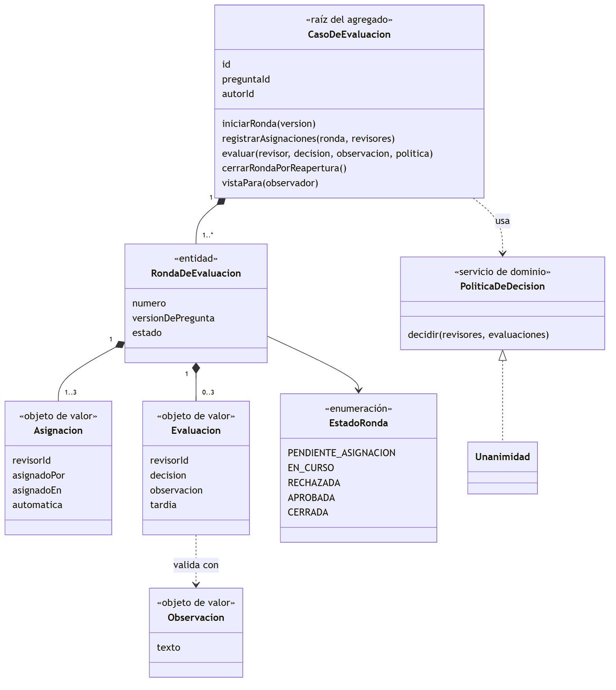
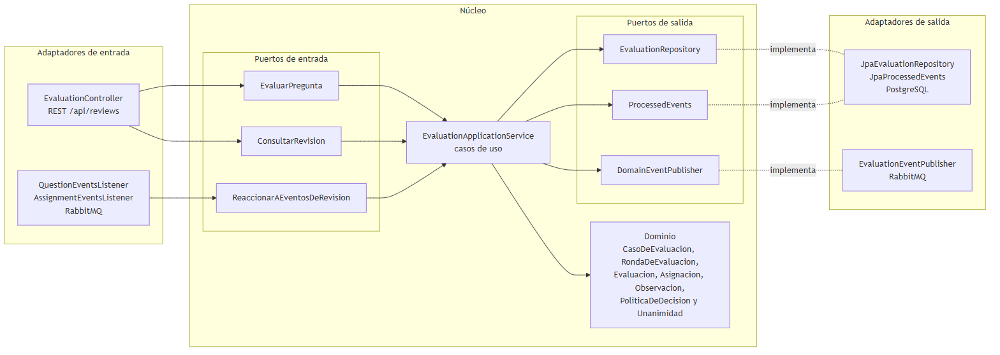
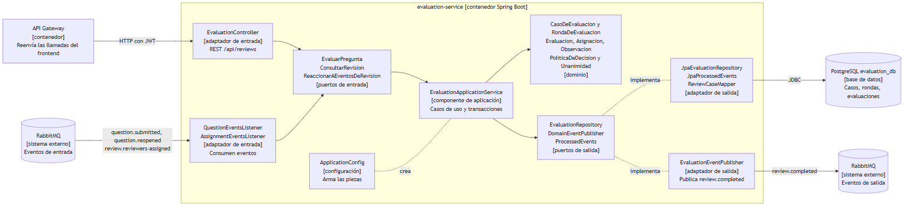

# Arquitectura hexagonal y DDD en evaluation-service

El tercer corte pide aplicar arquitectura hexagonal con la filosofía DDD a un microservicio que tenga reglas en su lógica de dominio. Elegimos
`evaluation-service`, el que decide si una pregunta se aprueba o se rechaza. Los demás servicios siguen en capas, como se acordó con los docentes.

## Por qué este servicio

Es el que más reglas de negocio guarda. Decide por unanimidad, deja que un solo rechazo cierre la ronda, no deja evaluar dos veces, obliga a escribir
una observación al rechazar y conserva el historial de rondas de cada pregunta. También es el núcleo de la historia HU-06, porque de aquí sale lo que el
autor lee para mejorar su pregunta. El dominio quedó modelado primero en el Taller 11 (`Pregunta` y `Revision` en Java puro), y aquí se aplicó la
misma idea sobre el servicio real.

## Lenguaje ubicuo

Estas son las palabras que usan el negocio, el código y las pruebas. Cada término es el nombre de una clase o de un método.

| Término | Qué significa | En el código |
|---|---|---|
| Caso de evaluación | Todo lo que se ha revisado de una pregunta, a lo largo de todas sus versiones | `CasoDeEvaluacion` |
| Ronda | Una vuelta completa de revisión de una versión de la pregunta | `RondaDeEvaluacion` |
| Asignación | Un revisor puesto en una ronda, con quién lo asignó y cuándo | `Asignacion` |
| Evaluación | La decisión de un revisor con su observación. Es definitiva | `Evaluacion` |
| Observación | El comentario que acompaña la decisión. Obligatoria al rechazar | `Observacion` |
| Decisión | Aprobar o rechazar | `Decision` |
| Política de decisión | La regla que dice cuándo una ronda queda aprobada o rechazada | `PoliticaDeDecision`, `Unanimidad` |
| Observación tardía | La que llega cuando la ronda ya se rechazó. El autor la lee, pero no cambia el resultado | `Evaluacion.tardia()` |
| Observador | Quien consulta el caso: administrador, autor o revisor, y cada uno ve lo que le toca | `Observador`, `VistaDelCaso` |

## El agregado

`CasoDeEvaluacion` es la raíz del agregado. Todo cambio pasa por ella: nadie toca una ronda ni una evaluación sin pasar por el caso. Por dentro
tiene rondas (entidades con identidad dentro del caso), y cada ronda guarda asignaciones y evaluaciones, que son objetos de valor inmutables.



Los objetos de valor son registros de Java (`record`), así que no cambian y se comparan por sus datos. Validan en el constructor, de modo que un
valor inválido no llega a existir. La política de decisión es un servicio de dominio: no pertenece a una sola entidad y se inyecta en el caso de
uso, por eso cambiar de unanimidad a mayoría es agregar una clase.

### Invariantes del negocio

| Regla | Quién la hace cumplir | Dónde se prueba |
|---|---|---|
| Para rechazar hay que escribir una observación | `CasoDeEvaluacion.evaluar` con `Observacion` | `CasoDeEvaluacionTest`, `ObservacionTest` |
| Una observación no pasa de 4000 caracteres y no queda con espacios sobrantes | `Observacion` | `ObservacionTest` |
| Solo evalúa un revisor asignado a la ronda vigente | `CasoDeEvaluacion.evaluar` | `CasoDeEvaluacionTest` |
| Un revisor evalúa una sola vez y la evaluación es definitiva | `CasoDeEvaluacion.evaluar` | `CasoDeEvaluacionTest` |
| La ronda se aprueba solo si todos los asignados aprueban | `Unanimidad` | `UnanimidadTest` |
| Un solo rechazo cierra la ronda, sin esperar a los demás | `Unanimidad` y `CasoDeEvaluacion` | `UnanimidadTest`, `CasoDeEvaluacionTest` |
| Tras el rechazo, las evaluaciones que faltan quedan como tardías y no cambian el resultado | `CasoDeEvaluacion.evaluar` | `CasoDeEvaluacionTest` |
| Una pregunta aprobada no admite otra ronda, y una ronda abierta bloquea la siguiente | `CasoDeEvaluacion.iniciarRonda` | `CasoDeEvaluacionTest` |
| Un evento repetido no abre dos rondas de la misma versión | `CasoDeEvaluacion.iniciarRonda` | `CasoDeEvaluacionTest` |
| Una asignación necesita revisor, quién asigna y fecha | `Asignacion` | `AsignacionTest` |
| Cada rol ve solo lo que le corresponde del caso | `CasoDeEvaluacion.vistaPara` | `CasoDeEvaluacionTest` |

Que sean de 1 a 3 revisores lo hace cumplir `assignment-service`, que es quien los asigna. Este servicio los recibe por evento y los registra.

## Puertos y adaptadores

El servicio se organiza en tres zonas. En el centro está el dominio, que no conoce a Spring, ni a JPA, ni a RabbitMQ. Alrededor, la aplicación, que
coordina los casos de uso. Afuera, los adaptadores, que son los que hablan con el mundo.



| Tipo | Puerto | Quién lo usa o lo implementa |
|---|---|---|
| Entrada | `EvaluarPregunta` | `EvaluationController` lo llama; `EvaluationApplicationService` lo implementa |
| Entrada | `ConsultarRevision` | `EvaluationController` lo llama; `EvaluationApplicationService` lo implementa |
| Entrada | `ReaccionarAEventosDeRevision` | Los listeners de RabbitMQ lo llaman; `EvaluationApplicationService` lo implementa |
| Salida | `EvaluationRepository` | La aplicación lo usa; `JpaEvaluationRepository` lo implementa |
| Salida | `DomainEventPublisher` | La aplicación lo usa; `EvaluationEventPublisher` lo implementa |
| Salida | `ProcessedEvents` | La aplicación lo usa; `JpaProcessedEvents` lo implementa |

Los paquetes siguen esa misma forma, para que se lea en el árbol de carpetas:

```
evaluation/
  domain/                   dominio: agregado, objetos de valor, política de decisión y eventos
  application/              casos de uso
    port/in/                puertos de entrada
    port/out/               puertos de salida
  adapter/in/web/           API REST
  adapter/in/messaging/     listeners de RabbitMQ
  adapter/out/persistence/  JPA y PostgreSQL
  adapter/out/messaging/    publicación de eventos
  config/                   armado de los objetos (raíz de composición) y topología de RabbitMQ
```

La clase `config.ApplicationConfig` es el único lugar que conoce todas las piezas: crea el servicio de aplicación y le entrega los adaptadores que
implementan los puertos.

### Vista C4 de nivel 3

El mismo servicio visto como componentes del modelo C4. Se ve qué entra por el gateway y por RabbitMQ, qué puertos atraviesa, dónde vive el dominio y
por dónde salen los datos y los eventos. Los dos RabbitMQ del dibujo son el mismo broker, separados para que las flechas no se crucen.



## Cómo se protege

`ArquitecturaTest` usa ArchUnit y falla el build si alguien rompe la forma del hexágono. Comprueba, entre otras cosas, que el dominio no depende de
Spring, de JPA ni de la mensajería, que la aplicación no conoce a los adaptadores, que los puertos son interfaces, que los adaptadores de entrada llaman
al puerto y no al servicio concreto, y que ningún adaptador depende de otro. Tiene la regla de arquitectura de cebolla de ArchUnit
(`onionArchitecture`) con cuatro adaptadores declarados.

## Qué cambió respecto al segundo corte

El dominio ya estaba separado, pero el servicio de aplicación era una clase concreta que usaban el controlador y los listeners. Ahora:

1. Los controladores y listeners dependen de tres puertos de entrada, no de la clase.
2. Los puertos de salida están en `application.port.out` y los adaptadores bajo `adapter.in` y `adapter.out`.
3. `Observacion` es un objeto de valor con sus reglas, en lugar de validar un `String` dentro del caso.
4. `Asignacion` y `Observacion` tienen pruebas propias.
5. Las reglas de ArchUnit pasaron de "capas" a hexágono completo.

El comportamiento externo no cambió: mismos endpoints, mismos eventos, mismas tablas.

## Pruebas del servicio

Las pruebas de dominio no necesitan Spring ni base de datos: `CasoDeEvaluacionTest`, `UnanimidadTest`, `ObservacionTest` y `AsignacionTest`.
La aplicación se prueba con repositorio y publicador en memoria (`EvaluationApplicationServiceTest`). Los adaptadores se prueban aparte: la
persistencia contra PostgreSQL embebido, los listeners con mensajes reales y el controlador con MockMvc. `EvaluationServiceFlowTest` recorre el
servicio completo.
