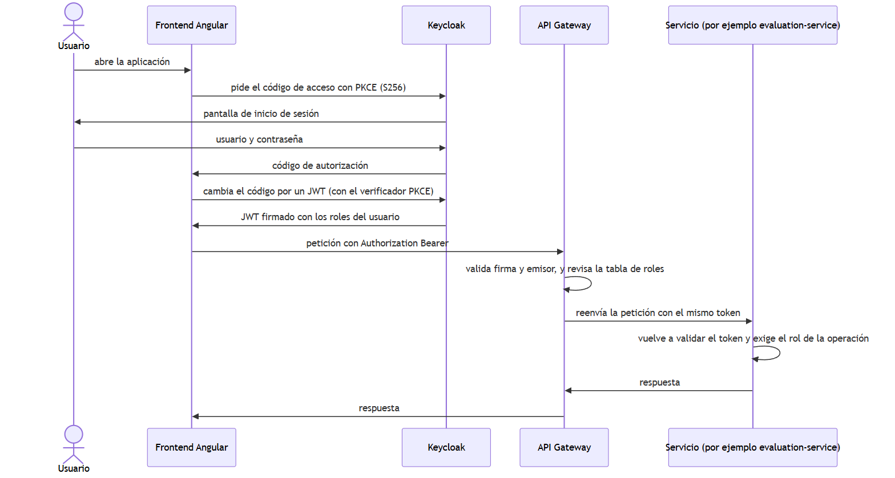

# Seguridad: autenticación y autorización

El tercer corte pide autenticación y autorización con tokens JWT y un sistema externo para manejarlas. Usamos Keycloak 26. Esta página junta en un
solo lugar cómo funciona y qué rol puede hacer qué. El detalle de la implementación está en el [documento 08 del segundo corte](../corte-2/08-implementacion-seguridad-y-resiliencia.md).

## Cómo se entra

El frontend no guarda contraseñas ni las ve. Redirige a Keycloak con el flujo de código de autorización y PKCE (S256). Keycloak devuelve un JWT firmado
con los roles del usuario y de ahí en adelante cada petición lleva ese token.

El token dura 15 minutos. El cliente de la aplicación (`bancopreguntas-web`) es público y solo acepta PKCE; no tiene secreto que se pueda filtrar.

## Dos barreras

La autorización se revisa dos veces, como acordamos con los docentes.

1. **En el gateway.** `RoleRules` es una tabla de método y camino contra roles. Si el token no tiene el rol, la petición no pasa.
2. **En cada servicio.** Cada servicio vuelve a validar la firma y el emisor del token con la clave pública de Keycloak y exige el rol de la operación
   (`requireAnyRole`). Así, si el gateway tuviera un error, el servicio no abre la operación.

El gateway también borra las cabeceras `X-User-Id` y `X-User-Roles` de la petición que llega de afuera. En modo `jwt` los servicios las ignoran, de
modo que nadie puede hacerse pasar por otro usuario escribiendo una cabecera.

## Qué puede hacer cada rol

| Rol | Puede |
|---|---|
| `AUTHOR` | Crear, modificar, enviar a revisión y reabrir sus preguntas. Ver su historial de revisiones y sus notificaciones |
| `REVIEWER` | Ver las preguntas que le asignaron y enviar su evaluación |
| `ADMIN` | Ver todas las preguntas, asignar de 1 a 3 revisores, publicar, ver usuarios, auditoría y correos simulados, y el reporte del grupo |
| `STUDENT` | Crear y presentar simulacros, y ver su propio progreso, fortalezas y debilidades |
| `TEACHER` | Ver el seguimiento de cualquier estudiante y el reporte del grupo, con descarga en CSV |

Un usuario puede tener más de un rol. La gestión de usuarios y roles se hace en Keycloak (consola o Postman), que es lo que pide el enunciado. El realm
versionado en `microservicios/infraestructura/keycloak/bancopreguntas-realm.json` trae usuarios de prueba para cada rol: `admin`, `autor1` y `autor2`,
`revisor1` a `revisor5`, `docente1` y `estudiante1` a `estudiante3`.

## Otras medidas

- Entre servicios, las llamadas REST propagan el token de quien hizo la petición, así que el servicio que recibe la llamada también valida y exige el
  rol. Nadie gana permisos por pasar por un servicio intermedio.
- Las contraseñas no las guarda nuestro código: las guarda Keycloak con hash. Eso cubre RNF-08.
- Keycloak registra los inicios de sesión correctos y fallidos, `user-service` los consulta y `audit-service` los guarda. El administrador los ve en
  la pantalla de auditoría (RNF-09).
- `user-service` habla con Keycloak con un cliente de credenciales propio, sin usuario de persona.
- Los secretos de desarrollo van en `.env`, que no se versiona. Hay un `.env.example`.

## Cómo se prueba

| Qué | Prueba |
|---|---|
| El servicio rechaza tokens inválidos o sin rol y acepta los correctos | `JwtSecurityTest` en `bp-platform` y `EvaluationServiceJwtTest` |
| La identidad sale del token y no de las cabeceras | `AuthenticatedUserTest`, `HeaderUserArgumentResolverTest` |
| El gateway aplica la tabla de roles | `ApiGatewayTest` |
| Recorrido completo con tokens reales de Keycloak | `pruebas-funcionales/recorrido_funcional.py`, con los roles de cada historia |

## Limitación conocida

Si no se configura nada, `bp-platform` arranca en modo `headers`, que sirve para pruebas y desarrollo. El `docker-compose.yml` lo fija en `jwt`
con la variable `SECURITY_MODE`. Un despliegue real tiene que dejarlo en `jwt`.
