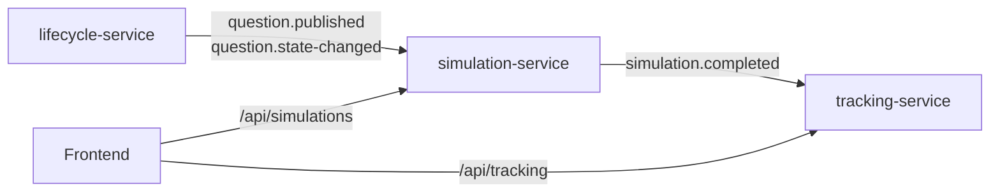

# Simulacros y seguimiento académico

El proyecto de curso describe simulacros y seguimiento (RF-21 a RF-28), y los docentes los ubicaron en el tercer corte. Los entregables de ese
corte no los listan como requisito, pero los construimos para que el sistema cubra el ciclo completo: las preguntas que se aprueban y se publican
terminan en simulacros que presentan los estudiantes, y los resultados llegan al docente.

Hay dos roles nuevos, `STUDENT` y `TEACHER`, y dos servicios, cada uno con una sola responsabilidad.

| Servicio | Responsabilidad | Puerto | Base de datos |
|---|---|---|---|
| `simulation-service` | Guarda su catálogo de preguntas publicadas, arma el simulacro al azar, controla el tiempo y califica | 8086 | `simulation_db` |
| `tracking-service` | Guarda el resultado de cada simulacro y calcula historial, estadísticas, fortalezas, debilidades y reporte del grupo | 8087 | `tracking_db` |

## Qué requisito cubre cada pieza

| Requisito | Qué dice | Dónde se cumple |
|---|---|---|
| RF-21 | Generar simulacros con preguntas publicadas | `simulation-service`: el catálogo se alimenta del evento `question.published` |
| RF-22 | Simulacros aleatorios por competencia, tema o dificultad | `simulation-service`: `SelectorDePreguntas` y `SeleccionAleatoria` (patrón Strategy) |
| RF-23 | Controlar el tiempo máximo | `simulation-service`: `Simulacro` y una tarea que cierra los vencidos |
| RF-24 | Calificar automáticamente | `simulation-service`: la calificación al finalizar o al vencer el tiempo |
| RF-25 | Historial de simulacros de cada estudiante | `tracking-service`: una entrada por `simulation.completed` |
| RF-26 | Estadísticas individuales | `tracking-service`: promedio, mejor y peor puntaje, tiempo medio y tendencia |
| RF-27 | Fortalezas y debilidades por competencia | `tracking-service`: umbrales de 70 % y 50 %, con un mínimo de 5 respuestas |
| RF-28 | Reportes para docentes | `tracking-service`: reporte del grupo en JSON y en CSV |

## Cómo se conectan

El simulacro no pregunta nada a otros servicios mientras se presenta: usa su propio catálogo, que se mantiene con los eventos del ciclo de vida. Una
pregunta que se archiva sale del catálogo y los simulacros ya armados no cambian. El resultado viaja por un evento con el patrón Outbox, y
`tracking-service` lo recibe de forma idempotente.

## Reglas que conviene conocer

- Mientras el simulacro está en curso no se revela la respuesta correcta. Se muestra al finalizar o cuando se acaba el tiempo.
- Se puede cambiar una respuesta mientras el simulacro siga en curso. Uno terminado no se vuelve a resolver.
- Si no hay suficientes preguntas con los filtros pedidos, el servicio responde 409 y dice cuántas hay.
- Un estudiante solo ve sus simulacros y su seguimiento. El docente y el administrador ven los de cualquiera.
- Un estudiante sin simulacros recibe ceros, no un error.

## Pantallas

| Rol | Ruta | Qué hace |
|---|---|---|
| Estudiante | `/simulacros` | Elige competencias, dificultad, cantidad y minutos, y ve cuántas preguntas hay disponibles. Lista sus simulacros |
| Estudiante | `/simulacros/:id` | Presenta el simulacro con un reloj. Al finalizar muestra el puntaje, los aciertos por competencia y la revisión de cada respuesta |
| Estudiante | `/progreso` | Puntaje promedio, mejor puntaje, tendencia, aciertos por competencia, fortalezas, debilidades e historial |
| Docente y administrador | `/reporte` | Reporte del grupo con la lista de estudiantes, quién necesita apoyo y descarga en CSV |
| Docente y administrador | `/estudiantes/:id` | El mismo seguimiento de un estudiante, visto por el docente |

Los estudiantes y docentes no tienen bandeja de notificaciones: esa pantalla es de los roles del banco de preguntas.

## Pruebas

| Qué | Dónde |
|---|---|
| Reglas de dominio y casos de uso de cada servicio | Pruebas unitarias de `simulation-service` y `tracking-service` |
| API, persistencia y arquitectura | MockMvc, PostgreSQL embebido y ArchUnit en cada servicio |
| Recorrido con tokens reales | `pruebas-funcionales/recorrido_funcional.py` crea un simulacro, lo responde, lo deja vencer y revisa el seguimiento y el reporte |
| Pantallas | Pruebas de Vitest para el simulacro, el seguimiento y el reporte del grupo, y para las llamadas a las dos APIs |
