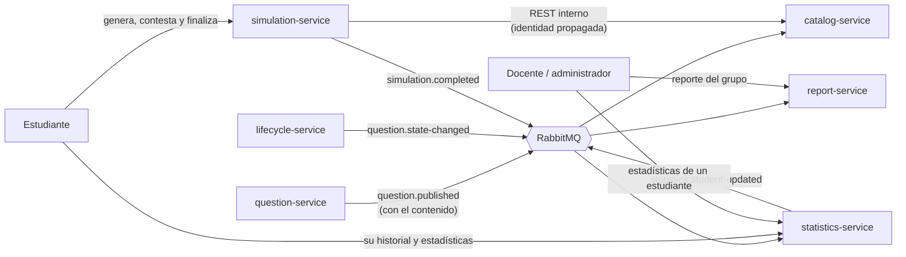

# Simulacros y seguimiento académico

> Este documento es el diseño para el tercer corte. Los servicios que describe (`catalog-service`, `statistics-service` y `report-service`) todavía no están
> en el repositorio de la segunda entrega.

Los docentes dejaron estos dos contextos para el tercer corte y los entregables de ese corte no los exigen, pero el
proyecto de curso sí los describe (RF-21 a RF-28). Se construyeron **por adelantado**, con los roles **Estudiante** y
**Docente**, y están repartidos en cuatro microservicios pequeños, cada uno con una sola responsabilidad:

| Servicio | Responsabilidad | Puerto | Base de datos |
|---|---|---|---|
| `catalog-service` | Copia de las preguntas publicadas, resumen y selección al azar | 8092 | `catalog_db` |
| `simulation-service` | Generar el simulacro, controlar el tiempo y calificar | 8086 | `simulation_db` |
| `statistics-service` | Historial, estadísticas, tendencia, fortalezas y debilidades de cada estudiante | 8087 | `statistics_db` |
| `report-service` | Reporte del grupo para docentes (JSON y CSV) | 8093 | `report_db` |

Las pantallas del frontend (estudiante y docente) ya existen; ver la sección 8.

| Requisito | Qué dice | Dónde se cumple |
|---|---|---|
| RF-21 | Generar simulacros con preguntas publicadas | `catalog-service` (se alimenta de `question.published`) y `simulation-service` |
| RF-22 | Simulacros aleatorios por competencias, temas o niveles de dificultad | `catalog-service`: `SelectorDePreguntas` y `SeleccionAleatoria` (Strategy) |
| RF-23 | Controlar el tiempo máximo del simulacro | `simulation-service`: `Simulacro` y `ExpirationScheduler` |
| RF-24 | Calificar automáticamente las respuestas | `simulation-service`: `Calificador` |
| RF-25 | Historial de simulacros de cada estudiante | `statistics-service`: una entrada por `simulation.completed` |
| RF-26 | Estadísticas individuales | `statistics-service`: `EstadisticasIndividuales` |
| RF-27 | Fortalezas y debilidades por competencia | `statistics-service`: `AnalisisDeCompetencias` |
| RF-28 | Reportes para docentes y coordinadores | `report-service`: `ReporteDeGrupo` (JSON y CSV) |

## 1. Visión general

- `catalog-service` tiene su **propia copia** de las preguntas publicadas. La recibe en `question.published`, que lleva el
  contenido de la pregunta (*event-carried state transfer*), y la retira con `question.state-changed` cuando una pregunta se
  archiva. Así el catálogo funciona aunque `question-service` esté caído.
- `simulation-service` le pide las preguntas al catálogo con una llamada REST síncrona (la identidad del estudiante viaja en la
  llamada) y guarda su propia copia en cada simulacro. Si el catálogo no responde, el simulacro no se crea (503).
- Cuando un simulacro termina, `simulation-service` publica `simulation.completed` (por el Outbox).
- `statistics-service` solo escucha ese evento, guarda una fila por simulacro, calcula todo lo demás al consultar y publica
  `statistics.student-updated` con el resumen del estudiante.
- `report-service` guarda el último resumen de cada estudiante (un modelo de lectura propio) y con él arma el reporte del grupo,
  sin consultar a ningún otro servicio.

## 2. Roles

| Rol | Simulacros | Seguimiento y reporte |
|---|---|---|
| `STUDENT` | Genera, consulta, contesta y finaliza **los suyos**; ve el resumen del catálogo | Su historial, sus estadísticas y sus fortalezas y debilidades |
| `TEACHER` | Consulta el simulacro de cualquier estudiante y el resumen del catálogo | Historial, estadísticas y competencias de cualquier estudiante, y el reporte del grupo (JSON y CSV) |
| `ADMIN` | Igual que el docente | Igual que el docente |

Los usuarios de demostración están en el realm de Keycloak: `docente1` y `estudiante1` a `estudiante3` (ver
[datos semilla](../corte-2/anexos/datos-semilla.md)). Un estudiante o un docente solo puede entrar a esta parte del sistema
y a su propio perfil; no ve las preguntas en elaboración, las revisiones ni las notificaciones. El gateway y cada servicio
exigen el rol de cada operación.

## 3. catalog-service

- Una pregunta publicada entra al catálogo; una versión más nueva reemplaza a la copia y una más vieja se ignora; una archivada sale.
- La selección filtra por competencias, temas (sin importar mayúsculas ni tildes, y pueden coincidir con el tema o el subtema) y
  dificultades, y escoge al azar sin repetir. Si hay menos preguntas que las pedidas responde **409** `PREGUNTAS_INSUFICIENTES`
  con cuántas hay.

| Método y ruta | Rol | Qué hace |
|---|---|---|
| `GET /api/catalog/summary` | STUDENT, TEACHER, ADMIN | Cuántas preguntas publicadas hay, por competencia y dificultad |
| `POST /api/catalog/selection` | STUDENT, ADMIN | **Interna**: la usa `simulation-service`; el gateway no la expone porque devuelve las respuestas correctas |

Detalle en el README del servicio.

## 4. simulation-service

- **Generar (RF-21 y RF-22).** El estudiante indica cuántas preguntas (`cantidad`, hasta 50 por defecto), cuánto tiempo
  (`duracionMinutos`, de 1 a 240) y, opcionalmente, `competencias`, `temas` y `dificultades`. Un filtro vacío significa
  «cualquiera».
- **Presentar (RF-23).** El simulacro empieza `EN_CURSO` y el tiempo corre desde que se genera. Se puede cambiar la respuesta
  de cada pregunta mientras haya tiempo; cuenta la última. Mientras está en curso **no se revela** la respuesta correcta.
- **Calificar (RF-24).** Al finalizar, el puntaje es el porcentaje de aciertos sobre **todas** las preguntas (una sin contestar
  no suma), con dos decimales, más el detalle por competencia. Finalizar o contestar un simulacro ya terminado responde 409.
- **Tiempo agotado.** Si se acaba el tiempo, el simulacro se cierra en `EXPIRADO` y se califica con lo que alcanzó a
  contestar. Lo cierra el primero que ocurra: una consulta o una respuesta tardía, o el cierre periódico
  (`ExpirationScheduler`, cada 30 s por defecto). Contestar con el tiempo agotado responde 409 `TIEMPO_AGOTADO`.

| Método y ruta | Rol | Qué hace |
|---|---|---|
| `POST /api/simulations` | STUDENT | Genera un simulacro (201) |
| `GET /api/simulations` | STUDENT | Mis simulacros, el más reciente primero, paginados |
| `GET /api/simulations/{id}` | STUDENT (los suyos), TEACHER, ADMIN | Consulta el simulacro y el tiempo restante |
| `POST /api/simulations/{id}/answers` | STUDENT | Contesta una pregunta: `{"preguntaId": "...", "opcion": "B"}` |
| `POST /api/simulations/{id}/finish` | STUDENT | Finaliza y califica |

Detalle en el [README del servicio](../../microservicios/servicios/simulation-service/README.md).

## 5. statistics-service y report-service

**statistics-service**

- **Historial (RF-25).** Cada `simulation.completed` agrega una entrada al historial del estudiante; un evento repetido no se
  cuenta dos veces.
- **Estadísticas individuales (RF-26).** Cantidad de simulacros y de expirados, puntaje promedio, mejor, peor y último, tiempo
  promedio, desempeño acumulado por competencia y **tendencia** (promedio de los últimos tres simulacros contra los tres
  anteriores; con 5 puntos o más de diferencia es `MEJORANDO` o `BAJANDO`, y si no, `ESTABLE`; `SIN_DATOS` con menos de dos).
- **Fortalezas y debilidades (RF-27).** Por competencia: *fortaleza* desde el 70 %, *debilidad* por debajo del 50 %,
  *intermedia* entre los dos y *sin datos suficientes* con menos de 5 preguntas vistas. Los umbrales son configurables.

| Método y ruta | Rol | Qué hace |
|---|---|---|
| `GET /api/statistics/me/history`, `/stats`, `/competencies` | STUDENT | Mi historial, mis estadísticas y mis competencias |
| `GET /api/statistics/students/{id}/history`, `/stats`, `/competencies` | TEACHER, ADMIN | Lo mismo de cualquier estudiante |

**report-service**

- **Reporte del grupo (RF-28).** Estudiantes con simulacros, total de simulacros, promedio general, desempeño del grupo por
  competencia y una fila por estudiante (simulacros, promedio, mejor, último, tendencia y debilidades), del mejor promedio al peor.
  Un resumen más viejo que el guardado se ignora, así que el orden de llegada de los eventos no importa.

| Método y ruta | Rol | Qué hace |
|---|---|---|
| `GET /api/reports/group` | TEACHER, ADMIN | Reporte del grupo en JSON |
| `GET /api/reports/group.csv` | TEACHER, ADMIN | El detalle por estudiante en CSV |

Detalle en los README de statistics-service y
report-service.

## 6. Eventos

| Evento | Lo publica | Lo consumen | Contenido |
|---|---|---|---|
| `question.published` | lifecycle-service | history, audit, notification, **catalog** | Incluye el contenido de la pregunta: versión, título, competencia, tema, subtema, dificultad, contexto, enunciado, las cuatro opciones y la respuesta correcta |
| `question.state-changed` | lifecycle-service | question, history, audit, **catalog** | El catálogo solo reacciona a `to = ARCHIVADA` |
| `simulation.completed` | simulation-service | **statistics** | Simulacro, estudiante, tiempos, duración, si expiró, total, aciertos, errores, sin responder, puntaje y aciertos por competencia |
| `statistics.student-updated` | statistics-service | **report** | Resumen del estudiante: simulacros, promedio, mejor, último, tendencia, debilidades y aciertos por competencia |

El esquema formal está en [`eventos.schema.json`](../corte-2/api/eventos/eventos.schema.json).

## 7. Configuración

| Variable | Servicio | Por defecto |
|---|---|---|
| `CATALOG_MAX_SELECTION` | catalog | 100 |
| `CATALOG_SERVICE_URL` | simulation | `http://localhost:8092` |
| `SIMULATION_MAX_QUESTIONS` | simulation | 50 |
| `SIMULATION_EXPIRATION_INTERVAL_MS` | simulation | 30000 |
| `STATISTICS_STRENGTH_THRESHOLD` | statistics | 70 |
| `STATISTICS_WEAKNESS_THRESHOLD` | statistics | 50 |
| `STATISTICS_MIN_ANSWERED` | statistics | 5 |

Además de las variables comunes (`<SERVICIO>_DB_*`, RabbitMQ y Keycloak), ver [`.env.example`](../../microservicios/.env.example).

## 8. Frontend, pruebas y decisiones

**Frontend.** El estudiante tiene las pantallas «Simulacros» (generar y ver los suyos), «Simulacro» (contestar con temporizador y
ver el resultado) y «Mi progreso» (historial, estadísticas, fortalezas y debilidades). El docente tiene «Reporte del grupo» con el
detalle de cada estudiante y la descarga en CSV. Se construyeron en `frontend/src/app/features/student` y `features/teacher`.

**Pruebas.** Se escriben con los servicios, en el tercer corte: pruebas de cada servicio, las del gateway para los roles de estudiante y docente,
el recorrido funcional de RF-21 a RF-28 y colecciones de Postman por servicio.

**Decisiones.**

- **Catálogo propio y evento con contenido.** El catálogo depende de `question.published` y no de una consulta a
  `question-service`. Cuesta una copia de las preguntas publicadas (inmutables mientras están publicadas) y a cambio los
  servicios no se acoplan en tiempo de ejecución.
- **Una llamada síncrona, de simulacros a catálogo.** Al estudiante que genera un simulacro se le responde en el momento, así
  que se justifica una llamada REST con la identidad propagada; el gateway no expone la selección.
- **El simulacro guarda su propia copia de las preguntas.** Lo que el estudiante vio no cambia aunque la pregunta se archive o se
  actualice después, y la calificación siempre es reproducible.
- **Selección por *Strategy*.** `SelectorDePreguntas` permite cambiar «al azar» por «equilibrado por competencia» sin tocar el
  caso de uso.
- **Estadísticas calculadas al consultar; reporte con modelo de lectura.** En `statistics-service` el historial es la única
  fuente y los cálculos son funciones puras fáciles de probar; `report-service` solo guarda el último resumen de cada estudiante.
- **Cierre por tiempo en dos pasos.** Una consulta o respuesta tardía cierra el simulacro al instante (precisión) y un proceso
  periódico cierra los demás (garantía de que el resultado llega al seguimiento).

## 9. Límites y pendientes

- Las estadísticas leen todo el historial de un estudiante en memoria, y el reporte lee un resumen por estudiante; está bien
  para cientos de estudiantes. Con más habría que agregar en SQL.
- No hay agrupación por curso, grupo o docente: el reporte es de todos los estudiantes que han hecho simulacros.
- No se revisan simulacros ya iniciados cuando una pregunta se archiva (conservan su copia).
